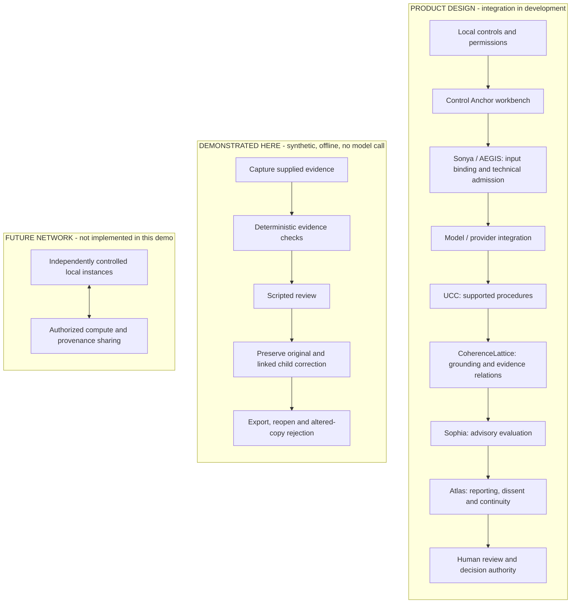

# Control Anchor

## What could you trust AI to do if you could inspect its work and keep control?

What if your rules traveled with the task, even when the model changed? What if a correction strengthened the record instead of erasing the mistake? And what if useful knowledge could move between people and organizations without requiring them to surrender authority over their own information?

**UVLM is building toward Control Anchor: a local-first AI workbench that connects human intent, enforceable permissions, evidence-linked work and accountable decisions.** The Triadic Brain supplies the broader architecture. Our ambition is a practical foundation for increasingly capable AI: understandable enough to govern, structured enough to challenge and useful enough to earn a place in everyday work.

[Read the Grand Vision](docs/GRAND_VISION.md) · [Meet Thomas Prislac](docs/THOMAS_PRISLAC_CV.md) · [Inspect the evidence](VALIDATION.md) · [Run the demo](#run-on-windows--powershell)

**This repository contains an offline, synthetic reviewer component; the product vision below describes the full workbench we intend to build.**

**24 October development update:** [Placement controls and shared-core ComfyUI progress](docs/DEVELOPMENT_UPDATE_2026-10-24.md).
Source-bound model-free component evidence; live and installed proof remain separate.

## The problem worth solving

A convincing answer is only the beginning of useful work. People still need to know which sources were used, what remains uncertain, whether an action was allowed and what changed after review. When those connections are missing, the burden falls on the person who must reconstruct the work and accept responsibility for the decision.

Our product hypothesis starts with evidence-heavy workflows: a small business reviewing a policy package, a researcher assembling a technical summary, or a household comparing estimates. These users need capable assistance and a clear way to question it. We want the same underlying control principles to serve all three, with workflows proportionate to their needs.

## The product we intend to deliver

Control Anchor would let a user define a goal, select permitted sources, choose supported local or remote models and set action and resource limits. A bounded coordinator would organize the work, retain unresolved questions and stop when evidence, authority or budget is missing. The user could inspect the result, request a correction and return later to a preserved history.

Bring-your-own-model support would make models replaceable workers within a governed workflow. Local-first design would preserve local decision authority and useful work without mandatory network participation. When a user selects a remote provider, the product must disclose the corresponding data transfer rather than imply that everything stays offline.

## Assurance power through a design that can be challenged

The design's assurance power comes from making the basis of confidence inspectable. Its control doctrines are concrete:

- **Human authority stays explicit.** A model recommendation cannot grant itself permission or stand in for a person's required decision.
- **Rules must reach execution.** Accepted, versioned controls should govern the actual tool or resource boundary, with observable blocked effects when permission is absent.
- **Work and challenge have distinct roles.** Analysis, advisory evaluation and reporting should expose disagreement rather than turn repeated agreement into presumed truth.
- **Evidence survives correction.** Sources, settings, outcomes and linked revisions should remain available when a result is challenged or reopened.
- **Recovery preserves accountability.** Interrupted and uncertain work should be reconciled before retrying, with completed, pending and unresolved effects kept distinct.

Together, these requirements could help reviewers spend less effort reconstructing events and more effort judging the work itself. They also give engineering teams testable obligations. The public component below demonstrates a bounded part of this foundation. It does not provide professional assurance, establish factual correctness or certify a secure production system.

## P2P cooperation with local control

Our longer-term vision connects independently governed workbenches through authorized peer-to-peer exchange. Eligible prior work could become reusable knowledge with a visible origin, version, permitted purpose and review status. A receiving participant would retain the choice to accept, reject or challenge it.

We would begin with two independently administered nodes sharing public or synthetic artifacts. Shared compute would follow as a separate, explicitly authorized capability with its own resource limits and verification requirements. Retaining a task, sharing an artifact, training a model and donating compute would remain separate choices.

The opportunity is cumulative usefulness: preserve valuable work, make eligible corrections discoverable and reduce unnecessary repetition. We will test that opportunity against ordinary shared libraries and manual handoffs, counting verification, transport, failures and support. P2P advantage and cost savings remain hypotheses to demonstrate.

## A business that earns adoption

We propose a free household core with meaningful safeguards, alongside optional paid organizational administration, supported integrations, deployment assistance and support. The local product should stand on its own; participation in a network or contribution of private data should never be the price of basic usefulness.

The same core could serve a standalone workbench, an embedded SDK/API for existing AI applications, or OEM/white-label distribution with implementation and support. The partner aim is to keep their models and customer experience while adding configurable controls, permission checks, traceable review, correction history and auditable handoffs. These are [proposed delivery routes](docs/GRAND_VISION.md#proposed-delivery-routes), not delivered integrations or a turnkey SDK.

For investors, the immediate opportunity is to help turn bounded component work into an integrated product with measurable user value. Funding should advance explicit gates: a dependable installed workflow; runtime controls and useful coordination; repeated design-partner use and purchasing evidence; then governed sharing. Initial buyers, pricing and unit economics still need validation. Research into learning and more ambitious cognitive mechanisms would have separate evaluations and stopping criteria, so the commercial product need not depend on an unproven breakthrough.

## Help build the next credible step

Thomas Prislac brings the product direction and an audit and governance perspective. Read his [comprehensive professional CV](docs/THOMAS_PRISLAC_CV.md) for experience, education, committees and special projects.

- **Prospective investors:** review the [Grand Vision and staged work packages](docs/GRAND_VISION.md#what-funding-could-build), then help define the next milestone and its evidence requirements.
- **Design partners:** bring a bounded, evidence-heavy workflow and the outcome that would make it worth adopting.
- **Engineers and researchers:** challenge the control boundaries, reproduce the demo and propose a test that could change the design.

[Open a project conversation](https://github.com/pdxvoiceteacher/control-anchor-reviewer-demo/issues). Share only information suitable for a public issue. We welcome concrete problems, rigorous challenge and collaborators ready to turn the vision into useful work.

## What this repository demonstrates today

This public reviewer demo is an inspectable starting point: it captures supplied evidence, performs deterministic checks, records scripted review, preserves linked revisions, exports and reopens evidence, rejects deliberately altered or incomplete copies and exercises one interrupted-decision recovery. **Its inputs are synthetic and no model is called. It is not the full live AI product.**

[](https://github.com/pdxvoiceteacher/control-anchor-reviewer-demo/actions/workflows/demo.yml)
[](https://github.com/pdxvoiceteacher/control-anchor-reviewer-demo/actions/workflows/integrity.yml)

The live badges report public demo tests/artifact generation on Linux and Windows,
and manifest/local-link consistency. They do not certify security, source truth,
rendering, live AI or production readiness. Each workflow runs on pull requests to
`main` and main updates; inspect its exact commit and job results. Generated demo
files stay on the disposable runner and are not uploaded.

## Observed result and first steps

The retained [21 October baseline](VALIDATION.md#focused-update--21-october-2026)
is **11 focused tests**, **six positive directory/ZIP checks** and **177 reopened
evidence objects** on Windows Python 3.12.14. A separate
[23 October validation](VALIDATION.md#public-documentation-update-on-23-october-2026)
checks this documentation update against the unchanged public demo.

The 18 October 2026 recorded run used **Windows and Python 3.12.14**: **8 focused tests passed
in 18.957 seconds**, with **4 directory/ZIP verification checks**. Practitioner
JSON reopened with 133 evidence objects; the changed disposable copy was rejected
and the retained original verified afterward. These are bounded component results,
not an assurance opinion or proof of useful cognitive performance.

The eight-test result above and its retained JSON remain historical; the separate
21 October evidence records PR #1's already completed execution.

**Development reconciliation — 23 October 2026:** the earlier CI233 result is
preserved. Later original receipts also demonstrate hosted application-only
installation, exact installed-copy verification, restricted scripted Home and
same-process provider-selection save/reread on the customer setup successor.
Two subsequent source gates failed and skipped installation; their results do
not erase that earlier success or qualify their newer source. At 06:57 UTC,
another successor completed six selected source cases and a separate hosted
installation/startup; its original receipts were inspected too. This is a scoped
success, not a fresh full-suite qualification.

These are **unmerged development checkpoints**. They do not verify installation
on the Project Lead's PC, provider activation/contact, inference, restart,
ordinary-user UAC or human acceptance. Separate task-preview and provider-disclosure
work retain their own source-review limits. Application-only installation separates
delivery from model acquisition; it does not make the intended AI workbench a model-free product.
Earlier merged provider metadata and bounded peer tests retain their own scope;
distributed peers and shared compute remain unverified. The dated
[product map](docs/PRODUCT_MAP.md#evidence-edition-and-remaining-joins) explains
those milestones without requiring private source access. Its private-development
links are attributed evidence, not publicly reproducible tests in this repository;
none of that source is imported here.

1. **Inspect without running:** read [VALIDATION.md](VALIDATION.md) and the
   [current retained result summary](validation/2026-10-21-summary.json).
2. **Run locally:** follow [Windows / PowerShell](#run-on-windows--powershell),
   using an existing Python 3.12 runtime and a fresh output directory. The two
   commands are `python -S demo.py --output demo-output` and
   `python -S -m unittest discover -s tests -v`. No dependency installation or API
   key is needed; the full quickstart explains runtime selection and hard links.
3. **Review the result:** open `demo-output/review.html`, inspect
   `demo-output/summary.json` and follow the [artifact guide](#what-to-inspect).

This reviewer repository is **public**. The Project Lead approved public source
access, including its history, on 19 October 2026. Existing licenses and notices remain
applicable; publication adds no Creative Commons license or new media/prose grant.
The main development repository remains private. See the
[publication review record](PUBLICATION_REVIEW.md) for scope and checks.

## Reader routes

| Reader / purpose | Start here |
| --- | --- |
| Funders and prospective collaborators | [Dated integration-pilot planning](docs/funding/README.md) (not a company-wide seed budget): a six-month, USD 100,000 core integration plan, a smaller uncosted offline-tool option and an optional, separately costed paid student intern opportunity. |
| Engineers | [Implementation/function crosswalk](docs/PRODUCT_MAP.md#actual-included-function-crosswalk), [focused tests](tests/test_component.py) and [exact source provenance](SOURCE_MANIFEST.json). |
| Academic collaborators | [Methods exercise and answer key](docs/METHODS_APPENDIX.md), [whole-product map](docs/PRODUCT_MAP.md) and [limitations](KNOWN_LIMITATIONS.md). No novelty or learning benefit is established. |
| Potential users | Run the local demo and inspect the human-readable review above; [product responsibilities](docs/PRODUCT_MAP.md) distinguish the intended workbench from this component. |
| Presenters | Optional [slides, scripts, teleprompters and covers](media/README.md), with dated evidence notes and source hashes. |
| Product direction and P2P | [Product vision and proposed sharing evaluation](docs/RESEARCH_LINEAGE_AND_EVALUATION.md): staged local usefulness, reusable work versus compute, and an ordinary-library comparison. |
| Current local workflow | [Workbench steps and role boundaries](docs/PRODUCT_MAP.md#local-workbench-workflow-and-role-boundaries): installation, provider selection, task preparation, analysis, correction and human decisions, with evidence limits. |
| Proposed next design | [Proposed roadmap](docs/PROPOSED_ROADMAP.md): function-first coordination, bounded planning, optional learning and prior sharing. These are proposals, not capabilities demonstrated by this demo. |

## Inspect the fixture without running it

The [source fixture](fixtures/source.txt) supplies **12 attendances in Session A
and 8 in Session B**. They sum to **20 session attendances**; the number of distinct
people across sessions is unknown.

The [existing candidate](fixtures/candidate.txt) already gives the correct total
and says unique-person attendance is unknown. The
[injected advisory](fixtures/advisory.json) requests a more explicit session
breakdown. It is scripted, not AI-discovered, and does not identify a hallucinated
total.

The [child candidate](fixtures/repaired-candidate.txt) spells out 12, 8 and 20
while retaining that uncertainty. The parent candidate and finding stay unchanged.
A linked child is a revision, not proven resolution:
`resolved_finding_ids=[]`.

The [request](fixtures/request-repair.txt) and [APPROVE fixture](fixtures/approve.txt)
exercise lifecycle transitions, not the Project Lead's actual approval or a
professional conclusion. The [recorded summary](validation/observed-demo-summary.json)
shows directory/ZIP checks, reopened export and altered-copy rejection. Those are
historical results, not tests rerun for this guide.

## Architecture at a glance

**The whole-product design and the demonstrated component have different scopes.**
The design arrows below describe intended responsibilities, not a completed live
workflow. The demo row describes this repository's recorded synthetic behavior.



Triadic Brain supplies the broader cognitive-system architecture; Control Anchor
is the intended workbench for locally defined controls and evidence-linked review.
The proposed Sophia peer network would connect eligible local instances while
preserving local permissions and decision authority. Household, organizational,
governmental and global use are intended scopes to investigate, not demonstrated
scale or partnerships.

The demo uses authored outputs and scripted decisions. It does not execute the
separate CoherenceLattice, Sophia or Atlas implementations. Advisory results do
not themselves authorize business actions or establish professional assurance.
This overview simplifies parallel checks, optional review and feedback paths;
see [the detailed product map](docs/PRODUCT_MAP.md),
[architecture responsibilities](#where-this-fits) and
[demonstrated limitations](KNOWN_LIMITATIONS.md).

Architecture attribution: adapted from UVLM's `triadicbrain-open-alpha`
`README.md`, “Design walkthrough,” at commit
`37583fd91ff7f0d912256c10fea89ff6896763cf`, Git blob
`724c97412410f584279b3d6def0f093741bdd84d`.
The diagram is embedded here so readers do not need private-repository access.
Existing [license scope and attribution](LICENSE_SCOPE.md) remain unchanged.

## Scope in one paragraph

The candidate is an authored fixture; `provider_invoked=false`. The actor
`SCRIPTED-DEMO-REVIEWER-NOT-THOMAS` records scripted decisions, not the Project Lead's actual
acceptance. The repair advisory is injected, not machine-discovered. Records named
Sophia and Atlas do not execute the separate cognitive components;
`STANDARD_PROFILE` has no semantic finding rules. Logical roles and a hash chain
do not establish independent custody, OS isolation, signing or factual correctness.
See [KNOWN_LIMITATIONS.md](KNOWN_LIMITATIONS.md) for the substantive boundaries,
including standalone ZIP verification.

The implementation is extracted unchanged from `pdxvoiceteacher/triadicbrain-open-alpha`
at `139932846cb1b6bf1571158464d89513d4e381f8`. The [source manifest](SOURCE_MANIFEST.json)
records original paths, byte identities, additions and modifications. The
[architecture context below](#where-this-fits) preserves the complete Triadic Brain,
Control Anchor and locally governed Sophia network vision while distinguishing
what this extraction actually demonstrates.

## Get this public reviewer repository

With an existing Git installation, choose a location for a new checkout:

```powershell
git clone https://github.com/pdxvoiceteacher/control-anchor-reviewer-demo.git
Set-Location .\control-anchor-reviewer-demo
git rev-parse HEAD
```

Record the commit you inspect. If you already have a checkout, inspect its state
before updating; preserve local work. Alternatively, use GitHub's **Code →
Download ZIP**, extract it and open PowerShell in the directory containing
`demo.py`.

This public reviewer repository needs no sign-in. Some provenance links refer to
separate private development repositories and may require their own access.
Acquiring this source does not install the full product.

## Run on Windows / PowerShell

Use an existing Python 3.12 runtime. No dependency installation or API key is
needed. The selected runtime uses the standard library, including the source's
closed local schema validator. `-S` disables site packages.

From this repository directory, if `python` already resolves to Python 3.12:

```powershell
$python = (Get-Command python -ErrorAction Stop).Source
& $python --version
& $python -S demo.py --output demo-output
if ($LASTEXITCODE -ne 0) { throw 'Demo failed; retain the command and error.' }
& $python -S -m unittest discover -s tests -v
if ($LASTEXITCODE -ne 0) { throw 'Focused tests failed; retain the command and error.' }
Get-Content .\demo-output\summary.json
Start-Process .\demo-output\review.html
```

On the Project Lead's workstation, the existing Codex runtime was used instead of the
Windows Store `python` alias:

```powershell
$python = Join-Path $env:USERPROFILE '.cache\codex-runtimes\codex-primary-runtime\dependencies\python\python.exe'
& $python -S demo.py --output demo-output
if ($LASTEXITCODE -ne 0) { throw 'Demo failed; retain the command and error.' }
& $python -S -m unittest discover -s tests -v
if ($LASTEXITCODE -ne 0) { throw 'Focused tests failed; retain the command and error.' }
```

Use a fresh output name for each run (for example `demo-output-2`). Existing
outputs are never overwritten. The filesystem must support ordinary NTFS-style
hard links for the implementation's atomic create-only publication. The initial
restricted sandbox denied this operation; the observed successful run used the
same Windows user outside that sandbox, without UAC elevation. See
[VALIDATION.md](VALIDATION.md). A denial is a failed run, not permission to replace
the publication mechanism or claim success.

## If a quickstart command fails

Check `$LASTEXITCODE` after each Python command. A nonzero result is a failed run:
stop and retain the exact command and error. Partial output is not completion.

- **Python is missing, opens the Store, or has the wrong version:** select an
  existing Python 3.12 executable as described above. If none is available,
  report the missing runtime; installation is outside this walkthrough.
- **File or module not found:** confirm PowerShell is in the cloned/extracted
  directory containing `demo.py`, `src` and `fixtures`.
- **Output already exists:** choose a fresh output name and preserve the old
  evidence.
- **Hard-link or access-denied error:** stop. The implementation needs supported
  filesystem hard links and ordinary-user access. Do not disable or replace its
  create-only publication mechanism to make a run appear successful.

The eight-test result and initial failures in [VALIDATION.md](VALIDATION.md)
remain dated observations, not proof of a new run on another machine.

## What to inspect

- `demo-output/summary.json`: directory and ZIP verification results, preserved
  parent bytes, export digests and the explicit tampered-copy rejection.
- `demo-output/store/packages/TX-SYNTHETIC-001/`: original/normalized source,
  raw candidate, prompt/settings manifests, 42 explicit control-result rows,
  review decision, custody chain, manifest and verification receipt.
- `demo-output/store/transactions/TX-SYNTHETIC-REPAIR/review/`: an **injected
  synthetic advisory finding**, its scripted selection and linked repair lineage.
  The harness uses the existing platform-observation API for this one fixture,
  following the upstream repair test. It does not claim AI discovery.
- `demo-output/store/packages/TX-SYNTHETIC-REPAIR-R1/`: separately captured and
  sealed child. Parent candidate/findings remain byte-identical; the lifecycle
  adds lineage records. `resolved_finding_ids=[]`: repair is not proven resolution.
- `demo-output/practitioner.json`, `.jsonl`, `.csv` and `review.html`: read-only
  projections. The runner rereads exported bytes and parses the JSON export.
  It also verifies retained directory/ZIP packages using the real verifier.
- `demo-output/tampered-disposable-copy/`: deliberately changed source bytes.
  Verification must reject this copy; the retained original must still verify.
- `demo-output/missing-evidence-disposable-copy/` and `.zip`: each omits
  `source/original.bin`. The real directory/ZIP consumers return
  `HOLD: PACKAGE_TOPOLOGY_INVALID` / exit 3; both retained originals still PASS.
  An expected rejection is a successful adverse demonstration, not a verifier PASS.
- `demo-output/adverse-store/`: candidate self-authorization stays data, model-role
  decision is denied and a missing decision blocks sealing. No human decision or
  directory/ZIP package is created there; original transaction bytes are preserved.
- `demo-output/interrupted-decision-journal.json` and the recovery transaction:
  deliberate `fault_after_target=1` leaves the decision written and state pending.
  Existing recovery completes it once with one receipt/event; a second recovery
  changes no store bytes. The recovered transaction then seals and verifies.
  This covers one synthetic pre-seal interruption, not OS crash recovery.

For a separate CLI verification after the run:

```powershell
$env:PYTHONPATH = Join-Path $PWD 'src'
& $python -S -m triadicbrain.assurance.production_cli verify --package .\demo-output\store\packages\TX-SYNTHETIC-001.zip
if ($LASTEXITCODE -ne 0) { throw 'Package verification failed; retain the command and error.' }
```

## Where this fits

The Triadic Brain is the architecture for governed, cooperating AI workers;
Control Anchor is the intended local workbench for organization-defined control
analysis. In the full design, Sonya/AEGIS govern ingress and permitted exchanges,
UCC runs supported procedures, CoherenceLattice grounds and analyzes, Sophia
evaluates separately, Atlas explains and organizes eligible continuity, TEL links
performed stages, and custody retains authoritative records. Models are replaceable
workers; human and professional authority remains separately attributable.

This demo exercises the captured-output evidence/review seam in that architecture.
The source writes records named Sophia and Atlas but does **not** invoke the
separate CoherenceLattice, Sophia or Atlas implementations. `STANDARD_PROFILE`
contains **no semantic finding rules**. Its evidence-control PASS values concern
bounded recorded facts, not the truth of the attendance statement or observational
business-control classification. Other results, deferrals and open findings remain
visible; the 42-row catalog is not 42 proven effective business controls.

The intended locally governed Sophia network extends the vision toward cooperating
local instances, separately authorized exchange, review and continuity. This
candidate does not implement or activate that network, optional P2P, PMR or
federation. Live inference and the full recurrent cognitive loop remain separate
product delivery work; upstream's bounded installed Home result does not qualify
this extraction as an installed product. The component demonstration preserves
that vision while bounding the evidence actually offered here.

**SYSTEM-GENERATED CONTROL EVIDENCE — NO ASSURANCE PROVIDED.** Logical roles and a
hash chain are demonstrated; independent custody, OS isolation and cryptographic
signing are not. Read [KNOWN_LIMITATIONS.md](KNOWN_LIMITATIONS.md) and the
[PUBLICATION_REVIEW.md](PUBLICATION_REVIEW.md) candidate-specific notes before redistribution.

License and attribution: [LICENSE](LICENSE), [LICENSE_SCOPE.md](LICENSE_SCOPE.md),
[NOTICE](NOTICE), [THIRD_PARTY_NOTICES.md](THIRD_PARTY_NOTICES.md) and
[AI_ASSISTANCE_DISCLOSURE.md](AI_ASSISTANCE_DISCLOSURE.md).

## Historical HOLD fields and public access

Historical `HOLD` fields in the [recorded summary](validation/observed-demo-summary.json)
and original source records retain the review status of those earlier artifacts.
The owner separately approved public access to this reviewer repository and its
history. That decision does not turn scripted review into actual human
acceptance, resolve a finding, change a license or qualify the product.

Keep historical JSON intact. Read the [publication review record](PUBLICATION_REVIEW.md)
alongside those fields and distinguish source visibility from operational and
assurance claims.
