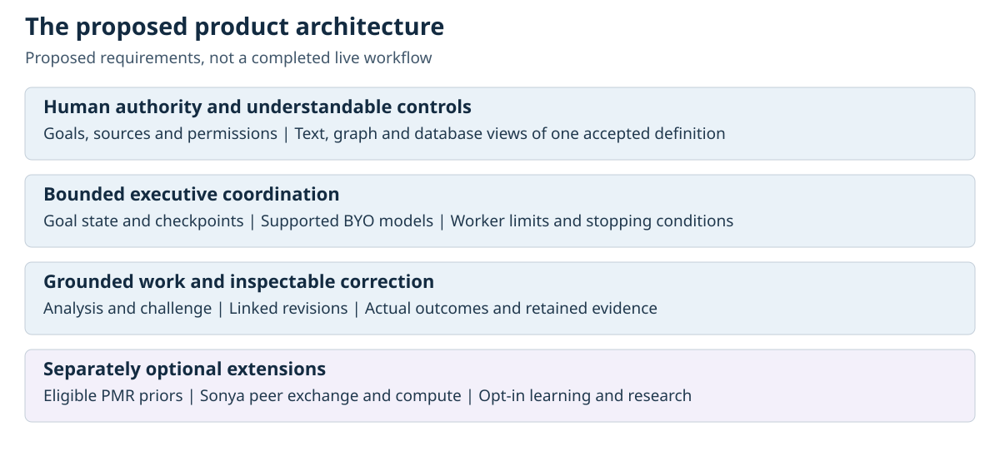
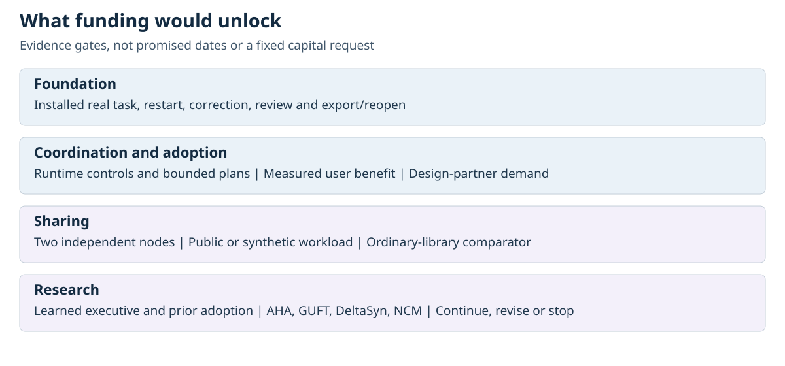

# UVLM Grand Vision

A roadmap for a governed AI workbench and the company needed to build it

Thomas Prislac and Ultra Verba Lux Mentis

23 October 2026

Discussion draft for prospective investors and founding collaborators

## The company we want to build

We want people to put capable AI to useful work without surrendering control over their information, resources or decisions. UVLM's proposed product is Control Anchor, a local-first workbench in which users can choose supported models, define understandable rules, inspect the basis of a result, challenge it and preserve corrections. The Triadic Brain is the broader architecture behind that workbench.

Our first obligation is practical usefulness. A person should be able to complete a real task, understand what the system did, correct its work and return later without losing the evidence or the limits of the result. More ambitious coordination, learning and distributed research should grow from that foundation. The local product must remain useful without joining a network or contributing private information to training.

This document describes what investment and collaboration could help build. The immediate opportunity is to turn bounded component work into a dependable, measurable product. The longer opportunity is a network of independently governed workbenches that can share permitted knowledge and compute. That larger vision is a development and research agenda, not a claim of a functioning global network.

## What we can show today

The public Control Anchor reviewer demo captures supplied source material, prompts, settings and candidate output; performs deterministic evidence checks; records scripted review; preserves an original and its linked correction; and exports and reopens evidence. It also demonstrates rejection of deliberately altered or incomplete evidence and recovery from one deliberately interrupted decision. Its inputs are synthetic and it calls no model. It does not demonstrate autonomous analysis, learned improvement or the full live workbench. [1]

The public product map reports additional, separately scoped development checkpoints, including hosted application-only installation and restricted scripted startup. Those checkpoints do not establish an accepted ordinary-user installed workflow, live provider inference, distributed peers or shared compute. We will keep this distinction visible as development progresses. A successful component test does not qualify a changed source version or the whole product. [2]

## What useful work should look like

For an individual or family, the promise is deliberate use of AI on their own terms. Consider someone preparing for a home repair: they bring two estimates and their own notes, set a spending limit for planning, ask the workbench to identify differences and unanswered questions, and choose whether any source may go to a remote model. The workbench could retain the goal, show where a comparison came from, flag missing information and preserve a corrected estimate for later review. It would not contact a contractor, commit money or train on the family’s records merely because those steps might be useful. This is a proposed user scenario, not an observed deployment.

Our initial product hypothesis is that people doing evidence-heavy work need more than an answer in a chat window. They need a usable connection between the task, its sources, the rules that apply, the work actually performed and the decision they make afterward. An initial design-partner workflow could be a small business reviewing a policy package or a researcher preparing an evidence-linked technical summary. The first customer segment and willingness to pay still need validation.

## A supported task would follow this path:

1. The user selects a goal and the sources the system may use, together with resource and action limits.
2. The workbench shows the effective settings, model route and any intended disclosure before work begins.
3. A bounded coordinator chooses supported steps, retains unresolved questions and stops or asks when authority, evidence or resources are missing.
4. Selected models and deterministic procedures perform the work. Separate evaluation challenges the result and records disagreements.
5. The user can inspect supporting evidence, request a correction and retain both the original and revised outcome.
6. Any required human decision remains attributable to that person. Eligible records can be reopened or reused under the permissions then in effect.

We should test whether this reduces time spent reconstructing context, makes material errors easier to catch and makes corrections easier to verify. More records alone are not a user benefit. The workflow must earn its complexity through better work, lower review burden or more reliable continuity.

## Why this company could matter

UVLM aims to make the connection between user intent, executable permissions, substantive work and correction history a coherent product. The intended distinction from a workflow interface or a general agent framework is that accepted controls would reach the actual runtime decision, and the resulting evidence would remain useful when work is challenged, resumed or shared. A model can change without discarding the user’s rules or the history of a task. This is a differentiation hypothesis to test against existing tools, not a claim that no other system offers related capabilities.

Personal and family autonomy is part of that product promise from the beginning. Organizational buyers may fund more demanding administration and support, but ordinary people should receive understandable safeguards rather than surveillance dressed as assistance. The company must make the basic experience useful enough that people choose it, while paid services earn their place by reducing real operating burdens.

## Executive function before a learned executive

The first coordinator should have explicit responsibilities: maintain goal state, track constraints, select allowed actions, inspect outcomes, revise a bounded plan and stop safely. We can implement and evaluate these functions without first claiming a new kind of intelligence. A later learned executive model could propose or improve plans, but it would operate within the same externally enforced permissions and resource limits. It would need to outperform a credible simpler coordinator on defined tasks before becoming a product dependency. [3]

Users should be able to bring eligible models through supported adapters. Models can serve different roles, and deterministic procedures can handle work that does not need generation. Compatibility, hardware requirements, provider terms, cost and behavior must be checked for each supported route. This is not a promise that every model can become an effective executive by being plugged in.

A bounded agent swarm means a controlled allocation of work, not unlimited recursive delegation. Each worker needs a purpose, permitted evidence, allowed tools, output contract, budget and stopping condition. A coordinator must account for aggregate cost and activity, prevent a worker from granting itself new authority and handle failed or conflicting results. Multiple agents repeating the same claim do not supply independent evidence.

## One control system with several usable views

People should not have to understand internal files to govern their work. The proposed interface offers text, visual graph and structured database views of the same accepted definitions. A user might read a rule in plain language, inspect its relationships in a graph or edit its supported fields in a structured form. These views must not become competing authorities.

Canonical typed definitions should specify units, bounds, ownership, versions and supported calculations. A natural-language draft is a proposal until its meaning has been reviewed and accepted. The runtime that performs an action must validate and apply that accepted definition. Testing must follow a changed setting all the way from input and saved representation to the actual decision and observed effect. A generated file or matching hash is not enough. [3]

The architecture separates responsibilities. Sonya binds tasks and exchanges to their permitted purpose; AEGIS handles technical admission; UCC executes supported control procedures; CoherenceLattice connects claims, evidence and alternatives; Sophia provides advisory evaluation; Atlas organizes explanations and eligible continuity. Custody and the Triadic Event Ledger retain records and link stages actually performed. Human authority remains separate. These are intended product responsibilities, not a claim that the public demo executes all these systems. [2]

## Broad access and a sustainable business

We propose a free household core with basic safeguards, understandable settings and useful local evidence and review. Safeguards should not depend on buying a premium plan or donating compute. Household controls must be visible, proportionate and limited to supported workflows. An exception should invite context and review, not become an automatic accusation or a covert surveillance mechanism.

Local-first means local authority and a usable local workflow. It does not mean every configuration is offline: a selected remote provider receives the data sent to it. The interface must make those boundaries understandable. Families and organizations should not have to join a public peer network to use the product.

Possible commercial offerings include maintained organizational controls, administration, supported adapters, deployment assistance, support, convenient synchronization and managed coordination or capacity. These are business model options, not validated demand or established revenue. We should select an initial offer through design-partner work and actual purchasing evidence, then measure retained use, support burden and contribution margin. A model that is inexpensive to distribute can still be expensive to secure and support.

## Shared knowledge and compute without losing local authority

The proposed Sonya-mediated peer-to-peer network would let eligible instances exchange authorized work, provenance and eventually bounded compute. Start with two independently administered nodes exchanging a public or synthetic artifact and a review request. Remote job execution is a separate later milestone, with explicit permission, sandboxing, resource limits, verification and stop controls.

A shared PMR prior library would make eligible prior work easier to discover and reuse. Every bundle needs a declared meaning: retrieved context, a procedural template, a representation prior or a model update are different things. Its provenance, permitted uses, compatibility, validity and version must be checked before use. Receiving or storing a bundle does not authorize activation, training or onward sharing. [3]

Authenticated provenance can identify a publisher and preserve a version relationship. It cannot establish that a claim is true, that a model update is safe or that the publisher had all necessary rights. Receiving instances must retain their own acceptance decisions. Corrections, expiry and revocation should affect future eligibility while preserving the historical record; they cannot promise erasure of copies already disclosed.

The economic question is whether reuse or shared execution produces accepted useful work more efficiently after counting verification, transport, coordination, failures and security overhead. We should compare against an ordinary shared repository and manual handoff before building an elaborate network. Reusing a good artifact may be more valuable than distributing its original computation. Neither compute savings nor network advantage is established today.

## Learning and long term research

Task history, retrieval, local learning and network learning require separate choices. Saving a task must not silently authorize model training. An experimental update should identify the selected data, rights, permitted purpose, resource limits, version, evaluation and rollback path. Network learning needs its own opt-in; local use must remain available without it. [3]

AHA, GUFT and DeltaSyn belong in a research portfolio with explicit hypotheses, relevant prior work, baseline comparisons and failure criteria. Their names do not establish discovery, general intelligence or compression advantage. NCM is an optional experimental generation or representation backend, not a prerequisite for the first useful product. Before funding an experiment, collaborators should agree what the proposed mechanism predicts and what evidence would count against it.

Awareness is a long-term research ambition. We do not claim to have demonstrated it or to know that this architecture will produce it. Product usefulness and near-term commercial value must stand on observable user outcomes, independently of that ambition.

## What funding could build

We propose funding bounded work packages, with later commitments conditional on evidence. The sequence below is a planning proposal, not a delivery schedule or a fixed capital request. A work package is ready to fund only after its responsible people, scope, dependencies and cost basis are agreed.

### Package 1  A dependable local workflow

Fund product engineering, release engineering, security review and product testing to join installation, supported provider activation, a permitted real response, selected analysis, correction, applicable review and export/reopen. Include restart, interruption, record-preserving update and a supported uninstall path.

Evidence gate: an independently witnessed ordinary-user run on the declared supported configuration, with exact source identity, permission boundaries, failures and unexecuted checks retained. No unresolved critical security issue in the supported scope. User review must establish that the task can actually be completed and understood, not merely that the software starts.

### Package 2  Useful executive coordination and controls

Fund persistent goal state, bounded planning, typed controls and consistent text, graph and database views. Test real runtime enforcement, aggregate worker budgets, changed inputs, conflicting rules and deliberate attempts to exceed authority.

Evidence gate: compare against the same model and task with a simpler workflow. Predefine task-quality and reviewer-effort measures, show whether benefits justify overhead, and demonstrate that unsupported or unauthorized actions fail at the actual execution boundary. Narrow the product if added orchestration does not help.

### Package 3  Design partner adoption and a sustainable offer

Fund structured discovery, onboarding, accessible explanations, support instrumentation and limited pilots in one selected segment. Keep household safeguards part of the product design rather than a future promise dependent on enterprise sales.

Evidence gate: documented user problems, completed and repeated useful tasks, observed support cost, and credible willingness-to-pay evidence for a named offer. Track nonadoption and abandonment as well as success. Distinguish an interested conversation, a pilot agreement and actual paid use.

### Package 4  Governed sharing and comparative research

Fund a permission and provenance contract, the two-node artifact study, independent evaluation and only then a separately scoped remote-execution experiment. Begin with approved public or synthetic data and independently administered endpoints.

Evidence gate: demonstrate correct admission, refusal, correction-aware reuse, interruption handling and revocation for future use. Compare total effort and accepted output quality against ordinary sharing. Do not proceed to broader federation if verification or operating costs eliminate the benefit.

### Package 5  Optional learning and experimental mechanisms

Fund narrowly defined studies of a learned executive, prior adoption, local learning or one AHA, GUFT, DeltaSyn or NCM hypothesis at a time. Keep experimental systems separate from the dependable product path.

Evidence gate: a frozen protocol, relevant baselines, held-out evaluation where applicable, reproducible versions, negative-result reporting and a decision to adopt, revise or stop. No product claim should exceed the supported experiment.

Each budget should separate paid person-time, compute and hardware, security and independent review, participant costs, documentation, recurring operations and contingency. It should show cash needs separately from in-kind contributions, and explain the cost of stopping or maintaining a phase. Funding amounts, staffing levels and timing follow that work, not an inherited seed-round number.

## Two funding conversations

Commercial investment would support a company building and selling a useful product. Prospective investors need an initial buyer, evidence of adoption, plausible delivery economics, a rights and ownership picture, and a disciplined explanation of what additional capital unlocks. The current vision is not a valuation or a securities offering.

Public-interest grants, sponsored research and philanthropic support would need a distinct research or access purpose, accountable deliverables and an eligible recipient arrangement. Potential themes include reproducible evaluation, accessible safeguards and bounded research collaboration. The existence of a public-interest purpose does not establish nonprofit status, tax deductibility or eligibility for a particular program. Commercial and sponsored-research budgets, rights, publication obligations and resource use should be explicit and separate.

A capital and partnerships collaborator could help turn these work packages into suitable conversations. That work should include eligibility checks, partner development and accurate applications, not promises that funding is available. No fundraising service, compensation structure or funding commitment is offered by this document.

## Operational proof of concept priorities

The next operational work should close specific gaps rather than rerun a large test count without a user outcome. The following priorities are proposals; no new execution is reported here.

- Public executed bounded evidence: the synthetic offline reviewer workflow. Retain its reproducible source, fixtures, observed results and limitations as the public entry point.
- Attributed executed bounded evidence upstream: hosted application-only installation, exact installed-copy verification, restricted scripted Home and same-process provider-selection save/reread. Report these as dated source-specific checkpoints through the public product map, not as a publicly reproducible full-product result.
- Implemented source with bounded tests: provider metadata and receiving/staging paths have separately scoped evidence with injected replies; one synthetic same-process loopback TCP case is reported. These do not establish real provider inference or independently operated distributed peers.
- Next local proof of concept: on an agreed supported machine, demonstrate installation and protected provider activation, authorized real inference, analysis, correction and reopened evidence. Record exact configuration and remaining gaps. Then test restart and interruption recovery without losing history.
- Next coordination proof of concept: exercise a small dependent-task graph with two concurrent workers, a shared budget, stale-worker fencing and an uncertain-dispatch reconciliation case. Show real blocked effects and preserved accounting, not only a textual refusal.
- Next sharing proof of concept: two independently administered nodes exchange an eligible artifact, reject a wrong-purpose request and handle a superseded prior. Add remote compute only under a separately scoped and authorized experiment.

Each operational report should identify the requirement, source version, environment, executed cases, actual side effects, result, failures, unexecuted work and next decision. A source-only review stays source-only; a later pass does not rewrite earlier failures. Reporting existing work does not require activating models, sharing data or running new paid infrastructure.

## The founding team we need

Thomas Prislac brings the product direction and an audit and governance perspective to company design. Building the product and testing the research requires complementary expertise. Early collaborators should own concrete deliverables and have room to challenge the plan.

- Product and platform engineering: own the supported end-to-end workflow, model adapters, release quality and recoverability. First deliverable: a reproducible installed task with retained evidence.
- Security and distributed systems: own the threat model, runtime boundaries, provenance contract and eventual peer isolation. First deliverable: tested admission and egress boundaries with documented failure behavior.
- Product design and user experience: own understandable controls, task setup, correction and accessible household and organizational flows. First deliverable: observed user sessions and revisions tied to actual confusion or task failure.
- Research and evaluation: own baseline selection, measurable hypotheses, independent assessment and honest reporting. First deliverable: a preregistered or otherwise frozen evaluation protocol and a complete result record.
- Capital and partnership development: own evidence-based funding materials, program fit, collaborator discovery and diligence readiness. First deliverable: a qualified opportunity pipeline tied to specific work packages and verified eligibility.

Some responsibilities may initially be combined, but independent evaluation and security challenge must remain credible. Roles, decision rights, availability, intellectual-property arrangements and compensation would be agreed separately. This document offers no employment, equity or compensation terms.

## Risks we should manage openly

Integration is the immediate risk: components may work individually while the joined user journey fails. The response is a narrow supported configuration and end-to-end evidence. Product complexity is another risk: controls may create more burden than value. The response is observed use and a simpler baseline, not more features.

Model variability, unsafe inputs and mistaken advice require bounded tools, explicit uncertainty and ongoing evaluation. Privacy, poisoning and peer abuse require enforced permission boundaries and a staged network threat model. Rights and licensing require a verified inventory before distribution or reuse. Economics require all-attempt cost accounting, including support and failed work. Speculative research requires a budget and stopping criteria that cannot consume the dependable product indefinitely.

We should resist confusing an impressive demonstration with durable demand, a signed artifact with truth, a control framework with professional assurance, or a growing network with useful output.

## The next decision

The most useful next commitment is to define and cost the first two work packages, choose a narrow initial workflow and recruit the people who can make it succeed. Prospective collaborators can help by testing the architecture, identifying a real user problem or taking responsibility for a bounded milestone. Prospective funders can evaluate that milestone and its evidence rather than being asked to fund every part of the long-term vision at once.

## Technical appendix and glossary

## Evidence labels

Proposed requirement identifies behavior the design calls for but does not establish as implemented. Implemented source identifies code present in a named version, without implying that it has been executed or accepted. Executed bounded evidence identifies observed behavior under a stated configuration and test population. Staged identifies work deliberately deferred until dependencies and evidence gates are met. These labels describe different dimensions: source can exist while a requirement remains unverified. The public demo supplies executed bounded evidence for its offline scope; the wider contracts below are proposed requirements, with optional learning and network extensions staged.

## Coordination and recovery contract

The proposed coordinator should represent task dependencies as an explicit directed acyclic graph, retain persistent checkpoints and record which effects are complete, pending or uncertain. Worker leases need expiry and stale-owner fencing so a replaced worker cannot continue acting as the current owner. Idempotency must be defined at the effect boundary, not inferred from a repeated task identifier. After an uncertain dispatch, reconcile the actual outcome before retrying; a timeout is not proof that nothing happened. Cancellation should stop new work and account for already dispatched effects. Recovery must preserve the distinction between planned, attempted and completed work.

## Concurrent budget contract

Several workers must not each spend the same remaining budget. Proposed shared resource control requires atomic reservation before dispatch, reconciliation to actual usage, release of unused reservations and durable accounting across retries and crashes. Define how outstanding or uncertain work retains a reservation, how leases and cancellation interact with it, and how global and per-task limits compose. Demonstrate contention and recovery against the real consumer before claiming enforceable swarm-wide limits.

## Consent and disclosure contract

Treat retention, later retrieval, local training, transmission for provider inference, provider training, network training and compute donation as distinct purposes. Do not collapse them into one learning switch. A permission for one purpose does not authorize another. Bind consent to the selected data, destination or participant, scope, version and current conditions. Some provider behavior may be governed by external terms rather than a local switch; expose those limitations and reject unsupported guarantees. Donation to public-interest research must not silently become commercial compute.

## Prior lifecycle and cost contract

The proposed prior lifecycle is identify and version, validate rights and compatibility, quarantine, evaluate, explicitly activate when authorized, and later supersede or revoke for future use. Define corruption detection, recovery from a trusted retained version and the result when no safe version remains. Historical records must preserve which version was actually used. Do not overwrite a prior in place and call the resulting identity unchanged.

Evaluate reuse and compression using the complete accounting boundary: prior acquisition and storage, model dependencies, transmitted payload, residual or reconstruction material, provenance, synchronization, validation and runtime work. Include failed attempts and cache maintenance. Report whether an apparent saving moves cost to another participant or merely excludes a prerequisite. For DeltaSyn research, state the reconstruction criterion and compare with a relevant deterministic baseline; no semantic-transfer or compression advantage is established by this proposal.

## Glossary

Control Anchor: the proposed user-facing governed workbench.
Triadic Brain: the broader architecture for grounded work, evaluation and continuity.
Executive function: explicit goal maintenance, supported action selection, outcome inspection and bounded replanning. A learned executive is a possible later implementation, not a current achievement.
Sonya and AEGIS: task and exchange binding, technical admission and permission boundaries. Ingress checks do not replace egress enforcement.
UCC: Universal Control Codex, supported procedures under an effective control profile. No universal compliance verdict is implied.
CoherenceLattice: relationships among claims, evidence, alternatives and missing information.
Sophia: advisory evaluation and challenge. Its recommendation does not grant authority.
Atlas: explanation and eligible continuity. A summary does not replace its original evidence.
TEL: Triadic Event Ledger, links to stages actually performed, not access to hidden model reasoning.
PMR: the proposed memory and prior-reuse layer. Retrieval and model modification remain distinct operations; formal bundle types must be specified before implementation claims.
P2P: optional peer-to-peer cooperation between locally governed instances.
AHA: a proposed research direction for generating cross-domain analogy candidates and testing them against evidence, disanalogies and task outcomes. A suggested connection is a hypothesis, not a discovered fact.
GUFT: research toward a shared representational grammar that might support transfer across domains. Evaluate whether the representation preserves useful structure and improves transfer against relevant alternatives; a shared notation alone is not demonstrated semantic transfer.
DeltaSyn: research into a compact conditional representation when sender and receiver have suitable shared priors, with residual information and explicit reconstruction checks. Count prior distribution, validation and reconstruction costs, and retain cases where the representation is larger or fails.
NCM: next-concept modeling, an optional experimental generation or representation direction. Its role and evaluation must be specified independently; adopting it would not itself establish a better executive or general learning capability.

Minimum task contract: task and parent identity; purpose; source identities; effective control version; permitted models, tools and destinations; budget and stop conditions; output and review requirements; retained outcomes and unresolved work.

Minimum prior contract: publisher identity; content and version; declared bundle type; purpose and rights; target compatibility; review and validity status; expiry or supersession; local acceptance decision. Authentication, correctness and authorization are different checks.

Minimum evidence chain for a control: accepted typed input, saved representation, actual runtime reader and predicate, resulting effect, retained outcome. Test legitimate, changed-input and adverse cases at that real boundary.

## Public references

[1] Control Anchor reviewer demo README, pinned 23 October documentation edition.
https://github.com/pdxvoiceteacher/control-anchor-reviewer-demo/blob/9f8968feae8f2be382670bdf68f81afee36c414a/README.md

[2] Product map and reviewer crosswalk, same pinned edition. The map distinguishes public-demo behavior from attributed development checkpoints and proposals.
https://github.com/pdxvoiceteacher/control-anchor-reviewer-demo/blob/9f8968feae8f2be382670bdf68f81afee36c414a/docs/PRODUCT_MAP.md

[3] Proposed Control Anchor roadmap, same pinned edition. These are proposals, not demonstrated capabilities.
https://github.com/pdxvoiceteacher/control-anchor-reviewer-demo/blob/9f8968feae8f2be382670bdf68f81afee36c414a/docs/PROPOSED_ROADMAP.md

