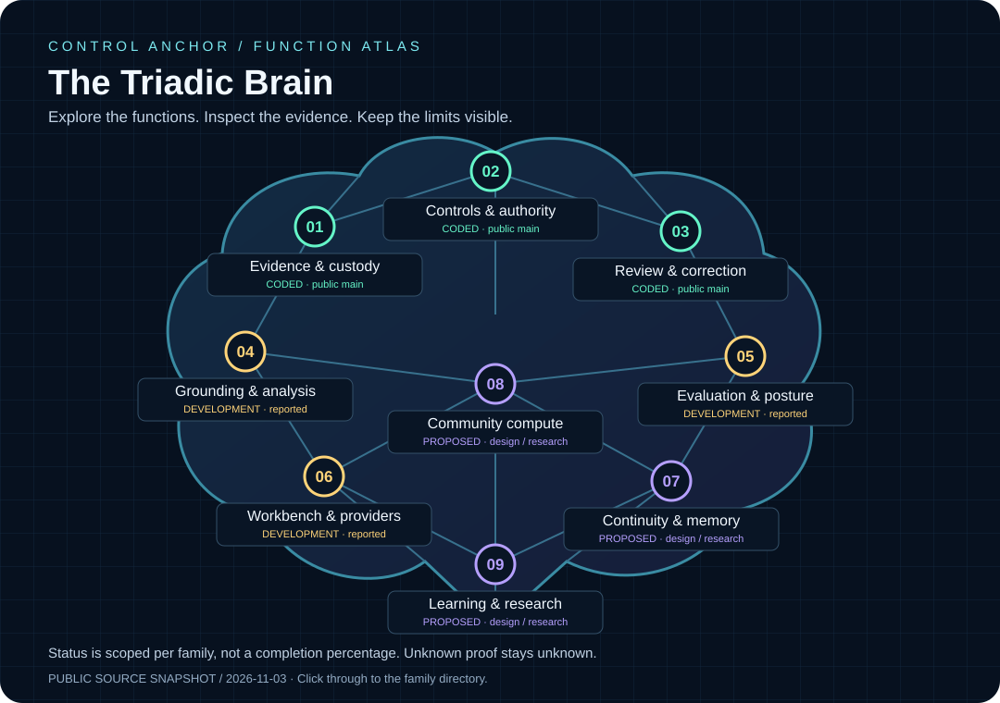

# Explore the Triadic Brain

[Back to the front page](../../README.md) · [Detailed product crosswalk](../PRODUCT_MAP.md)

**Reviewed 2026-11-03.** Public reviewer-demo code and dated public descriptions only. Not a whole-product completion score or a live development tracker.
Public source baseline: `23a674cab2af23baae6e74af2aaf5c7c934ff473`. Development descriptions retain their own dated evidence; this date does not requalify them.

- **CODED · public main:** bounded implementation in this offline synthetic repository, not the whole Brain.
- **DEVELOPMENT · reported:** described development components or integration work; private source is not republished or independently qualified here.
- **PROPOSED · design / research:** broader intended behavior, even where smaller foundations exist.
- **UNKNOWN:** missing or uninspected proof stays unknown. No status implies production readiness.

## Choose a family

1. [Evidence & custody](#evidence) — CODED · public main
2. [Controls & authority](#controls) — CODED · public main
3. [Review & correction](#review) — CODED · public main
4. [Grounding & analysis](#grounding) — DEVELOPMENT · reported
5. [Evaluation & posture](#evaluation) — DEVELOPMENT · reported
6. [Workbench & providers](#interface) — DEVELOPMENT · reported
7. [Continuity & memory](#continuity) — PROPOSED · design / research
8. [Community compute](#community) — PROPOSED · design / research
9. [Learning & research](#research) — PROPOSED · design / research

## 01. Evidence & custody

**CODED · public main**

Retain captured inputs, canonical records and a hash-linked history in the offline demo.

**Boundary:** Logical checks in one process. No independent custody, signing, source-truth guarantee or full native runtime is demonstrated.

- [Code: captured transactions](../../src/triadicbrain/assurance/transaction.py)
- [Code: custody verification](../../src/triadicbrain/assurance/custody.py)
- [Function crosswalk](../../docs/PRODUCT_MAP.md#actual-included-function-crosswalk)

[Back to family directory](#choose-a-family)

## 02. Controls & authority

**CODED · public main**

Deterministic evidence controls and logical actor/action authorization are included on public main.

**Boundary:** This does not establish general policy interpretation, OS isolation or an installed enforcement boundary. The standard review profile has no semantic finding rules.

- [Code: controls](../../src/triadicbrain/assurance/controls.py)
- [Code: authorization](../../src/triadicbrain/assurance/authorization.py)
- [Code: review policy](../../src/triadicbrain/assurance/review_policy.py)

[Back to family directory](#choose-a-family)

## 03. Review & correction

**CODED · public main**

Scripted review decisions, a separate repair child, export/reopen and one interrupted-decision recovery are exercised by the demo.

**Boundary:** The human decisions are scripted; the original findings remain. This is not actual human acceptance, learned improvement or a professional conclusion.

- [Code: transaction and recovery](../../src/triadicbrain/assurance/transaction.py)
- [Code: export and views](../../src/triadicbrain/assurance/web.py)
- [Tests: component cases](../../tests/test_component.py)
- [Observed evidence](../../VALIDATION.md)

[Back to family directory](#choose-a-family)

## 04. Grounding & analysis

**DEVELOPMENT · reported**

CoherenceLattice grounding, claim/evidence relationships and supported UCC procedures are described as development components.

**Boundary:** Reported development, not code shipped in this reviewer demo. Current installed integration is unverified by this map; deterministic demo checks are not full CoherenceLattice execution.

- [Responsibilities and role boundaries](../../docs/PRODUCT_MAP.md#local-workbench-workflow-and-role-boundaries)
- [Connections and proof obligations](../../docs/DEVELOPMENT_UPDATE_2026-10-30.md#provisional-connection-map)

[Back to family directory](#choose-a-family)

## 05. Evaluation & posture

**DEVELOPMENT · reported**

Sophia evaluation and Atlas explanation have distinct responsibilities in the broader development architecture.

**Boundary:** Named records in this demo do not prove those components ran. Agreement alone is not independent corroboration; no current whole-system pass is claimed.

- [Roles and limits](../../docs/PRODUCT_MAP.md#local-workbench-workflow-and-role-boundaries)
- [Whole-product vision](../../docs/TRIADIC_BRAIN_VISION.md)

[Back to family directory](#choose-a-family)

## 06. Workbench & providers

**DEVELOPMENT · reported**

Control Anchor interfaces, authenticated task intake, provider selection and retained outcomes are described in dated development checkpoints.

**Boundary:** Source, injected-boundary tests and hosted installation evidence have different scopes. No installer, live model invocation or current installed acceptance is supplied by this map.

- [Interface directions](../../docs/PRODUCT_MAP.md#two-interface-directions-one-local-authority)
- [Dated connection update](../../docs/DEVELOPMENT_UPDATE_2026-10-30.md)
- [Known public-demo limits](../../KNOWN_LIMITATIONS.md)

[Back to family directory](#choose-a-family)

## 07. Continuity & memory

**PROPOSED · design / research**

Eligible retrieval, purpose-limited reuse and restart-aware continuity are design goals. Existing retained history is a foundation, not proof of this broader capability.

**Boundary:** Optional memory and adaptive reuse require their own implementation and evidence. Retention is not training consent; a successor must not inherit unearned authority.

- [Memory and continuity connections](../../docs/DEVELOPMENT_UPDATE_2026-10-30.md#provisional-connection-map)
- [Privacy-aware lifecycle design](../../docs/design-notes/2026-11-03-refinements.en.md)

[Back to family directory](#choose-a-family)

## 08. Community compute

**PROPOSED · design / research**

Voluntary, locally governed Sophia cooperation is the network vision. Dated bounded peer experiments are groundwork, not an operating shared-compute service.

**Boundary:** Distributed execution, independent participants and practical usefulness remain separate proof obligations. This public demo performs no networked compute.

- [Community compute vision](../../docs/COMMUNITY_COMPUTE_VISION.md)
- [Dated peer evidence and limits](../../docs/PRODUCT_MAP.md#evidence-edition-and-remaining-joins)

[Back to family directory](#choose-a-family)

## 09. Learning & research

**PROPOSED · design / research**

Adaptive attention, analogy, recursive review and measurement proposals are research directions, not established improvements.

**Boundary:** No general learning, consciousness, speed, cost or scientific benefit is established by design descriptions or test totals. Negative and unknown findings remain relevant.

- [Research lineage and evaluation](../../docs/RESEARCH_LINEAGE_AND_EVALUATION.md)
- [Public micro-spectrum paper](../../docs/papers/triadic-brain-micro-spectrum/README.md)
- [Whitepaper and companions](../../docs/whitepaper/triadic-brain-20261102/README.md)

[Back to family directory](#choose-a-family)

## Optional browser explorer

GitHub renders this directory as Markdown. The front-page graphic opens this directory; the numbered family links are the clickable controls. The graphic itself is a static image, not an interactive SVG embedded in GitHub.

For the interactive graphic, download [explorer.html](explorer.html) and open it in a browser. It is self-contained, has no scripts or external assets, and uses ordinary keyboard-accessible links. Source links open this public repository at the reviewed baseline. No GitHub Pages site is enabled or required.

## Maintain this map

Edit [map.json](map.json), then run `python tools/build_brain_map.py` from the repository root. Run `python tools/build_brain_map.py --check` and `python -m unittest discover -s tests -p test_brain_map.py`. Update the source manifest using the repository's normal publication process. Preserve prior publication metadata and historical evidence.

A status change needs evidence for that specific scope. Do not promote private development to public-main code, treat a document as implementation, or imply that a new review date proves a fresh runtime result. No private source links, operational records, hosted analytics, external scripts or paid services belong in this map.
