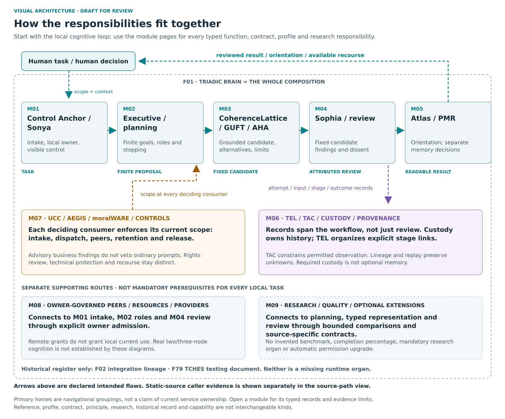

# Triadic Brain visual architecture atlas

**Draft documentation for review.** This atlas positions the conserved registry by responsibility, record kind and source status. It does not claim that every responsibility is a separate executable module or that every drawn join is implemented.

The registry contains **86 mixed-kind records**, not 86 or 85 completed functions. Each ID has one primary editorial home; references in focused views do not duplicate capabilities. **F01** is the whole-system composition. **F02** and **F79** are historical records outside capability diagrams. TCHES is a historical testing document, not a Brain feature or a future heat-system implementation.

[Open scalable overview](svg/00-overview.svg) · [Full text alternatives](TEXT_ALTERNATIVES.md) · [Complete placement ledger](PLACEMENT_LEDGER.md) · [Machine-readable ledger](source/architecture-data.json)

## Read connections correctly

- **Dashed arrows:** declared intended or research relationships; not implemented-edge evidence.
- **Solid arrows in the source-path view:** a caller and accepting consumer were inspected in source. This is not execution, installed or human acceptance evidence.
- **Teal:** data. **Amber:** control or current-owner constraint. **Purple:** provenance or recorded outcomes. A control arrow does not create authority.
- **REF boxes / focused nodes:** secondary references to the primary home, not new registry functions.
- **B:** selected bounded component evidence. **C:** selected current/historical source. **D:** design. **R:** research/optional/unresolved. **P:** human process. **H:** historical material. These are not a completion ranking.

A source file, a bounded component qualification, an unresolved join and a research responsibility are separate dimensions in the ledger. The public documentation does not contain underlying private execution receipts.

## Module navigation

Primary homes below are **proposed editorial responsibility groupings**, not an assertion about the current package tree or authenticated service owner. Contracts, profiles, lenses, deployment scopes, process vocabulary and optional branches retain those kinds.

| Home | Responsibility area | Primary records |
|---|---|---|
| [M00](modules/M00.md) | System composition | F01 |
| [M01](modules/M01.md) | Control Anchor / Sonya | F03, F04, F05, F67 |
| [M02](modules/M02.md) | Executive / planning / roles | F19, F20, F39, F47, F56, F64, F83 |
| [M03](modules/M03.md) | CoherenceLattice / GUFT / AHA | F07, F08, F15, F16, F17, F18, F49, F50, F53, F55, F70 |
| [M04](modules/M04.md) | Sophia / review / profiles | F09, F27, F32, F33, F34, F58, F74, F80, F81, F82 |
| [M05](modules/M05.md) | Atlas / PMR / memory | F10, F11, F12, F13, F14, F48, F57, F68, F69, F84, F85 |
| [M06](modules/M06.md) | TEL / TAC / custody / provenance | F28, F30, F35, F42, F60, F61, F62, F63, F65, F66, F75 |
| [M07](modules/M07.md) | UCC / AEGIS / moralWARE / controls | F22, F23, F24, F25, F26, F29, F31, F45, F59, F77 |
| [M08](modules/M08.md) | Peer / resource / provider integration | F06, F21, F36, F37, F38, F72, F73 |
| [M09](modules/M09.md) | Research / quality / optional extensions | F40, F41, F43, F44, F46, F51, F52, F54, F71, F76, F78, F86 |
| [M10](modules/M10.md) | Historical provenance register | F02, F79 |

## Focused connection views

| View | What it clarifies |
|---|---|
| [Source-connected cognitive route](svg/10-source-connected-cognitive-route.svg) · [PNG](png/10-source-connected-cognitive-route.png) | WORK, separate DISPATCH, JOINED analysis, separate evaluator, custody acceptance, Atlas/TEL and inspection. |
| [Prior-comparison boundary](svg/11-comparison-boundary.svg) · [PNG](png/11-comparison-boundary.png) | Existing pure comparison versus the unmerged/unqualified native custody/current-use join. |
| [Intended cognitive loop](svg/focus-cognitive-loop.svg) · [PNG](png/focus-cognitive-loop.png) | Candidate/review/orientation feedback and separate history. |
| [Authority and revocation](svg/focus-authority-revocation.svg) · [PNG](png/focus-authority-revocation.png) | Advisory findings, actual decision owners, revocation and stale-owner recovery. |
| [Memory lifecycle](svg/focus-memory-lifecycle.svg) · [PNG](png/focus-memory-lifecycle.png) | Custody, posture, retention, retrieval, current use and lifecycle are separate decisions. |
| [Intended three-node cooperation](svg/focus-three-node.svg) · [PNG](png/focus-three-node.png) | Each independently governed owner admits work; returned data still needs local current-use admission. |
| [Knowledge waters](svg/12-knowledge-waters.svg) · [PNG](png/12-knowledge-waters.png) | A bounded research overlay for revisable inquiry, not a new organ, literal fluid law or measured performance graph. |
| [Historical provenance register](svg/13-provenance-register.svg) · [PNG](png/13-provenance-register.png) | Historical lineage and testing-document records are not a capability backlog. |

## Source and scope

The core record descriptions are bound to a snapshot of the **2026-11-02.R5.1 frozen English source** concept map. The snapshot hash and status are in `source/architecture-data.json`. Guide/narrative anchors are retained as logical snapshot references rather than dead links to an unintegrated or wrong edition. The source-path supplement is a separate static inspection; it does not upgrade family maturity. Exact private source paths and repository locators are kept outside this public directory.

`source/diagram-recipes.json` contains editable lane layouts. `source/module-flow-edges.json` retains the intended arrow source bindings. `source/source-connected-edges.json` retains static-source status and boundaries. `source/focused-flows.json` and the DOT files retain all focused edges. No numeric performance or completion chart is included because no suitable measured dataset was established for this atlas.

[Build and verify locally](BUILD.md). No external rendering service, network access, installations, runtime/provider calls, CI runs or paid resources are needed.
