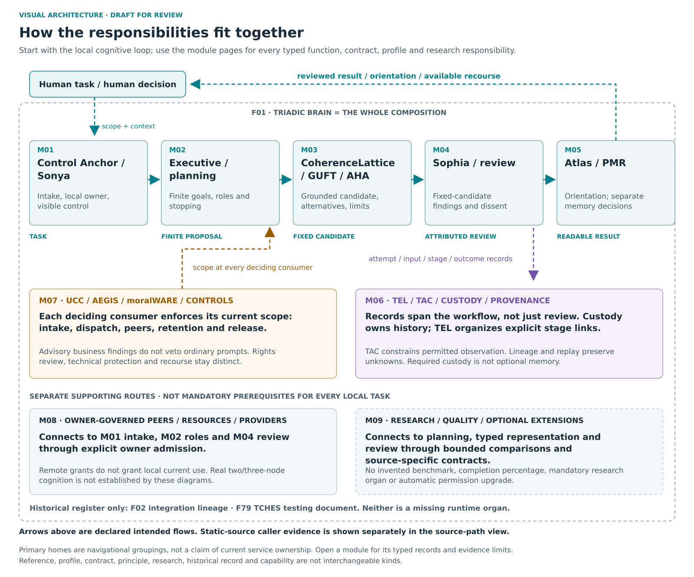

# M00 — System composition

[Atlas index](../README.md) · [Placement ledger](../PLACEMENT_LEDGER.md)

The overall composition, not another executable organ.

**Placement status:** proposed editorial responsibility grouping, not an implemented package or service-owner map. Primary cards below retain different record kinds. Diagram arrows are declared intended relations unless explicitly marked source-connected.

## F01 — Triadic Brain

**Kind:** system_scope — whole product.
**Primary home:** M00. proposed editorial responsibility grouping; not a claim of current package or service ownership.

Integrate analysis, review, presentation, controls and voluntary cooperation around a human task.

**Reported scope:** source_components. Selected current or historical source mechanisms exist; full current integration and user benefit are not established for this family.
**Source presence:** selected current or historical source described
**Whole-family / record integration:** not established in this edition
**Specific join or documentary obligation:** Demonstrate one complete governed cognitive workflow on actual user-owned machines.

**Boundary:** No single coordinator acquires every node owner's authority.
**Deciding owner:** The relevant local task/action owner under accepted controls and affected rights; exact current service binding is not established by this public description.

**Description type:** preserved functional description; not an implemented API specification
- Input / context: User task and context
- Output / record: reviewed result, evidence and permitted reuse
- Intended reader or consumer: The human participant and the component owners that together deliver the task.
- Interface limit: exact current producer/validator/consumer contract remains to be traced where not established

**Classification note:** The Brain is the whole cooperative cognition product, not an executive submodule.

**Secondary editorial associations:** [F03](M01.md#F03) in M01; [F04](M01.md#F04) in M01; [F07](M03.md#F07) in M03; [F09](M04.md#F09) in M04; [F10](M05.md#F10) in M05; [F19](M02.md#F19) in M02.

**Logical source anchor:** `FAMILY_GUIDE.en.md#F01` in the bound R5.1 English snapshot. This is intentionally not a relative hyperlink until its publication destination is settled. The preserved source description is embedded in the public JSON ledger; it is documentation, not an execution receipt.
