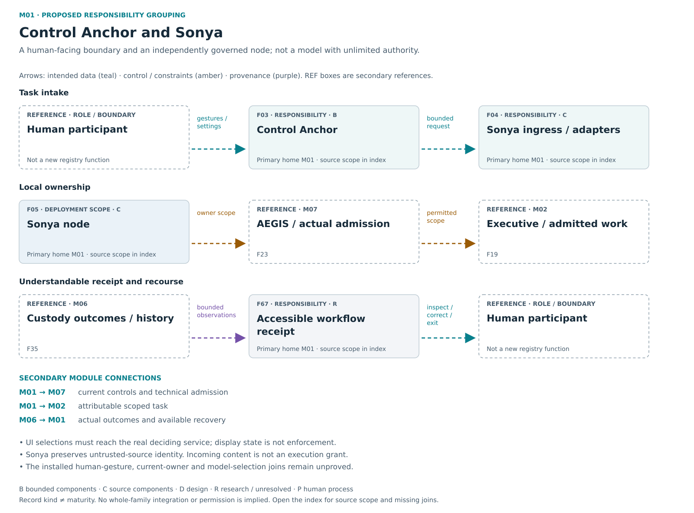

# M01 — Control Anchor / Sonya

[Atlas index](../README.md) · [Placement ledger](../PLACEMENT_LEDGER.md)

Human interaction, attributable ingress and independently owned local work.

**Placement status:** proposed editorial responsibility grouping, not an implemented package or service-owner map. Primary cards below retain different record kinds. Diagram arrows are declared intended relations unless explicitly marked source-connected.

[Scalable SVG](../svg/01-sonya.svg) · [Text alternative](../TEXT_ALTERNATIVES.md#01-sonya)

## F03 — Control Anchor

**Kind:** capability — human interface.
**Primary home:** M01. proposed editorial responsibility grouping; not a claim of current package or service ownership.

Give people one understandable interface to configure, inspect, select, stop and recover supported node work.

**Reported scope:** bounded_evidence. Selected Home and native interface paths have bounded evidence; complete installed user interaction remains unproved.
**Source presence:** selected current or historical source described
**Whole-family / record integration:** not established in this edition
**Specific join or documentary obligation:** Join actual installed human gestures, current owner, model selection and node controls.

**Boundary:** UI state is not enforcement unless it reaches the actual deciding consumer.
**Deciding owner:** The authoritative native service decides; the interface conveys the human selection.

**Description type:** preserved functional description; not an implemented API specification
- Input / context: Human gestures and settings
- Output / record: bounded requests; results → human-readable views
- Intended reader or consumer: The human user and the authoritative native services that receive explicit selections.
- Interface limit: exact current producer/validator/consumer contract remains to be traced where not established

**Classification note:** Control Anchor is the node interaction/configuration/inspection surface; it does not own enforcement.

**Secondary editorial associations:** [F04](M01.md#F04) in M01; [F05](M01.md#F05) in M01; [F19](M02.md#F19) in M02; [F45](M07.md#F45) in M07; [F67](M01.md#F67) in M01.

**Logical source anchor:** `FAMILY_GUIDE.en.md#F03` in the bound R5.1 English snapshot. This is intentionally not a relative hyperlink until its publication destination is settled. The preserved source description is embedded in the public JSON ledger; it is documentation, not an execution receipt.

## F04 — Sonya ingress and adapters

**Kind:** capability — ingress and adapter boundary.
**Primary home:** M01. proposed editorial responsibility grouping; not a claim of current package or service ownership.

Receive tasks, preserve source and context, quarantine untrusted material and route supported integrations.

**Reported scope:** source_components. Selected current or historical source mechanisms exist; full current integration and user benefit are not established for this family.
**Source presence:** selected current or historical source described
**Whole-family / record integration:** not established in this edition
**Specific join or documentary obligation:** Authenticate real application or model discovery, supported capability and admission before use.

**Boundary:** Incoming content and detected applications confer no execution or API rights.
**Deciding owner:** The native request/custody owner and separately authorized provider-credential owner.

**Description type:** preserved functional description; not an implemented API specification
- Input / context: Untrusted input/context
- Output / record: attributable bounded request
- Intended reader or consumer: The admitted native task route or selected provider adapter, then downstream capture/quarantine.
- Interface limit: exact current producer/validator/consumer contract remains to be traced where not established

**Classification note:** Sonya receives and binds untrusted input through supported adapters; receiving content grants no downstream authority.

**Secondary editorial associations:** [F05](M01.md#F05) in M01; [F22](M07.md#F22) in M07; [F23](M07.md#F23) in M07; [F35](M06.md#F35) in M06; [F73](M08.md#F73) in M08.

**Logical source anchor:** `FAMILY_GUIDE.en.md#F04` in the bound R5.1 English snapshot. This is intentionally not a relative hyperlink until its publication destination is settled. The preserved source description is embedded in the public JSON ledger; it is documentation, not an execution receipt.

## F05 — Sonya node

**Kind:** deployment_entity — governed node.
**Primary home:** M01. proposed editorial responsibility grouping; not a claim of current package or service ownership.

Keep resources, integrations and policy under an independently governed local owner.

**Reported scope:** source_components. Selected current or historical source mechanisms exist; full current integration and user benefit are not established for this family.
**Source presence:** selected current or historical source described
**Whole-family / record integration:** not established in this edition
**Specific join or documentary obligation:** Enroll and operate actual independently governed machines with their resource owners.

**Boundary:** Independent local authority; not shared account or global writable drive.
**Deciding owner:** The local participant or institution owns its resources and accepted integrations.

**Description type:** preserved functional description; not an implemented API specification
- Input / context: Local/peer requests
- Output / record: owner-admitted operations and outcomes
- Intended reader or consumer: Local task and resource owners; cooperating nodes receive only admitted interfaces.
- Interface limit: exact current producer/validator/consumer contract remains to be traced where not established

**Classification note:** A Sonya node is a locally governed participant, not another individual function or the same thing as Sonya ingress.

**Secondary editorial associations:** [F03](M01.md#F03) in M01; [F04](M01.md#F04) in M01; [F06](M08.md#F06) in M08; [F36](M08.md#F36) in M08; [F72](M08.md#F72) in M08.

**Logical source anchor:** `FAMILY_GUIDE.en.md#F05` in the bound R5.1 English snapshot. This is intentionally not a relative hyperlink until its publication destination is settled. The preserved source description is embedded in the public JSON ledger; it is documentation, not an execution receipt.

## F67 — Accessible workflow receipt

**Kind:** crosscutting_responsibility — usable receipt and recourse design.
**Primary home:** M01. proposed editorial responsibility grouping; not a claim of current package or service ownership.

Provide usable source expansion, correction, replay, retention, quarantine, export and recovery with visible human burden.

**Reported scope:** research_or_unresolved. A preserved research, optional or incompletely reconciled responsibility; exact current implementation and benefit remain unresolved.
**Source presence:** family-specific source completeness not established by this label
**Whole-family / record integration:** not established in this edition
**Specific join or documentary obligation:** Observe usable review, correction, export, stop and recovery paths with representative users and assistive needs.

**Boundary:** Receipt does not certify outcome; scoped human-review rules do not create a universal manual gate.
**Deciding owner:** The relevant local task/action owner under accepted controls and affected rights; exact current service binding is not established by this public description.

**Description type:** preserved functional description; not an implemented API specification
- Input / context: Bounded workflow observations
- Output / record: readable machine-checkable receipt and available recourse
- Intended reader or consumer: The person inspecting, correcting, leaving or recovering a workflow.
- Interface limit: exact current producer/validator/consumer contract remains to be traced where not established

**Classification note:** MVR is a user-facing receipt/recourse responsibility across existing UI, custody and export functions, not a standalone organ.

**Secondary editorial associations:** [F03](M01.md#F03) in M01; [F11](M05.md#F11) in M05; [F33](M04.md#F33) in M04; [F58](M04.md#F58) in M04.

**Logical source anchor:** `FAMILY_GUIDE.en.md#F67` in the bound R5.1 English snapshot. This is intentionally not a relative hyperlink until its publication destination is settled. The preserved source description is embedded in the public JSON ledger; it is documentation, not an execution receipt.
