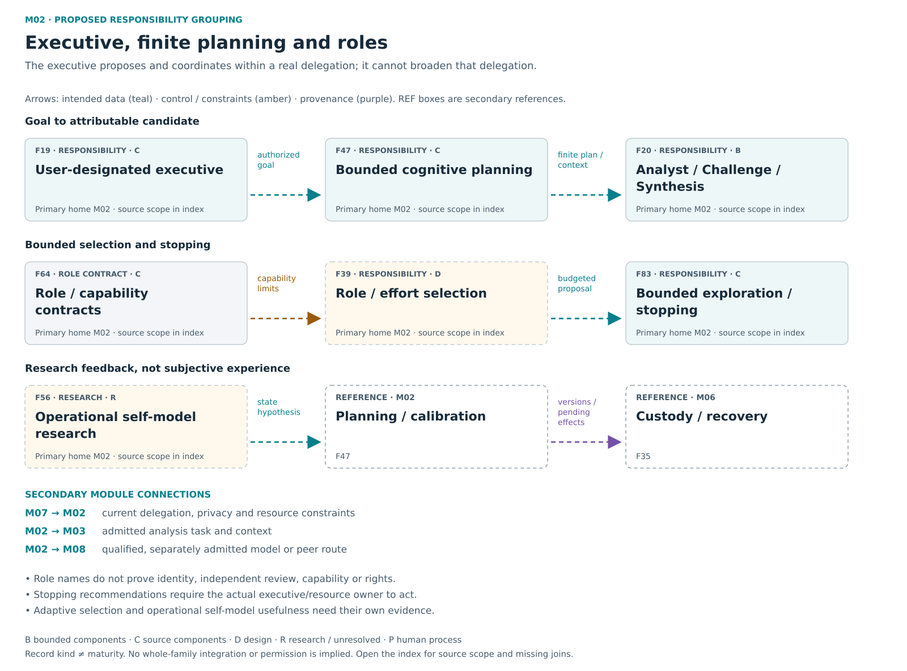

# M02 — Executive / planning / roles

[Atlas index](../README.md) · [Placement ledger](../PLACEMENT_LEDGER.md)

Finite goals, role proposals, plans, outcome comparison and stopping.

**Placement status:** proposed editorial responsibility grouping, not an implemented package or service-owner map. Primary cards below retain different record kinds. Diagram arrows are declared intended relations unless explicitly marked source-connected.

[Scalable SVG](../svg/02-executive.svg) · [Text alternative](../TEXT_ALTERNATIVES.md#02-executive)

## F19 — User designated executive

**Kind:** capability — delegated coordination role.
**Primary home:** M02. proposed editorial responsibility grouping; not a claim of current package or service ownership.

Maintain goals, observe state, propose finite work and compare outcomes within an actual delegation.

**Reported scope:** source_components. Selected current or historical source mechanisms exist; full current integration and user benefit are not established for this family.
**Source presence:** selected current or historical source described
**Whole-family / record integration:** not established in this edition
**Specific join or documentary obligation:** Connect finite delegation to real model replacement, useful outcomes, stopping and recovery.

**Boundary:** Delegation cannot be widened by the executive itself.
**Deciding owner:** The relevant local task/action owner under accepted controls and affected rights; exact current service binding is not established by this public description.

**Description type:** preserved functional description; not an implemented API specification
- Input / context: Authorized observations and goals
- Output / record: recommendations, selected plans and outcome review
- Intended reader or consumer: Admitted role workers and the user-facing progress/recovery surface.
- Interface limit: exact current producer/validator/consumer contract remains to be traced where not established

**Classification note:** The executive coordinates bounded work under user designation; it is not universal authority and need not be a separate model process.

**Secondary editorial associations:** [F20](M02.md#F20) in M02; [F22](M07.md#F22) in M07; [F39](M02.md#F39) in M02; [F47](M02.md#F47) in M02; [F83](M02.md#F83) in M02.

**Logical source anchor:** `FAMILY_GUIDE.en.md#F19` in the bound R5.1 English snapshot. This is intentionally not a relative hyperlink until its publication destination is settled. The preserved source description is embedded in the public JSON ledger; it is documentation, not an execution receipt.

## F20 — Analyst Challenge and Synthesis

**Kind:** capability — analyst challenge synthesis role composition.
**Primary home:** M02. proposed editorial responsibility grouping; not a claim of current package or service ownership.

Produce a proposal, challenge it and synthesize an attributable response to the findings.

**Reported scope:** bounded_evidence. Selected cognitive-role cases have bounded evidence, not a complete live independent-model workflow.
**Source presence:** selected current or historical source described
**Whole-family / record integration:** not established in this edition
**Specific join or documentary obligation:** Qualify actual model or peer contributions through the full proposal, challenge and synthesis route.

**Boundary:** Role labels do not confer identity, independence or execution rights.
**Deciding owner:** The relevant local task/action owner under accepted controls and affected rights; exact current service binding is not established by this public description.

**Description type:** preserved functional description; not an implemented API specification
- Input / context: Same-task context and bound predecessor outputs
- Output / record: accountable synthesis
- Intended reader or consumer: The next bounded contribution stage and the fixed-candidate evaluator.
- Interface limit: exact current producer/validator/consumer contract remains to be traced where not established

**Classification note:** These are distinct contribution roles that may share a permitted runtime; role names alone do not establish independent models.

**Secondary editorial associations:** [F07](M03.md#F07) in M03; [F09](M04.md#F09) in M04; [F19](M02.md#F19) in M02; [F21](M08.md#F21) in M08.

**Logical source anchor:** `FAMILY_GUIDE.en.md#F20` in the bound R5.1 English snapshot. This is intentionally not a relative hyperlink until its publication destination is settled. The preserved source description is embedded in the public JSON ledger; it is documentation, not an execution receipt.

## F39 — Role and effort selection

**Kind:** research_proposal — adaptive role and effort selection.
**Primary home:** M02. proposed editorial responsibility grouping; not a claim of current package or service ownership.

Choose appropriate roles, models and effort under user limits using complete observed costs and outcomes.

**Reported scope:** design. A preserved design responsibility or proposed connection; complete intended behavior is not demonstrated.
**Source presence:** family-specific source completeness not established by this label
**Whole-family / record integration:** not established in this edition
**Specific join or documentary obligation:** Compare matched tasks with complete costs, calibrated role choices and a bounded rollback path.

**Boundary:** No automatic expansion; utility and cost cannot be inferred from model size or agreement.
**Deciding owner:** The relevant local task/action owner under accepted controls and affected rights; exact current service binding is not established by this public description.

**Description type:** preserved functional description; not an implemented API specification
- Input / context: Task complexity/history/budget
- Output / record: bounded proposal and measured result
- Intended reader or consumer: The bounded executive, subject to current task and resource constraints.
- Interface limit: exact current producer/validator/consumer contract remains to be traced where not established

**Classification note:** Retain budgeted model/role selection and total-outcome comparison as genuine research, not measured efficiency or automatic expansion.

**Secondary editorial associations:** [F19](M02.md#F19) in M02; [F20](M02.md#F20) in M02; [F40](M09.md#F40) in M09; [F46](M09.md#F46) in M09; [F64](M02.md#F64) in M02.

**Logical source anchor:** `FAMILY_GUIDE.en.md#F39` in the bound R5.1 English snapshot. This is intentionally not a relative hyperlink until its publication destination is settled. The preserved source description is embedded in the public JSON ledger; it is documentation, not an execution receipt.

## F47 — Bounded cognitive planning

**Kind:** capability — planning state and belief primitives.
**Primary home:** M02. proposed editorial responsibility grouping; not a claim of current package or service ownership.

Maintain plans, beliefs and action-observation state with finite revision, authorized refresh, explicit uncertainty and attributable resume or hold.

**Reported scope:** source_components. Selected current or historical source mechanisms exist; full current integration and user benefit are not established for this family.
**Source presence:** selected current or historical source described
**Whole-family / record integration:** not established in this edition
**Specific join or documentary obligation:** Map planning and belief-state primitives to actual consumers, including bounded refresh, current authority and resume or hold.

**Boundary:** Plan proposal does not grant tools or actions; belief is not verified fact.
**Deciding owner:** The relevant local task/action owner under accepted controls and affected rights; exact current service binding is not established by this public description.

**Description type:** preserved functional description; not an implemented API specification
- Input / context: Goal, evidence-relative beliefs, observed discrepancy, current context and pending operations
- Output / record: Versioned finite plan or revision with attributable resume, hold and unresolved effects
- Intended reader or consumer: The executive and next admitted worker, with the custody/recovery owner preserving pending effects.
- Interface limit: exact current producer/validator/consumer contract remains to be traced where not established

**Classification note:** Historical planning/ledger/state mechanisms exist; only the effectful loop is restricted to a digest fixture in inspected evidence. Do not demote the whole planning family to test content.

**Secondary editorial associations:** [F19](M02.md#F19) in M02; [F35](M06.md#F35) in M06; [F48](M05.md#F48) in M05; [F62](M06.md#F62) in M06; [F83](M02.md#F83) in M02.

**Logical source anchor:** `FAMILY_GUIDE.en.md#F47` in the bound R5.1 English snapshot. This is intentionally not a relative hyperlink until its publication destination is settled. The preserved source description is embedded in the public JSON ledger; it is documentation, not an execution receipt.

## F56 — Operational self model

**Kind:** research_proposal — operational self-model research.
**Primary home:** M02. proposed editorial responsibility grouping; not a claim of current package or service ownership.

Research whether explicit state, discrepancies and calibration improve planning and refusal without inferring subjective experience.

**Reported scope:** research_or_unresolved. A preserved research, optional or incompletely reconciled responsibility; exact current implementation and benefit remain unresolved.
**Source presence:** family-specific source completeness not established by this label
**Whole-family / record integration:** not established in this edition
**Specific join or documentary obligation:** Connect observed operational state to tested planning and calibration improvements without inferring subjective experience.

**Boundary:** Operational state and adaptive behavior do not establish subjective experience.
**Deciding owner:** The relevant local task/action owner under accepted controls and affected rights; exact current service binding is not established by this public description.

**Description type:** preserved functional description; not an implemented API specification
- Input / context: Observed conditions/outcomes
- Output / record: bounded self-description and revised proposals
- Intended reader or consumer: Planning/calibration research, with subjective-experience questions kept separate.
- Interface limit: exact current producer/validator/consumer contract remains to be traced where not established

**Classification note:** Preserve bounded state/calibration/planning research, with consciousness hypotheses explicitly distinct and no asserted hidden-state access.

**Secondary editorial associations:** [F19](M02.md#F19) in M02; [F47](M02.md#F47) in M02; [F61](M06.md#F61) in M06; [F63](M06.md#F63) in M06.

**Logical source anchor:** `FAMILY_GUIDE.en.md#F56` in the bound R5.1 English snapshot. This is intentionally not a relative hyperlink until its publication destination is settled. The preserved source description is embedded in the public JSON ledger; it is documentation, not an execution receipt.

## F64 — Role and capability contracts

**Kind:** schema_or_vocabulary — role model runtime task output contracts.
**Primary home:** M02. proposed editorial responsibility grouping; not a claim of current package or service ownership.

Keep role, model, runtime, task and output requirements separate and preserve native validation across adapters.

**Reported scope:** source_components. Selected current or historical source mechanisms exist; full current integration and user benefit are not established for this family.
**Source presence:** selected current or historical source described
**Whole-family / record integration:** Consumer-specific adoption must be established; the contract itself is not a standalone runtime module.
**Specific join or documentary obligation:** Qualify substitution and wrapper-version boundaries with native validation rather than assuming a common interface proves compatibility.

**Boundary:** A role label does not prove identity, authority or model capability.
**Deciding owner:** The relevant local task/action owner under accepted controls and affected rights; exact current service binding is not established by this public description.

**Description type:** Data, meaning or handoff contract description; not an autonomous component or complete implemented API.
- Input / context: Versioned capability declarations
- Output / record: compatible bounded proposals
- Intended reader or consumer: Adapter admission, role selection and native validation consumers.
- Interface limit: exact current producer/validator/consumer contract remains to be traced where not established

**Sense distinction:** Open Web Steward native validation and older generic wrappers require explicit version comparison rather than assumed newer-contract conformance.

**Classification note:** Separate identities/compatibility axes are contracts used by actual adapters and planners, not five new subsystems.

**Secondary editorial associations:** [F04](M01.md#F04) in M01; [F19](M02.md#F19) in M02; [F20](M02.md#F20) in M02; [F33](M04.md#F33) in M04; [F73](M08.md#F73) in M08.

**Logical source anchor:** `FAMILY_GUIDE.en.md#F64` in the bound R5.1 English snapshot. This is intentionally not a relative hyperlink until its publication destination is settled. The preserved source description is embedded in the public JSON ledger; it is documentation, not an execution receipt.

## F83 — Bounded exploration and stopping

**Kind:** capability — historical exploration and stopping governor.
**Primary home:** M02. proposed editorial responsibility grouping; not a claim of current package or service ownership.

Recommend halts or redirection for risk, exhausted budgets, missing signals, oscillation or stagnation.

**Reported scope:** source_components. Selected current or historical source mechanisms exist; full current integration and user benefit are not established for this family.
**Source presence:** selected current or historical source described
**Whole-family / record integration:** not established in this edition
**Specific join or documentary obligation:** Bind halt and redirection recommendations to the actual executive stopping and resource controls.

**Boundary:** No result grants execution, memory write, publication, truth or broader prior rights.
**Deciding owner:** The relevant local task/action owner under accepted controls and affected rights; exact current service binding is not established by this public description.

**Description type:** preserved functional description; not an implemented API specification
- Input / context: Risk tier, task signals, remaining budget, oscillation or stagnation observations
- Output / record: Bounded halt, redirect or continue recommendation
- Intended reader or consumer: The actual executive termination and resource-control owner.
- Interface limit: exact current producer/validator/consumer contract remains to be traced where not established

**Classification note:** Source-backed halt/redirect recommendations exist in Sophia; placement near executive is a proposed consumer connection, not transferred enforcement authority.

**Secondary editorial associations:** [F19](M02.md#F19) in M02; [F45](M07.md#F45) in M07; [F47](M02.md#F47) in M02; [F55](M03.md#F55) in M03.

**Logical source anchor:** `FAMILY_GUIDE.en.md#F83` in the bound R5.1 English snapshot. This is intentionally not a relative hyperlink until its publication destination is settled. The preserved source description is embedded in the public JSON ledger; it is documentation, not an execution receipt.
