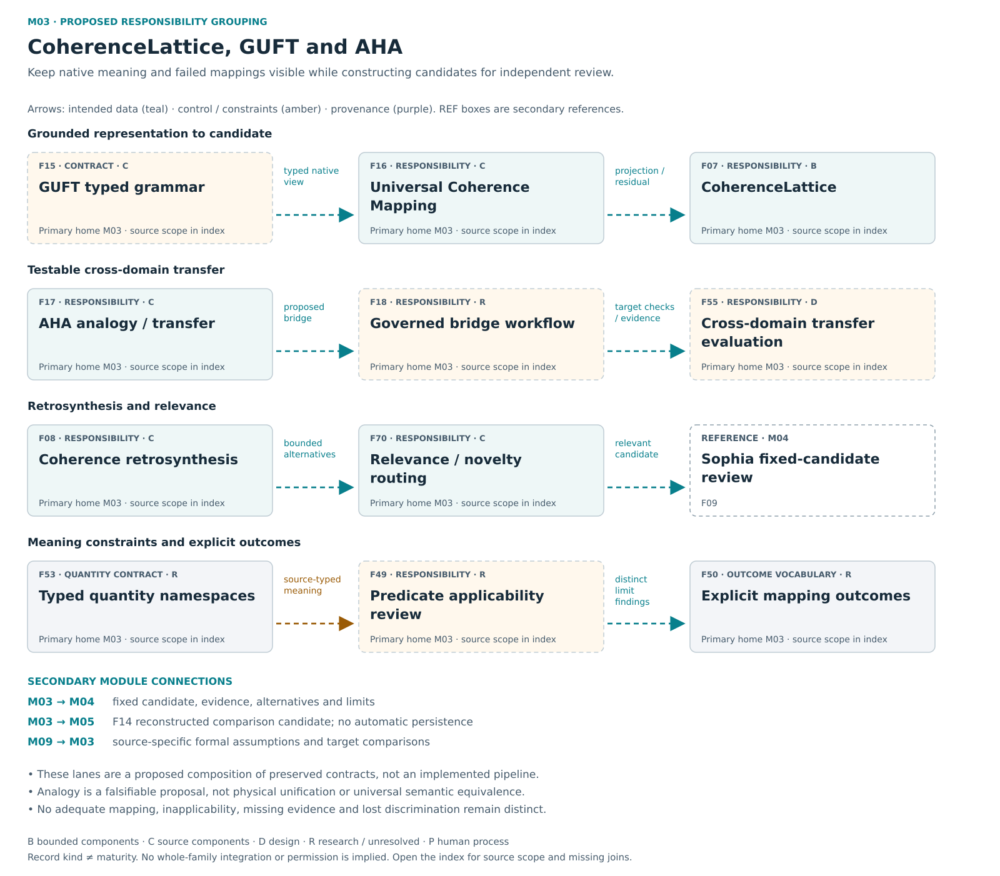

# M03 — CoherenceLattice / GUFT / AHA

[Atlas index](../README.md) · [Placement ledger](../PLACEMENT_LEDGER.md)

Typed grounding, candidate construction, alternatives and testable transfer.

**Placement status:** proposed editorial responsibility grouping, not an implemented package or service-owner map. Primary cards below retain different record kinds. Diagram arrows are declared intended relations unless explicitly marked source-connected.

[Scalable SVG](../svg/03-coherence.svg) · [Text alternative](../TEXT_ALTERNATIVES.md#03-coherence)

## F07 — CoherenceLattice

**Kind:** capability — analysis and candidate engine.
**Primary home:** M03. proposed editorial responsibility grouping; not a claim of current package or service ownership.

Ground claims and construct analytical candidates while preserving evidence, alternatives and unresolved relationships.

**Reported scope:** bounded_evidence. Structural and bounded conformance mechanisms exist; general semantic usefulness and the complete consumer loop remain unproved.
**Source presence:** selected current or historical source described
**Whole-family / record integration:** not established in this edition
**Specific join or documentary obligation:** Establish candidate usefulness and the complete evidence-to-evaluation consumer loop in a declared domain.

**Boundary:** Candidate generation does not certify truth or authorize actions.
**Deciding owner:** The relevant local task/action owner under accepted controls and affected rights; exact current service binding is not established by this public description.

**Description type:** preserved functional description; not an implemented API specification
- Input / context: Native evidence/context
- Output / record: structured candidates, bindings and residuals
- Intended reader or consumer: Sophia receives a fixed candidate; Atlas later presents its assessed meaning.
- Interface limit: exact current producer/validator/consumer contract remains to be traced where not established

**Classification note:** Retain CoherenceLattice as analysis/candidate responsibility with explicit generation versus truth/authority boundary.

**Secondary editorial associations:** [F08](M03.md#F08) in M03; [F09](M04.md#F09) in M04; [F15](M03.md#F15) in M03; [F17](M03.md#F17) in M03.

**Logical source anchor:** `FAMILY_GUIDE.en.md#F07` in the bound R5.1 English snapshot. This is intentionally not a relative hyperlink until its publication destination is settled. The preserved source description is embedded in the public JSON ledger; it is documentation, not an execution receipt.

## F08 — Coherence retrosynthesis

**Kind:** capability — retrosynthesis mechanism and broader research goal.
**Primary home:** M03. proposed editorial responsibility grouping; not a claim of current package or service ownership.

Work backward from outcomes or discrepancies to candidate branches, counterhypotheses, invariants and missing distinctions.

**Reported scope:** source_components. Selected current or historical source mechanisms exist; full current integration and user benefit are not established for this family.
**Source presence:** selected current or historical source described
**Whole-family / record integration:** not established in this edition
**Specific join or documentary obligation:** Distinguish useful general alternative generation from declared examples and connect its feedback to prior selection.

**Boundary:** No automatic prior promotion, task selection or dispatch.
**Deciding owner:** The relevant local task/action owner under accepted controls and affected rights; exact current service binding is not established by this public description.

**Description type:** preserved functional description; not an implemented API specification
- Input / context: Observed result and declared alternatives
- Output / record: new bounded candidates
- Intended reader or consumer: Sophia evaluates reconstructed candidates; Atlas can orient eligible prior comparison.
- Interface limit: exact current producer/validator/consumer contract remains to be traced where not established

**Classification note:** Retain actual bounded declared-alternative processing and the broader reconstruction goal separately; fixture-limited evidence does not erase the goal.

**Secondary editorial associations:** [F07](M03.md#F07) in M03; [F14](M05.md#F14) in M05; [F17](M03.md#F17) in M03; [F70](M03.md#F70) in M03.

**Logical source anchor:** `FAMILY_GUIDE.en.md#F08` in the bound R5.1 English snapshot. This is intentionally not a relative hyperlink until its publication destination is settled. The preserved source description is embedded in the public JSON ledger; it is documentation, not an execution receipt.

## F15 — GUFT typed grammar

**Kind:** research_proposal — typed cross-domain research framework.
**Primary home:** M03. proposed editorial responsibility grouping; not a claim of current package or service ownership.

Represent cross-domain material while preserving native evidence, units, uncertainty, residuals, provenance, consent and refusal.

**Reported scope:** source_components. Selected current or historical source mechanisms exist; full current integration and user benefit are not established for this family.
**Source presence:** selected current or historical source described
**Whole-family / record integration:** not established in this edition
**Specific join or documentary obligation:** Pin a specific grammar version and empirically validate proposed domain transfer without erasing native meaning.

**Boundary:** A shared representation does not establish physical unification or universal semantic equivalence.
**Deciding owner:** The relevant local task/action owner under accepted controls and affected rights; exact current service binding is not established by this public description.

**Description type:** preserved functional description; not an implemented API specification
- Input / context: Domain-specific records
- Output / record: additional typed common views
- Intended reader or consumer: Domain adapters, UCM projection and AHA analysis that retain native context.
- Interface limit: exact current producer/validator/consumer contract remains to be traced where not established

**Classification note:** Retain the actual representation research and archived packet contract; do not reduce GUFT to a scalar or dismiss it for lacking universal benefit proof.

**Secondary editorial associations:** [F16](M03.md#F16) in M03; [F17](M03.md#F17) in M03; [F49](M03.md#F49) in M03; [F50](M03.md#F50) in M03; [F53](M03.md#F53) in M03.

**Logical source anchor:** `FAMILY_GUIDE.en.md#F15` in the bound R5.1 English snapshot. This is intentionally not a relative hyperlink until its publication destination is settled. The preserved source description is embedded in the public JSON ledger; it is documentation, not an execution receipt.

## F16 — Universal Coherence Mapping

**Kind:** capability — typed mapping and posterior primitives.
**Primary home:** M03. proposed editorial responsibility grouping; not a claim of current package or service ownership.

Project typed native state into an additional view while preserving candidate distributions, omitted mass and refusal.

**Reported scope:** source_components. Selected current or historical source mechanisms exist; full current integration and user benefit are not established for this family.
**Source presence:** selected current or historical source described
**Whole-family / record integration:** not established in this edition
**Specific join or documentary obligation:** Connect distribution-preserving projection, inapplicability and refusal primitives to actual semantic consumers.

**Boundary:** Projection cannot replace domain evidence or calibrate a probability by naming it.
**Deciding owner:** The relevant local task/action owner under accepted controls and affected rights; exact current service binding is not established by this public description.

**Description type:** preserved functional description; not an implemented API specification
- Input / context: Native values/units/uncertainty
- Output / record: typed projection and residual
- Intended reader or consumer: AHA, evaluators and optional contextual views that preserve the full mapping limits.
- Interface limit: exact current producer/validator/consumer contract remains to be traced where not established

**Classification note:** Actual UCM primitives preserve native state, full distributions, residual and refusal; they are not merely an acronym or missing design.

**Secondary editorial associations:** [F15](M03.md#F15) in M03; [F49](M03.md#F49) in M03; [F50](M03.md#F50) in M03; [F51](M09.md#F51) in M09.

**Logical source anchor:** `FAMILY_GUIDE.en.md#F16` in the bound R5.1 English snapshot. This is intentionally not a relative hyperlink until its publication destination is settled. The preserved source description is embedded in the public JSON ledger; it is documentation, not an execution receipt.

## F17 — AHA analogy and transfer

**Kind:** capability — structural analogy mechanism with research hypothesis.
**Primary home:** M03. proposed editorial responsibility grouping; not a claim of current package or service ownership.

Propose grounded donor-to-target relations with invariants, disanalogies and falsifiable target checks.

**Reported scope:** source_components. Selected current or historical source mechanisms exist; full current integration and user benefit are not established for this family.
**Source presence:** selected current or historical source described
**Whole-family / record integration:** not established in this edition
**Specific join or documentary obligation:** Demonstrate useful target transfer with grounded observations and meaningful negative controls.

**Boundary:** Structural similarity does not prove a useful or true target transfer.
**Deciding owner:** The relevant local task/action owner under accepted controls and affected rights; exact current service binding is not established by this public description.

**Description type:** preserved functional description; not an implemented API specification
- Input / context: Donor/target evidence
- Output / record: testable bridge or no adequate mapping
- Intended reader or consumer: A governed bridge and target-domain evaluation, not an automatic final answer.
- Interface limit: exact current producer/validator/consumer contract remains to be traced where not established

**Classification note:** AHA has source-backed structural mechanisms; semantic transfer utility remains a research question rather than a false completed capability.

**Secondary editorial associations:** [F07](M03.md#F07) in M03; [F15](M03.md#F15) in M03; [F18](M03.md#F18) in M03; [F55](M03.md#F55) in M03.

**Logical source anchor:** `FAMILY_GUIDE.en.md#F17` in the bound R5.1 English snapshot. This is intentionally not a relative hyperlink until its publication destination is settled. The preserved source description is embedded in the public JSON ledger; it is documentation, not an execution receipt.

## F18 — Governed bridge workflow

**Kind:** research_proposal — donor-to-target workflow.
**Primary home:** M03. proposed editorial responsibility grouping; not a claim of current package or service ownership.

Preserve donor passages, target hypotheses, proposed insertions, contrary views and interpretation through a reviewable bridge.

**Reported scope:** research_or_unresolved. Related governed-bridge mechanisms exist; the complete historical-to-current responsibility mapping remains unresolved.
**Source presence:** family-specific source completeness not established by this label
**Whole-family / record integration:** not established in this edition
**Specific join or documentary obligation:** Trace each historical donor-to-target bridge responsibility into the current producer and evaluator.

**Boundary:** No cultural certification or automatic authority.
**Deciding owner:** The relevant local task/action owner under accepted controls and affected rights; exact current service binding is not established by this public description.

**Description type:** preserved functional description; not an implemented API specification
- Input / context: Bound donor/target candidate
- Output / record: governed bridge evidence
- Intended reader or consumer: CoherenceLattice/Sophia target review and eligible explanation or reuse.
- Interface limit: exact current producer/validator/consumer contract remains to be traced where not established

**Classification note:** Preserve source-declared donor passage, hypothesis and counterview responsibilities; historical name equivalence to current governed bridge is unresolved.

**Secondary editorial associations:** [F17](M03.md#F17) in M03; [F33](M04.md#F33) in M04; [F55](M03.md#F55) in M03; [F66](M06.md#F66) in M06.

**Logical source anchor:** `FAMILY_GUIDE.en.md#F18` in the bound R5.1 English snapshot. This is intentionally not a relative hyperlink until its publication destination is settled. The preserved source description is embedded in the public JSON ledger; it is documentation, not an execution receipt.

## F49 — Predicate applicability review

**Kind:** research_proposal — predicate applicability and mapping-limit design.
**Primary home:** M03. proposed editorial responsibility grouping; not a claim of current package or service ownership.

Distinguish an inapplicable category from missing, restricted or out-of-domain observation and preserve meaningful limits.

**Reported scope:** research_or_unresolved. Typed mapping/refusal foundations exist; exact current coverage of every applicability and meaning-limit state remains unresolved.
**Source presence:** family-specific source completeness not established by this label
**Whole-family / record integration:** not established in this edition
**Specific join or documentary obligation:** Map the distinct applicability and meaning-limit states to current UCM and AHA consumers without collapsing them.

**Boundary:** Mapping limits cannot be used to erase dissent or disguise missing evidence.
**Deciding owner:** The relevant local task/action owner under accepted controls and affected rights; exact current service binding is not established by this public description.

**Description type:** preserved functional description; not an implemented API specification
- Input / context: Native-domain statement, available observations and the applicable representation grammar
- Output / record: Distinct applicability/meaning-limit finding rather than one undifferentiated empty value
- Intended reader or consumer: UCM/AHA review and the reader who must understand why a predicate or mapping failed.
- Interface limit: exact current producer/validator/consumer contract remains to be traced where not established

**Sense distinction:** Preserve meaningful mapping, explicit non-meaning, null reference/no asserted relation and null collapse/lost discrimination separately from unavailable, restricted, out-of-domain and inapplicable observations; exact current schema mapping remains unresolved.

**Classification note:** Preserve distinct unavailable/OOD/inapplicable/null states and review obligations; implementation equivalence remains unresolved.

**Secondary editorial associations:** [F15](M03.md#F15) in M03; [F16](M03.md#F16) in M03; [F17](M03.md#F17) in M03; [F50](M03.md#F50) in M03.

**Logical source anchor:** `FAMILY_GUIDE.en.md#F49` in the bound R5.1 English snapshot. This is intentionally not a relative hyperlink until its publication destination is settled. The preserved source description is embedded in the public JSON ledger; it is documentation, not an execution receipt.

## F50 — Explicit mapping outcomes

**Kind:** schema_or_vocabulary — typed mapping outcomes.
**Primary home:** M03. proposed editorial responsibility grouping; not a claim of current package or service ownership.

Represent multiple mappings, no adequate bridge, out-of-domain input and proposed new distinctions without forced classification.

**Reported scope:** research_or_unresolved. Full-posterior and refusal primitives exist; exact status-to-consumer coverage remains unresolved.
**Source presence:** family-specific source completeness not established by this label
**Whole-family / record integration:** Consumer-specific adoption must be established; the contract itself is not a standalone runtime module.
**Specific join or documentary obligation:** Reconcile each historical mapping outcome to a current schema or leave the missing case explicit.

**Boundary:** Novel status does not promote a candidate to accepted ontology.
**Deciding owner:** The relevant local task/action owner under accepted controls and affected rights; exact current service binding is not established by this public description.

**Description type:** Data, meaning or handoff contract description; not an autonomous component or complete implemented API.
- Input / context: Domain/evidence/mapping attempt
- Output / record: typed status with uncertainty and residual
- Intended reader or consumer: The mapping evaluator and any later proposal to extend the vocabulary.
- Interface limit: exact current producer/validator/consumer contract remains to be traced where not established

**Classification note:** The named states are outcome vocabulary/schema requirements within mapping consumers, not independent modules; they carry real residual/refusal obligations.

**Secondary editorial associations:** [F15](M03.md#F15) in M03; [F16](M03.md#F16) in M03; [F17](M03.md#F17) in M03; [F49](M03.md#F49) in M03.

**Logical source anchor:** `FAMILY_GUIDE.en.md#F50` in the bound R5.1 English snapshot. This is intentionally not a relative hyperlink until its publication destination is settled. The preserved source description is embedded in the public JSON ledger; it is documentation, not an execution receipt.

## F53 — Typed quantity namespaces

**Kind:** schema_or_vocabulary — typed mathematical quantity namespaces.
**Primary home:** M03. proposed editorial responsibility grouping; not a claim of current package or service ownership.

Bind mathematical quantities to exact definitions, units, estimators and versions so reused symbols do not create false equivalences.

**Reported scope:** research_or_unresolved. Source-defined quantity distinctions and selected diagnostic duties are preserved; complete formula-to-code mapping and calibration are unresolved.
**Source presence:** family-specific source completeness not established by this label
**Whole-family / record integration:** Consumer-specific adoption must be established; the contract itself is not a standalone runtime module.
**Specific join or documentary obligation:** Disambiguate every reused quantity and optional diagnostic by source version, units, estimator and current consumer.

**Boundary:** Repeated symbols do not guarantee identical quantities or valid dimensions.
**Deciding owner:** The relevant local task/action owner under accepted controls and affected rights; exact current service binding is not established by this public description.

**Description type:** Data, meaning or handoff contract description; not an autonomous component or complete implemented API.
- Input / context: Canonical typed formula
- Output / record: implementation and test with explicit interpretation
- Intended reader or consumer: Formula, metric and domain consumers that must interpret a quantity in its source sense.
- Interface limit: exact current producer/validator/consumer contract remains to be traced where not established

**Sense distinction:** Source-versioned quantity/diagnostic senses include coupling versus energy, criticality versus phase-lock, Mutual Containment or boundary-pressure, and Agency Profile Vector. These optional research diagnostics are not person worth, physical law or operational authority; exact mapping and calibration remain unresolved.

**Classification note:** Preserve source-specific quantities, units and estimator origins; naming/disambiguation is a crosscutting contract, not a new computation module.

**Secondary editorial associations:** [F15](M03.md#F15) in M03; [F46](M09.md#F46) in M09; [F51](M09.md#F51) in M09; [F52](M09.md#F52) in M09; [F54](M09.md#F54) in M09.

**Logical source anchor:** `FAMILY_GUIDE.en.md#F53` in the bound R5.1 English snapshot. This is intentionally not a relative hyperlink until its publication destination is settled. The preserved source description is embedded in the public JSON ledger; it is documentation, not an execution receipt.

## F55 — Cross domain transfer evaluation

**Kind:** research_proposal — cross-domain transfer evaluation.
**Primary home:** M03. proposed editorial responsibility grouping; not a claim of current package or service ownership.

Test proposed analogies against target outcomes, native and ablated baselines, round-trip limits and meaningful failures.

**Reported scope:** design. A preserved design responsibility or proposed connection; complete intended behavior is not demonstrated.
**Source presence:** family-specific source completeness not established by this label
**Whole-family / record integration:** not established in this edition
**Specific join or documentary obligation:** Compare source-grounded target tests with clean, adverse and ablated baselines and human review burden.

**Boundary:** Analogy and normalized scores guarantee no benefit. Transfer across data, task, source, model, implementation, hardware, time, organization, population, jurisdiction and governance requires separate evidence; byte-codec gains do not establish semantic transfer.
**Deciding owner:** The relevant local task/action owner under accepted controls and affected rights; exact current service binding is not established by this public description.

**Description type:** preserved functional description; not an implemented API specification
- Input / context: Matched donor/target task, mapping and controls
- Output / record: utility/calibration/residual outcomes
- Intended reader or consumer: Target-domain reviewers assessing whether the proposed transfer is useful.
- Interface limit: exact current producer/validator/consumer contract remains to be traced where not established

**Classification note:** Retain native/ablated baseline and failed-transfer testing as a real research obligation; a protocol is not empirical utility evidence.

**Secondary editorial associations:** [F17](M03.md#F17) in M03; [F18](M03.md#F18) in M03; [F40](M09.md#F40) in M09; [F78](M09.md#F78) in M09.

**Logical source anchor:** `FAMILY_GUIDE.en.md#F55` in the bound R5.1 English snapshot. This is intentionally not a relative hyperlink until its publication destination is settled. The preserved source description is embedded in the public JSON ledger; it is documentation, not an execution receipt.

## F70 — Relevance and novelty routing

**Kind:** capability — relevance and novelty routing.
**Primary home:** M03. proposed editorial responsibility grouping; not a claim of current package or service ownership.

Separate answer-relevant context from novel-pattern capture while preserving assumptions, unresolved terms and safe disclosure.

**Reported scope:** source_components. Selected current or historical source mechanisms exist; full current integration and user benefit are not established for this family.
**Source presence:** selected current or historical source described
**Whole-family / record integration:** not established in this edition
**Specific join or documentary obligation:** Carry relevance, clarification and novelty through current safe representations and consent instead of importing legacy raw payloads.

**Boundary:** Novelty does not imply correctness or storage permission.
**Deciding owner:** The relevant local task/action owner under accepted controls and affected rights; exact current service binding is not established by this public description.

**Description type:** preserved functional description; not an implemented API specification
- Input / context: Task context, assumptions, unresolved terms and a possibly useful pattern
- Output / record: Answer-relevance or clarification route, or a separate novelty nomination
- Intended reader or consumer: Answer construction/clarification or a separate novelty-review route.
- Interface limit: exact current producer/validator/consumer contract remains to be traced where not established

**Classification note:** Historical routing/candidate source establishes responsibility; raw legacy prompt/output handling must not bypass modern quarantine.

**Secondary editorial associations:** [F08](M03.md#F08) in M03; [F10](M05.md#F10) in M05; [F13](M05.md#F13) in M05; [F17](M03.md#F17) in M03.

**Logical source anchor:** `FAMILY_GUIDE.en.md#F70` in the bound R5.1 English snapshot. This is intentionally not a relative hyperlink until its publication destination is settled. The preserved source description is embedded in the public JSON ledger; it is documentation, not an execution receipt.
