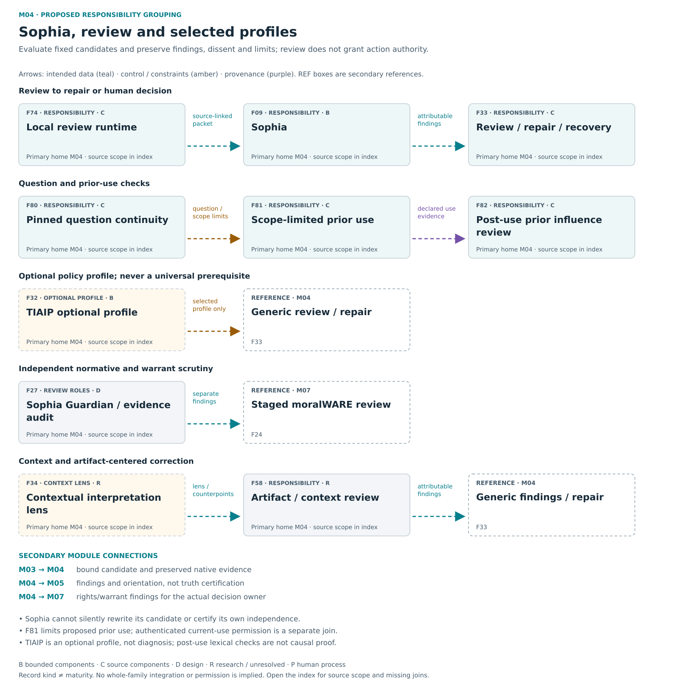

# M04 — Sophia / review / profiles

[Atlas index](../README.md) · [Placement ledger](../PLACEMENT_LEDGER.md)

Fixed-candidate assessment, question/prior checks, findings and review repair.

**Placement status:** proposed editorial responsibility grouping, not an implemented package or service-owner map. Primary cards below retain different record kinds. Diagram arrows are declared intended relations unless explicitly marked source-connected.

[Scalable SVG](../svg/04-sophia.svg) · [Text alternative](../TEXT_ALTERNATIVES.md#04-sophia)

## F09 — Sophia

**Kind:** capability — fixed-candidate evaluation.
**Primary home:** M04. proposed editorial responsibility grouping; not a claim of current package or service ownership.

Evaluate a fixed candidate with attributable findings, declared checks, limitations and dissent.

**Reported scope:** bounded_evidence. Selected evaluator connections have bounded evidence; live usefulness, independence and distributed review remain unproved.
**Source presence:** selected current or historical source described
**Whole-family / record integration:** not established in this edition
**Specific join or documentary obligation:** Establish live-model usefulness, current-policy handling and genuinely attributable distributed review.

**Boundary:** Cannot rewrite candidate or grant itself action authority.
**Deciding owner:** The relevant local task/action owner under accepted controls and affected rights; exact current service binding is not established by this public description.

**Description type:** preserved functional description; not an implemented API specification
- Input / context: Candidate/evidence/controls
- Output / record: attributable evaluation report
- Intended reader or consumer: Synthesis, Atlas and the relevant human or protected-action decision owner.
- Interface limit: exact current producer/validator/consumer contract remains to be traced where not established

**Classification note:** Retain attributable evaluation of fixed candidates, not a free-standing truth authority.

**Secondary editorial associations:** [F07](M03.md#F07) in M03; [F10](M05.md#F10) in M05; [F27](M04.md#F27) in M04; [F80](M04.md#F80) in M04.

**Logical source anchor:** `FAMILY_GUIDE.en.md#F09` in the bound R5.1 English snapshot. This is intentionally not a relative hyperlink until its publication destination is settled. The preserved source description is embedded in the public JSON ledger; it is documentation, not an execution receipt.

## F27 — Guardian and evidence auditor

**Kind:** crosscutting_responsibility — separated review roles.
**Primary home:** M04. proposed editorial responsibility grouping; not a claim of current package or service ownership.

Separate normative review from independent scrutiny of the warrant and framing behind a decision.

**Reported scope:** design. A preserved design responsibility or proposed connection; complete intended behavior is not demonstrated.
**Source presence:** family-specific source completeness not established by this label
**Whole-family / record integration:** not established in this edition
**Specific join or documentary obligation:** Demonstrate separately attributed review of norms and evidence rather than self-approval under role aliases.

**Boundary:** No duplicated same-agent vote masquerading as independent review.
**Deciding owner:** The relevant local task/action owner under accepted controls and affected rights; exact current service binding is not established by this public description.

**Description type:** preserved functional description; not an implemented API specification
- Input / context: Candidate/report/baseline
- Output / record: distinct findings and uncertainty
- Intended reader or consumer: The staged normative workflow and independently authorized decision owner.
- Interface limit: exact current producer/validator/consumer contract remains to be traced where not established

**Classification note:** Sophia implements the proposed Guardian role; the Evidence Auditor is distinct. Do not count a second Guardian plus Sophia vote as independence.

**Secondary editorial associations:** [F09](M04.md#F09) in M04; [F24](M07.md#F24) in M07; [F26](M07.md#F26) in M07; [F61](M06.md#F61) in M06.

**Logical source anchor:** `FAMILY_GUIDE.en.md#F27` in the bound R5.1 English snapshot. This is intentionally not a relative hyperlink until its publication destination is settled. The preserved source description is embedded in the public JSON ledger; it is documentation, not an execution receipt.

## F32 — TIAIP optional profile

**Kind:** optional_profile_or_extension — specialized review profile and separate donors.
**Primary home:** M04. proposed editorial responsibility grouping; not a claim of current package or service ownership.

Offer a trauma-informed review profile through a generic policy interface while keeping profile, application and adapter identities distinct.

**Reported scope:** bounded_evidence. An exact captured-context synthetic increment has bounded evidence; clinical adequacy and full installed integration are excluded.
**Source presence:** selected current or historical source described
**Whole-family / record integration:** not established in this edition
**Specific join or documentary obligation:** Join actual user profile selection, disclosure, persisted repair-use state and exact compatible host contracts.

**Boundary:** Optional trauma-informed review is not diagnosis or clinical validation.
**Deciding owner:** The relevant local task/action owner under accepted controls and affected rights; exact current service binding is not established by this public description.

**Description type:** preserved functional description; not an implemented API specification
- Input / context: Captured context + selected profile
- Output / record: findings/human decision/repair/checkpoint
- Intended reader or consumer: The optional selected generic review-policy consumer.
- Interface limit: exact current producer/validator/consumer contract remains to be traced where not established

**Classification note:** Keep TIAIP profile, standalone application, thin module and captured-context increment separate; none inherits another's maturity.

**Secondary editorial associations:** [F31](M07.md#F31) in M07; [F33](M04.md#F33) in M04; [F45](M07.md#F45) in M07; [F58](M04.md#F58) in M04.

**Logical source anchor:** `FAMILY_GUIDE.en.md#F32` in the bound R5.1 English snapshot. This is intentionally not a relative hyperlink until its publication destination is settled. The preserved source description is embedded in the public JSON ledger; it is documentation, not an execution receipt.

## F33 — Provider neutral review and recovery

**Kind:** capability — generic review repair and recovery contracts.
**Primary home:** M04. proposed editorial responsibility grouping; not a claim of current package or service ownership.

Preserve findings, human decisions, one-successor repair lineage, revalidation, decision-bound export and recovery.

**Reported scope:** source_components. Selected current or historical source mechanisms exist; full current integration and user benefit are not established for this family.
**Source presence:** selected current or historical source described
**Whole-family / record integration:** not established in this edition
**Specific join or documentary obligation:** Map generic review independently of optional profiles and demonstrate durable one-successor, restart and cancellation boundaries.

**Boundary:** A plugin cannot rewrite finalized history. Missing/error evidence is not a clean verdict; export approval is not public release and claimed repair is not proof of improvement. Generic review must not require a clinical profile or become a blanket ban on authorized delegation.
**Deciding owner:** The relevant local task/action owner under accepted controls and affected rights; exact current service binding is not established by this public description.

**Description type:** preserved functional description; not an implemented API specification
- Input / context: Candidate/review/decision
- Output / record: successor and recovery receipts
- Intended reader or consumer: Human review, native re-evaluation, repair successor and decision-bound export consumers.
- Interface limit: exact current producer/validator/consumer contract remains to be traced where not established

**Sense distinction:** Open Web Steward is one historical local static review/repair/export workbench, not a crawler or a provider adapter.

**Classification note:** Retain generic lifecycle semantics independently of the optional TIAIP profile and historical workbench donors.

**Secondary editorial associations:** [F25](M07.md#F25) in M07; [F31](M07.md#F31) in M07; [F32](M04.md#F32) in M04; [F35](M06.md#F35) in M06; [F62](M06.md#F62) in M06.

**Logical source anchor:** `FAMILY_GUIDE.en.md#F33` in the bound R5.1 English snapshot. This is intentionally not a relative hyperlink until its publication destination is settled. The preserved source description is embedded in the public JSON ledger; it is documentation, not an execution receipt.

## F34 — Contextual interpretation lens

**Kind:** research_proposal — contextual interpretation lens.
**Primary home:** M04. proposed editorial responsibility grouping; not a claim of current package or service ownership.

Expose context, jurisdiction, translation loss, counterpoints and opportunities for correction.

**Reported scope:** research_or_unresolved. A preserved research, optional or incompletely reconciled responsibility; exact current implementation and benefit remain unresolved.
**Source presence:** family-specific source completeness not established by this label
**Whole-family / record integration:** not established in this edition
**Specific join or documentary obligation:** Identify the actual contextual-review consumer and preserve contrary interpretations through correction.

**Boundary:** Cross-cutting lens, not sovereign subsystem or cultural certification.
**Deciding owner:** The relevant local task/action owner under accepted controls and affected rights; exact current service binding is not established by this public description.

**Description type:** preserved functional description; not an implemented API specification
- Input / context: Evidence/lens/context
- Output / record: attributable interpretation and limits
- Intended reader or consumer: Reviewers and the correction/interpretation workflow.
- Interface limit: exact current producer/validator/consumer contract remains to be traced where not established

**Classification note:** EIR has declared contextual/counterpoint duties in a historical queued register; do not infer an installed reviewer from the label.

**Secondary editorial associations:** [F09](M04.md#F09) in M04; [F24](M07.md#F24) in M07; [F31](M07.md#F31) in M07; [F58](M04.md#F58) in M04.

**Logical source anchor:** `FAMILY_GUIDE.en.md#F34` in the bound R5.1 English snapshot. This is intentionally not a relative hyperlink until its publication destination is settled. The preserved source description is embedded in the public JSON ledger; it is documentation, not an execution receipt.

## F58 — Artifact centered contextual review

**Kind:** crosscutting_responsibility — artifact-centered contextual review.
**Primary home:** M04. proposed editorial responsibility grouping; not a claim of current package or service ownership.

Review sources, depiction, accessibility, equivalence and translation loss with attributable findings and correction.

**Reported scope:** research_or_unresolved. A preserved research, optional or incompletely reconciled responsibility; exact current implementation and benefit remain unresolved.
**Source presence:** family-specific source completeness not established by this label
**Whole-family / record integration:** not established in this edition
**Specific join or documentary obligation:** Connect contextual and accessibility findings to attributable generic review and repair.

**Boundary:** Not profiling of reviewer/user or certification of a culture.
**Deciding owner:** The relevant local task/action owner under accepted controls and affected rights; exact current service binding is not established by this public description.

**Description type:** preserved functional description; not an implemented API specification
- Input / context: Artifact/context/countervoices
- Output / record: findings and possible repair
- Intended reader or consumer: Generic finding, review and repair consumers.
- Interface limit: exact current producer/validator/consumer contract remains to be traced where not established

**Classification note:** Review duties concern artifacts and their source/context/translation loss, not identity classification; connect to existing review roles.

**Secondary editorial associations:** [F11](M05.md#F11) in M05; [F33](M04.md#F33) in M04; [F34](M04.md#F34) in M04; [F57](M05.md#F57) in M05; [F67](M01.md#F67) in M01.

**Logical source anchor:** `FAMILY_GUIDE.en.md#F58` in the bound R5.1 English snapshot. This is intentionally not a relative hyperlink until its publication destination is settled. The preserved source description is embedded in the public JSON ledger; it is documentation, not an execution receipt.

## F74 — Local review runtime

**Kind:** capability — historical local review runtime.
**Primary home:** M04. proposed editorial responsibility grouping; not a claim of current package or service ownership.

Turn selected evidence and candidate outputs into bounded inspectable review artifacts.

**Reported scope:** source_components. Selected current or historical source mechanisms exist; full current integration and user benefit are not established for this family.
**Source presence:** selected current or historical source described
**Whole-family / record integration:** not established in this edition
**Specific join or documentary obligation:** Join source selection, local runtime and diagnostic packet consumers to the active task workflow.

**Boundary:** Output supports review, not final truth/action authority.
**Deciding owner:** The relevant local task/action owner under accepted controls and affected rights; exact current service binding is not established by this public description.

**Description type:** preserved functional description; not an implemented API specification
- Input / context: Sources/candidates/declared runtime
- Output / record: source-linked packets and review views
- Intended reader or consumer: Human or downstream review through the active task workflow.
- Interface limit: exact current producer/validator/consumer contract remains to be traced where not established

**Classification note:** Retain the source-backed local review workflow; review-support outputs are not final authority.

**Secondary editorial associations:** [F07](M03.md#F07) in M03; [F09](M04.md#F09) in M04; [F33](M04.md#F33) in M04; [F58](M04.md#F58) in M04.

**Logical source anchor:** `FAMILY_GUIDE.en.md#F74` in the bound R5.1 English snapshot. This is intentionally not a relative hyperlink until its publication destination is settled. The preserved source description is embedded in the public JSON ledger; it is documentation, not an execution receipt.

## F80 — Pinned question continuity

**Kind:** capability — historical question continuity audit.
**Primary home:** M04. proposed editorial responsibility grouping; not a claim of current package or service ownership.

Compare the original question with navigation and prior-use artifacts to expose drift separately from answer quality.

**Reported scope:** source_components. Selected current or historical source mechanisms exist; full current integration and user benefit are not established for this family.
**Source presence:** selected current or historical source described
**Whole-family / record integration:** not established in this edition
**Specific join or documentary obligation:** Join question-continuity checks to the current task consumer while preserving authorized successor questions.

**Boundary:** No result grants execution, memory write, publication, truth or broader prior rights.
**Deciding owner:** The relevant local task/action owner under accepted controls and affected rights; exact current service binding is not established by this public description.

**Description type:** preserved functional description; not an implemented API specification
- Input / context: Original or explicitly revised question and navigation/prior-query artifacts
- Output / record: Question-continuity diagnostic identifying drift or an attributable authorized change
- Intended reader or consumer: Current task navigation, prior routing and Sophia review.
- Interface limit: exact current producer/validator/consumer contract remains to be traced where not established

**Classification note:** Exact historical audit source exists; lexical continuity diagnostics are not semantic correctness proof.

**Secondary editorial associations:** [F04](M01.md#F04) in M01; [F09](M04.md#F09) in M04; [F47](M02.md#F47) in M02; [F81](M04.md#F81) in M04.

**Logical source anchor:** `FAMILY_GUIDE.en.md#F80` in the bound R5.1 English snapshot. This is intentionally not a relative hyperlink until its publication destination is settled. The preserved source description is embedded in the public JSON ledger; it is documentation, not an execution receipt.

## F81 — Scope limited prior use

**Kind:** capability — historical bounded prior-use routing.
**Primary home:** M04. proposed editorial responsibility grouping; not a claim of current package or service ownership.

Limit selected priors to their permitted purpose and preserve a non-actionable posture when authority is missing.

**Reported scope:** source_components. Selected current or historical source mechanisms exist; full current integration and user benefit are not established for this family.
**Source presence:** selected current or historical source described
**Whole-family / record integration:** not established in this edition
**Specific join or documentary obligation:** Bind retrieval to authenticated current-use limits before any prior reaches an answer-producing consumer.

**Boundary:** Possession of a prior is not current permission to use it.
**Deciding owner:** The actual current-use authority decides which selected prior may reach the answer consumer.

**Description type:** preserved functional description; not an implemented API specification
- Input / context: Selected prior candidates and current allowed-use constraints
- Output / record: Limited prior-use posture such as background or answer support, or non-actionable handling when authority is missing
- Intended reader or consumer: The exact answer-producing or background-context consumer, subject to authenticated current use.
- Interface limit: exact current producer/validator/consumer contract remains to be traced where not established

**Classification note:** Exact historical source caps use at allowed posture; current grant/consumer binding still needs tracing.

**Secondary editorial associations:** [F09](M04.md#F09) in M04; [F13](M05.md#F13) in M05; [F14](M05.md#F14) in M05; [F80](M04.md#F80) in M04; [F84](M05.md#F84) in M05.

**Logical source anchor:** `FAMILY_GUIDE.en.md#F81` in the bound R5.1 English snapshot. This is intentionally not a relative hyperlink until its publication destination is settled. The preserved source description is embedded in the public JSON ledger; it is documentation, not an execution receipt.

## F82 — Post use prior influence review

**Kind:** capability — historical post-use prior audit.
**Primary home:** M04. proposed editorial responsibility grouping; not a claim of current package or service ownership.

Inspect question continuity, returned identity and declared prior influence while keeping lexical heuristics distinct from causal proof.

**Reported scope:** source_components. Selected current or historical source mechanisms exist; full current integration and user benefit are not established for this family.
**Source presence:** selected current or historical source described
**Whole-family / record integration:** not established in this edition
**Specific join or documentary obligation:** Preserve post-use review and evaluate usefulness without treating lexical overlap as causal proof.

**Boundary:** Word overlap is not proof of causal influence or semantic quality.
**Deciding owner:** The relevant local task/action owner under accepted controls and affected rights; exact current service binding is not established by this public description.

**Description type:** preserved functional description; not an implemented API specification
- Input / context: Question, returned track identity and declared evidence of prior use
- Output / record: Post-use influence review with heuristic limits stated
- Intended reader or consumer: Sophia/Atlas explanation and any separately authorized correction.
- Interface limit: exact current producer/validator/consumer contract remains to be traced where not established

**Classification note:** Exact source audits returned identity and heuristic influence; lexical overlap is not causal influence proof.

**Secondary editorial associations:** [F09](M04.md#F09) in M04; [F13](M05.md#F13) in M05; [F63](M06.md#F63) in M06; [F81](M04.md#F81) in M04.

**Logical source anchor:** `FAMILY_GUIDE.en.md#F82` in the bound R5.1 English snapshot. This is intentionally not a relative hyperlink until its publication destination is settled. The preserved source description is embedded in the public JSON ledger; it is documentation, not an execution receipt.
