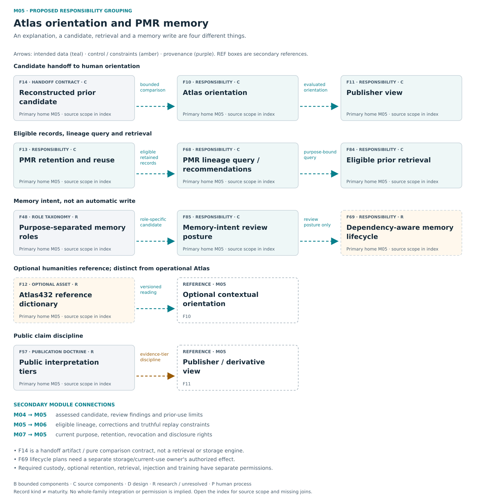

# M05 — Atlas / PMR / memory

[Atlas index](../README.md) · [Placement ledger](../PLACEMENT_LEDGER.md)

Orientation and separately governed retention, retrieval and lifecycle.

**Placement status:** proposed editorial responsibility grouping, not an implemented package or service-owner map. Primary cards below retain different record kinds. Diagram arrows are declared intended relations unless explicitly marked source-connected.

[Scalable SVG](../svg/05-atlas.svg) · [Text alternative](../TEXT_ALTERNATIVES.md#05-atlas)

## F10 — Atlas orientation

**Kind:** capability — presentation and proposed prior orientation.
**Primary home:** M05. proposed editorial responsibility grouping; not a claim of current package or service ownership.

Explain results and disagreement and orient human decisions through eligible prior comparison.

**Reported scope:** source_components. Selected current or historical source mechanisms exist; full current integration and user benefit are not established for this family.
**Source presence:** selected current or historical source described
**Whole-family / record integration:** not established in this edition
**Specific join or documentary obligation:** Connect reconstruction candidates to authorized prior comparison and an understandable result display.

**Boundary:** No automatic memory write or truth certification.
**Deciding owner:** The relevant local task/action owner under accepted controls and affected rights; exact current service binding is not established by this public description.

**Description type:** preserved functional description; not an implemented API specification
- Input / context: Bound candidate plus Sophia findings/eligible priors
- Output / record: presentation and orientation
- Intended reader or consumer: The human reader and a separately authorized next-task or prior-use route.
- Interface limit: exact current producer/validator/consumer contract remains to be traced where not established

**Sense distinction:** Operational Atlas differs from the optional Atlas432 humanities dictionary.

**Classification note:** Current rendering and intended prior orientation are related but not equally established; Atlas is not memory custody.

**Secondary editorial associations:** [F09](M04.md#F09) in M04; [F11](M05.md#F11) in M05; [F13](M05.md#F13) in M05; [F84](M05.md#F84) in M05; [F85](M05.md#F85) in M05.

**Logical source anchor:** `FAMILY_GUIDE.en.md#F10` in the bound R5.1 English snapshot. This is intentionally not a relative hyperlink until its publication destination is settled. The preserved source description is embedded in the public JSON ledger; it is documentation, not an execution receipt.

## F11 — Publisher view

**Kind:** capability — presentation facet and export view.
**Primary home:** M05. proposed editorial responsibility grouping; not a claim of current package or service ownership.

Present or export fixed evidence and continuity without silently changing the source record.

**Reported scope:** source_components. Selected current or historical source mechanisms exist; full current integration and user benefit are not established for this family.
**Source presence:** selected current or historical source described
**Whole-family / record integration:** not established in this edition
**Specific join or documentary obligation:** Preserve current disclosure and derivative rights at release, including the relationship between findings and human posture.

**Boundary:** Presentation is not original custody or publication permission.
**Deciding owner:** The relevant local task/action owner under accepted controls and affected rights; exact current service binding is not established by this public description.

**Description type:** preserved functional description; not an implemented API specification
- Input / context: Evaluated record
- Output / record: presentation or permitted derivative
- Intended reader or consumer: The intended reader or recipient of a separately authorized derivative.
- Interface limit: exact current producer/validator/consumer contract remains to be traced where not established

**Classification note:** Publisher is a facet of Atlas and existing export consumers, not a new controller or permission to publish.

**Secondary editorial associations:** [F10](M05.md#F10) in M05; [F33](M04.md#F33) in M04; [F37](M08.md#F37) in M08; [F57](M05.md#F57) in M05; [F67](M01.md#F67) in M01.

**Logical source anchor:** `FAMILY_GUIDE.en.md#F11` in the bound R5.1 English snapshot. This is intentionally not a relative hyperlink until its publication destination is settled. The preserved source description is embedded in the public JSON ledger; it is documentation, not an execution receipt.

## F12 — Atlas432 contextual dictionary

**Kind:** optional_profile_or_extension — contextual reference dictionary.
**Primary home:** M05. proposed editorial responsibility grouping; not a claim of current package or service ownership.

Offer optional source-versioned humanities readings with competing interpretations and explicit refusal when support is inadequate.

**Reported scope:** research_or_unresolved. Selected historical dictionary source exists, including a repaired successor; complete dictionary interpretation and current Brain integration remain unestablished.
**Source presence:** selected historical source described; not full current adoption
**Whole-family / record integration:** not established in this edition
**Specific join or documentary obligation:** Pin the optional dictionary and each source-specific sense; reconcile its actual consumer without equating it to operational Atlas.

**Boundary:** Contextual readings are not person classifications, moral ranks or calibrated probabilities.
**Deciding owner:** The relevant local task/action owner under accepted controls and affected rights; exact current service binding is not established by this public description.

**Description type:** preserved functional description; not an implemented API specification
- Input / context: Contextual lookup
- Output / record: reference material, alternatives and limitations
- Intended reader or consumer: An explicitly selected optional interpretation workflow, not person classification.
- Interface limit: exact current producer/validator/consumer contract remains to be traced where not established

**Sense distinction:** Former 432 Atlas and Rosetta 432 usage must be read with the source-specific sense; relation scores are not Rosetta posteriors.

**Classification note:** Keep Atlas432 as an optional versioned humanities dictionary distinct from operational Atlas; do not require it for core cognition.

**Secondary editorial associations:** [F10](M05.md#F10) in M05; [F15](M03.md#F15) in M03; [F51](M09.md#F51) in M09; [F52](M09.md#F52) in M09.

**Logical source anchor:** `FAMILY_GUIDE.en.md#F12` in the bound R5.1 English snapshot. This is intentionally not a relative hyperlink until its publication destination is settled. The preserved source description is embedded in the public JSON ledger; it is documentation, not an execution receipt.

## F13 — PMR retention and reuse

**Kind:** capability — optional governed prior retention and reuse.
**Primary home:** M05. proposed editorial responsibility grouping; not a claim of current package or service ownership.

Govern optional retention, expiry, revocation and eligible cross-task use of prior material.

**Reported scope:** source_components. Reference and bounded lifecycle components exist; authenticated durable native retention and reuse remain in implementation.
**Source presence:** selected current or historical source described
**Whole-family / record integration:** not established in this edition
**Specific join or documentary obligation:** Connect durable owner-backed storage to authorized retrieval and actual current-task use.

**Boundary:** Mandatory custody, optional retention, retrieval, injection and training have separate permissions.
**Deciding owner:** The authenticated native retention/current-use owner, subject to affected rights and user policy.

**Description type:** preserved functional description; not an implemented API specification
- Input / context: Human-governed eligible candidate
- Output / record: retained/revoked/expired prior
- Intended reader or consumer: Authorized retrieval/current-use consumers and separately governed storage owners.
- Interface limit: exact current producer/validator/consumer contract remains to be traced where not established

**Classification note:** Retain PMR responsibility with opt-in rights and lifecycle boundaries; in-memory/synthetic mechanisms do not establish durable reuse.

**Secondary editorial associations:** [F14](M05.md#F14) in M05; [F35](M06.md#F35) in M06; [F48](M05.md#F48) in M05; [F68](M05.md#F68) in M05; [F69](M05.md#F69) in M05; [F84](M05.md#F84) in M05.

**Logical source anchor:** `FAMILY_GUIDE.en.md#F13` in the bound R5.1 English snapshot. This is intentionally not a relative hyperlink until its publication destination is settled. The preserved source description is embedded in the public JSON ledger; it is documentation, not an execution receipt.

## F14 — Retrosynthesis prior candidate

**Kind:** schema_or_vocabulary — candidate handoff and comparison interface.
**Primary home:** M05. proposed editorial responsibility grouping; not a claim of current package or service ownership.

Carry an explicit reconstructed candidate into bounded Atlas prior comparison without implying retrieval or persistence.

**Reported scope:** source_components. A supplied-prior comparison leaf exists; it does not perform lookup, grant authentication, persistence or provider-context injection.
**Source presence:** selected current or historical source described
**Whole-family / record integration:** Consumer-specific adoption must be established; the contract itself is not a standalone runtime module.
**Specific join or documentary obligation:** Bind exact prior bytes, authenticated current use, custody transaction, Atlas display and retained influence evidence.

**Boundary:** A comparison recommendation or reference receipt does not perform its transaction.
**Deciding owner:** The bounded comparator has no retention or dispatch authority; those remain with separate native owners.

**Description type:** Data, meaning or handoff contract description; not an autonomous component or complete implemented API.
- Input / context: Declared reconstruction candidate and explicitly supplied eligible prior bytes
- Output / record: Bounded comparison result, with missing authority or integration visible
- Intended reader or consumer: An Atlas comparison/display consumer; the candidate itself makes no storage or model call.
- Interface limit: exact current producer/validator/consumer contract remains to be traced where not established

**Classification note:** Place RetrosynthesisSeedCandidate on the CoherenceLattice to Sophia to Atlas handoff; it is an artifact/interface with comparison support, not an autonomous organ.

**Secondary editorial associations:** [F08](M03.md#F08) in M03; [F10](M05.md#F10) in M05; [F13](M05.md#F13) in M05; [F81](M04.md#F81) in M04; [F85](M05.md#F85) in M05.

**Logical source anchor:** `FAMILY_GUIDE.en.md#F14` in the bound R5.1 English snapshot. This is intentionally not a relative hyperlink until its publication destination is settled. The preserved source description is embedded in the public JSON ledger; it is documentation, not an execution receipt.

## F48 — Purpose separated memory roles

**Kind:** crosscutting_responsibility — purpose-separated memory design roles.
**Primary home:** M05. proposed editorial responsibility grouping; not a claim of current package or service ownership.

Distinguish working, episodic, semantic, procedural and prospective memory with separate owners, retention and current-use rules.

**Reported scope:** research_or_unresolved. A preserved research, optional or incompletely reconciled responsibility; exact current implementation and benefit remain unresolved.
**Source presence:** family-specific source completeness not established by this label
**Whole-family / record integration:** not established in this edition
**Specific join or documentary obligation:** Identify each memory role's data model, owner, lifecycle and actual eligible-use route.

**Boundary:** Memory roles do not imply permission to train weights or retain everything.
**Deciding owner:** The relevant local task/action owner under accepted controls and affected rights; exact current service binding is not established by this public description.

**Description type:** preserved functional description; not an implemented API specification
- Input / context: Authorized observations/goals/results
- Output / record: role-specific memory candidates and later purpose-bound use
- Intended reader or consumer: The task/planning/retrieval consumer appropriate to that memory role.
- Interface limit: exact current producer/validator/consumer contract remains to be traced where not established

**Classification note:** Working, episodic, semantic, procedural and prospective memory are source-declared responsibility distinctions, not five proven stores and not just empty names.

**Secondary editorial associations:** [F13](M05.md#F13) in M05; [F47](M02.md#F47) in M02; [F62](M06.md#F62) in M06; [F68](M05.md#F68) in M05; [F69](M05.md#F69) in M05.

**Logical source anchor:** `FAMILY_GUIDE.en.md#F48` in the bound R5.1 English snapshot. This is intentionally not a relative hyperlink until its publication destination is settled. The preserved source description is embedded in the public JSON ledger; it is documentation, not an execution receipt.

## F57 — Public interpretation tiers

**Kind:** crosscutting_responsibility — public evidence-tier doctrine.
**Primary home:** M05. proposed editorial responsibility grouping; not a claim of current package or service ownership.

Distinguish aesthetic invitation, explanatory interpretation and verifiable technical claims in public presentation.

**Reported scope:** research_or_unresolved. A preserved research, optional or incompletely reconciled responsibility; exact current implementation and benefit remain unresolved.
**Source presence:** family-specific source completeness not established by this label
**Whole-family / record integration:** Not applicable as a standalone module; assess the relevant process and concrete consumers in their own scopes.
**Specific join or documentary obligation:** Connect claim-tier labels to source checks in actual public derivatives.

**Boundary:** Art or analogy cannot migrate into empirical proof by presentation.
**Deciding owner:** Relevant human maintainers and the actual existing action or artifact owners; this entry establishes no separate runtime authority.

**Description type:** preserved functional description; not an implemented API specification
- Input / context: Public artifact/claim
- Output / record: appropriate evidence level and limitations
- Intended reader or consumer: Public presentation and derivative review.
- Interface limit: exact current producer/validator/consumer contract remains to be traced where not established

**Classification note:** Wonder/Understanding/Verification are publication and interpretation tiers, not a runtime classifier or an independent organ.

**Secondary editorial associations:** [F11](M05.md#F11) in M05; [F34](M04.md#F34) in M04; [F54](M09.md#F54) in M09; [F58](M04.md#F58) in M04.

**Logical source anchor:** `FAMILY_GUIDE.en.md#F57` in the bound R5.1 English snapshot. This is intentionally not a relative hyperlink until its publication destination is settled. The preserved source description is embedded in the public JSON ledger; it is documentation, not an execution receipt.

## F68 — PMR lineage query and recommendations

**Kind:** capability — historical provenance query and recommendation mechanism.
**Primary home:** M05. proposed editorial responsibility grouping; not a claim of current package or service ownership.

Index eligible provenance and dependencies and recommend purpose-specific retention without making memory admission or deletion decisions.

**Reported scope:** source_components. Selected current or historical source mechanisms exist; full current integration and user benefit are not established for this family.
**Source presence:** selected current or historical source described
**Whole-family / record integration:** not established in this edition
**Specific join or documentary obligation:** Connect dependency queries and purpose-relative utility recommendations to the separate owner-approved memory route.

**Boundary:** Utility is not permission, truth, deletion, training or policy installation.
**Deciding owner:** The query/index mechanism recommends; the authenticated memory owner decides any lifecycle effect.

**Description type:** preserved functional description; not an implemented API specification
- Input / context: Eligible provenance records, dependencies and a declared query or retention purpose
- Output / record: Index/query result and purpose-relative retention recommendation
- Intended reader or consumer: Atlas retrieval and the separate PMR disposition/retention decision route.
- Interface limit: exact current producer/validator/consumer contract remains to be traced where not established

**Classification note:** Actual historical indexing/query/scoring exists; recommendation is not memory admission or deletion.

**Secondary editorial associations:** [F13](M05.md#F13) in M05; [F48](M05.md#F48) in M05; [F69](M05.md#F69) in M05; [F84](M05.md#F84) in M05; [F85](M05.md#F85) in M05.

**Logical source anchor:** `FAMILY_GUIDE.en.md#F68` in the bound R5.1 English snapshot. This is intentionally not a relative hyperlink until its publication destination is settled. The preserved source description is embedded in the public JSON ledger; it is documentation, not an execution receipt.

## F69 — Dependency aware memory lifecycle

**Kind:** research_proposal — memory lifecycle and replay design with planner source.
**Primary home:** M05. proposed editorial responsibility grouping; not a claim of current package or service ownership.

Prune, compress, archive, quarantine or revoke eligible material while preserving required ancestry and truthful replay limits.

**Reported scope:** research_or_unresolved. A preserved research, optional or incompletely reconciled responsibility; exact current implementation and benefit remain unresolved.
**Source presence:** family-specific source completeness not established by this label
**Whole-family / record integration:** not established in this edition
**Specific join or documentary obligation:** Connect pure lifecycle recommendations to actual persistence and distributed copies, preserving dependencies and truthful erasure limits.

**Boundary:** Revocation cannot guarantee erasure of already disclosed copies; hash-only is not content replay.
**Deciding owner:** The actual storage/current-use owner applies permitted lifecycle effects and propagates applicable restrictions.

**Description type:** preserved functional description; not an implemented API specification
- Input / context: Retained graph, current permissions, replay needs, revocations and proposed disposition
- Output / record: Lifecycle plan and, only through a separate authorized owner, a recorded retention or revocation effect
- Intended reader or consumer: The real storage/current-use owner and affected descendant consumers after a permitted change.
- Interface limit: exact current producer/validator/consumer contract remains to be traced where not established

**Sense distinction:** Foundational selective consolidation preserves minimal sufficient lineage, permits governed pruning and reopens context-invalidated procedures; the complete native mechanism remains unproved.

**Classification note:** Preserve dependency-aware revocation/replay research and actual pure recommendation source separately from lifecycle effects.

**Secondary editorial associations:** [F13](M05.md#F13) in M05; [F43](M09.md#F43) in M09; [F48](M05.md#F48) in M05; [F66](M06.md#F66) in M06; [F68](M05.md#F68) in M05.

**Logical source anchor:** `FAMILY_GUIDE.en.md#F69` in the bound R5.1 English snapshot. This is intentionally not a relative hyperlink until its publication destination is settled. The preserved source description is embedded in the public JSON ledger; it is documentation, not an execution receipt.

## F84 — Eligible prior retrieval

**Kind:** capability — historical prior retrieval and orientation.
**Primary home:** M05. proposed editorial responsibility grouping; not a claim of current package or service ownership.

Find prior candidates with scope, allowed-use reasons, provenance and a trace of the proposed use.

**Reported scope:** source_components. Selected current or historical source mechanisms exist; full current integration and user benefit are not established for this family.
**Source presence:** selected current or historical source described
**Whole-family / record integration:** not established in this edition
**Specific join or documentary obligation:** Replace implicit legacy storage assumptions with current owner custody and disclosure checks on retrieval.

**Boundary:** No result grants execution, memory write, publication, truth or broader prior rights.
**Deciding owner:** The retrieval owner checks scope and disclosure; returned material does not authorize its use.

**Description type:** preserved functional description; not an implemented API specification
- Input / context: Task/prior query, candidate records, scope and allowed-use reasons
- Output / record: Eligible prior candidate packet with provenance and a proposed-use trace
- Intended reader or consumer: Atlas orientation and the scope-limited prior-use route.
- Interface limit: exact current producer/validator/consumer contract remains to be traced where not established

**Classification note:** Exact Atlas retrieval source exists; current custody/disclosure-safe equivalence remains unresolved.

**Secondary editorial associations:** [F10](M05.md#F10) in M05; [F13](M05.md#F13) in M05; [F68](M05.md#F68) in M05; [F81](M04.md#F81) in M04; [F85](M05.md#F85) in M05.

**Logical source anchor:** `FAMILY_GUIDE.en.md#F84` in the bound R5.1 English snapshot. This is intentionally not a relative hyperlink until its publication destination is settled. The preserved source description is embedded in the public JSON ledger; it is documentation, not an execution receipt.

## F85 — Memory intent review posture

**Kind:** capability — historical memory disposition posture.
**Primary home:** M05. proposed editorial responsibility grouping; not a claim of current package or service ownership.

Classify proposed memory handling as pending, candidate, quarantine, rejection or more-evidence without performing the storage action.

**Reported scope:** source_components. Selected current or historical source mechanisms exist; full current integration and user benefit are not established for this family.
**Source presence:** selected current or historical source described
**Whole-family / record integration:** not established in this edition
**Specific join or documentary obligation:** Connect candidate memory posture to a separate authorized PMR decision and later eligible use.

**Boundary:** No result grants execution, memory write, publication, truth or broader prior rights.
**Deciding owner:** The disposition producer recommends a posture; a separate authenticated memory owner decides the transaction.

**Description type:** preserved functional description; not an implemented API specification
- Input / context: Memory intent, proposed route and grounding/review evidence
- Output / record: Pending, retrieval-candidate, quarantine/reject, more-evidence or long-term-candidate posture
- Intended reader or consumer: A separately authorized PMR decision owner, not a direct memory write.
- Interface limit: exact current producer/validator/consumer contract remains to be traced where not established

**Classification note:** Source emits candidate/review/quarantine posture; separate authorized PMR admission and later use are not performed by a posture.

**Secondary editorial associations:** [F10](M05.md#F10) in M05; [F13](M05.md#F13) in M05; [F33](M04.md#F33) in M04; [F68](M05.md#F68) in M05; [F84](M05.md#F84) in M05.

**Logical source anchor:** `FAMILY_GUIDE.en.md#F85` in the bound R5.1 English snapshot. This is intentionally not a relative hyperlink until its publication destination is settled. The preserved source description is embedded in the public JSON ledger; it is documentation, not an execution receipt.
