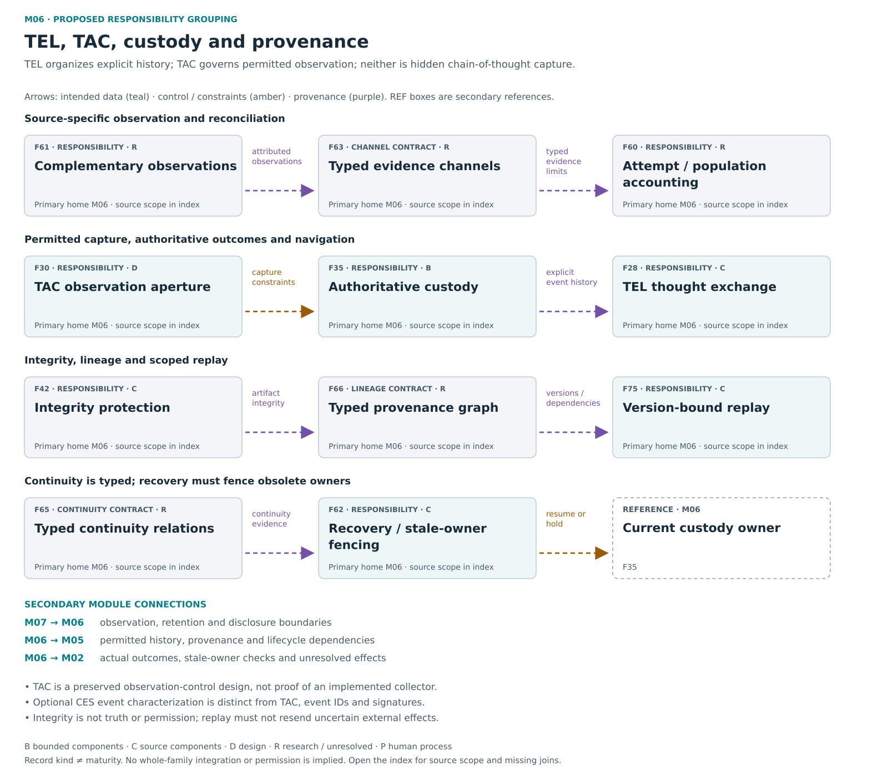

# M06 — TEL / TAC / custody / provenance

[Atlas index](../README.md) · [Placement ledger](../PLACEMENT_LEDGER.md)

Authoritative outcomes, permitted observation, typed lineage and recovery.

**Placement status:** proposed editorial responsibility grouping, not an implemented package or service-owner map. Primary cards below retain different record kinds. Diagram arrows are declared intended relations unless explicitly marked source-connected.

[Scalable SVG](../svg/06-tel-tac.svg) · [Text alternative](../TEXT_ALTERNATIVES.md#06-tel-tac)

## F28 — Thought Exchange Layer

**Kind:** capability — event and evidence chronology.
**Primary home:** M06. proposed editorial responsibility grouping; not a claim of current package or service ownership.

Preserve explicit stage, summary, event and evidence relationships for navigation and review.

**Reported scope:** source_components. Selected current or historical source mechanisms exist; full current integration and user benefit are not established for this family.
**Source presence:** selected current or historical source described
**Whole-family / record integration:** not established in this edition
**Specific join or documentary obligation:** Bind required graph, summary and event roles to actual stage history; do not use them as a substitute telemetry schema.

**Boundary:** Declared event history is not hidden chain-of-thought capture.
**Deciding owner:** The relevant local task/action owner under accepted controls and affected rights; exact current service binding is not established by this public description.

**Description type:** preserved functional description; not an implemented API specification
- Input / context: Supported events
- Output / record: ordered auditable chronology
- Intended reader or consumer: Atlas, inspection/export and supported replay navigation; custody remains original history.
- Interface limit: exact current producer/validator/consumer contract remains to be traced where not established

**Sense distinction:** TEL means explicit Thought Exchange history, not the Telemetry Aperture Controller.

**Classification note:** TEL is explicit declared event/graph evidence, not hidden model thought; required event, graph and summary artifacts remain distinct.

**Secondary editorial associations:** [F35](M06.md#F35) in M06; [F61](M06.md#F61) in M06; [F63](M06.md#F63) in M06; [F66](M06.md#F66) in M06.

**Logical source anchor:** `FAMILY_GUIDE.en.md#F28` in the bound R5.1 English snapshot. This is intentionally not a relative hyperlink until its publication destination is settled. The preserved source description is embedded in the public JSON ledger; it is documentation, not an execution receipt.

## F30 — Telemetry Aperture Controller

**Kind:** capability — source-declared telemetry controller design.
**Primary home:** M06. proposed editorial responsibility grouping; not a claim of current package or service ownership.

Govern permitted observation and sampling; separately preserve optional typed event characterization historically called CES.

**Reported scope:** design. A preserved design responsibility or proposed connection; complete intended behavior is not demonstrated.
**Source presence:** family-specific source completeness not established by this label
**Whole-family / record integration:** not established in this edition
**Specific join or documentary obligation:** Trace sampling controls into real authorized collection, coverage, retention and consumers; separately map optional CES event characterization.

**Boundary:** Increased sampling does not authorize retention, export or federation. Emergency scope/duration comes from an authorized owner or governance process; a model cannot declare itself new access.
**Deciding owner:** The relevant authorized observation owner or governance process defines scope, duration and emergency basis.

**Description type:** preserved functional description; not an implemented API specification
- Input / context: Authorized observation purpose, uncertainty, window and retention constraints; optional supplied event context
- Output / record: Proposed sampling/disclosure settings; separately, optional typed CES event features
- Intended reader or consumer: Permitted observation/retention consumers; CES features separately support event comparison.
- Interface limit: exact current producer/validator/consumer contract remains to be traced where not established

**Sense distinction:** TAC determines permitted observation resolution, windows and retention. Optional CES (Coherence Event Signatures) characterizes supplied event context for comparison and trace. Event identifiers, hashes, analytical measures and cryptographic signatures are distinct. Current CES integration remains unresolved and is not a local-pilot prerequisite.

**Classification note:** TAC is a substantive designed sampling/disclosure responsibility; historical policy simulation is not a live collector, but lack of one does not erase TAC.

**Secondary editorial associations:** [F28](M06.md#F28) in M06; [F29](M07.md#F29) in M07; [F45](M07.md#F45) in M07; [F61](M06.md#F61) in M06; [F63](M06.md#F63) in M06.

**Logical source anchor:** `FAMILY_GUIDE.en.md#F30` in the bound R5.1 English snapshot. This is intentionally not a relative hyperlink until its publication destination is settled. The preserved source description is embedded in the public JSON ledger; it is documentation, not an execution receipt.

## F35 — Authoritative custody

**Kind:** capability — authoritative task custody.
**Primary home:** M06. proposed editorial responsibility grouping; not a claim of current package or service ownership.

Retain task and attempt identity, actual outcomes, uncertainty, effective versions and correction history.

**Reported scope:** bounded_evidence. Selected native and portable custody paths have bounded evidence; full protected installed ownership remains separate.
**Source presence:** selected current or historical source described
**Whole-family / record integration:** not established in this edition
**Specific join or documentary obligation:** Demonstrate physical-node custody authority, restart, minimized retention and distributed reconciliation.

**Boundary:** Required custody is minimized and access controlled under declared retention/deletion rules; it does not authorize permanent rejected-payload capture. Credentials and root/task keys stay out of ordinary event logs and public provenance.
**Deciding owner:** The authoritative native custody owner with minimized, access-controlled retention and deletion duties.

**Description type:** preserved functional description; not an implemented API specification
- Input / context: Attempts and observed lifecycle events under an explicit capture and retention boundary
- Output / record: Minimized authoritative task history with original outcomes, versions, corrections and unknowns
- Intended reader or consumer: Inspection, reconciliation, reports and separately authorized downstream processing.
- Interface limit: exact current producer/validator/consumer contract remains to be traced where not established

**Classification note:** Retain operation/attempt/outcome accounting; custody is not optional cross-task memory.

**Secondary editorial associations:** [F04](M01.md#F04) in M01; [F22](M07.md#F22) in M07; [F28](M06.md#F28) in M06; [F47](M02.md#F47) in M02; [F60](M06.md#F60) in M06.

**Logical source anchor:** `FAMILY_GUIDE.en.md#F35` in the bound R5.1 English snapshot. This is intentionally not a relative hyperlink until its publication destination is settled. The preserved source description is embedded in the public JSON ledger; it is documentation, not an execution receipt.

## F42 — Integrity protection

**Kind:** crosscutting_responsibility — integrity mechanisms with current source adaptation.
**Primary home:** M06. proposed editorial responsibility grouping; not a claim of current package or service ownership.

Preserve exact-artifact integrity checks and versioned evidence boundaries while distinguishing integrity from truth and permission.

**Reported scope:** source_components. Selected current source includes adapted hashing, safe-path, closed-manifest, sidecar and archive-verification mechanisms. This is source presence, not new execution, installed acceptance or full historical-contract adoption.
**Source presence:** Selected current adapted integrity mechanisms identified by source inspection.
**Whole-family / record integration:** not established in this edition
**Specific join or documentary obligation:** Trace any remaining historical integrity contract and current deployment claim to its exact supported consumer and evidence; selected current mechanism presence alone is insufficient.

**Boundary:** Integrity does not establish semantic truth or permission.
**Deciding owner:** The relevant local task/action owner under accepted controls and affected rights; exact current service binding is not established by this public description.

**Description type:** preserved functional description; not an implemented API specification
- Input / context: Bound source/artifacts
- Output / record: integrity outcomes and retained failures
- Intended reader or consumer: Existing dossier and artifact-verification consumers; no separate IntegrityLock service is inferred.
- Interface limit: exact current producer/validator/consumer contract remains to be traced where not established

**Classification note:** Retain concrete hashing, safe paths, closed manifest, sidecar and archive verification; current Workbench adaptations exist, but no separate IntegrityLock service follows.

**Secondary editorial associations:** [F35](M06.md#F35) in M06; [F37](M08.md#F37) in M08; [F66](M06.md#F66) in M06; [F75](M06.md#F75) in M06.

**Logical source anchor:** `FAMILY_GUIDE.en.md#F42` in the bound R5.1 English snapshot. This is intentionally not a relative hyperlink until its publication destination is settled. The preserved source description is embedded in the public JSON ledger; it is documentation, not an execution receipt.

## F60 — Attempt and population accounting

**Kind:** crosscutting_responsibility — attempt and population accounting.
**Primary home:** M06. proposed editorial responsibility grouping; not a claim of current package or service ownership.

Count attempted, admitted, dispatched and observed work separately while exposing duplicates, rejected cases and unknown outcomes.

**Reported scope:** research_or_unresolved. A preserved research, optional or incompletely reconciled responsibility; exact current implementation and benefit remain unresolved.
**Source presence:** family-specific source completeness not established by this label
**Whole-family / record integration:** not established in this edition
**Specific join or documentary obligation:** Reconcile attempts and operations across independent journals, including duplicate, rejected, missing and unknown identities.

**Boundary:** An absent record is not proof of no attempt; counts do not grant authority.
**Deciding owner:** The relevant local task/action owner under accepted controls and affected rights; exact current service binding is not established by this public description.

**Description type:** preserved functional description; not an implemented API specification
- Input / context: Independent source observations
- Output / record: reconciled population with unknowns and provenance
- Intended reader or consumer: Population reports and the authoritative reconciliation owner.
- Interface limit: exact current producer/validator/consumer contract remains to be traced where not established

**Classification note:** Attempt coverage and denominators are evidence/accounting obligations across consumers, not a duplicate master log service.

**Secondary editorial associations:** [F28](M06.md#F28) in M06; [F35](M06.md#F35) in M06; [F40](M09.md#F40) in M09; [F61](M06.md#F61) in M06.

**Logical source anchor:** `FAMILY_GUIDE.en.md#F60` in the bound R5.1 English snapshot. This is intentionally not a relative hyperlink until its publication destination is settled. The preserved source description is embedded in the public JSON ledger; it is documentation, not an execution receipt.

## F61 — Complementary observation surfaces

**Kind:** crosscutting_responsibility — complementary observation surfaces.
**Primary home:** M06. proposed editorial responsibility grouping; not a claim of current package or service ownership.

Preserve independent host and native evidence, missing intervals, contradictions, staleness and actual lineage independence.

**Reported scope:** research_or_unresolved. A preserved research, optional or incompletely reconciled responsibility; exact current implementation and benefit remain unresolved.
**Source presence:** family-specific source completeness not established by this label
**Whole-family / record integration:** not established in this edition
**Specific join or documentary obligation:** Map host and native collector permissions, capture gaps, independent custody and conflicts on actual supported routes.

**Boundary:** Copied evidence cannot manufacture independence, and silence cannot certify safety.
**Deciding owner:** The relevant local task/action owner under accepted controls and affected rights; exact current service binding is not established by this public description.

**Description type:** preserved functional description; not an implemented API specification
- Input / context: Scoped instrumented observations
- Output / record: source-specific journals and reconciled views
- Intended reader or consumer: Scope-aware reconciliation and reporting across supported host/native routes.
- Interface limit: exact current producer/validator/consumer contract remains to be traced where not established

**Classification note:** Host/native independent observation is an architecture responsibility; no uninspected sensor coverage is implied.

**Secondary editorial associations:** [F28](M06.md#F28) in M06; [F30](M06.md#F30) in M06; [F60](M06.md#F60) in M06; [F63](M06.md#F63) in M06.

**Logical source anchor:** `FAMILY_GUIDE.en.md#F61` in the bound R5.1 English snapshot. This is intentionally not a relative hyperlink until its publication destination is settled. The preserved source description is embedded in the public JSON ledger; it is documentation, not an execution receipt.

## F62 — Session recovery and stale owner fencing

**Kind:** capability — checkpoint recovery and stale-owner fencing.
**Primary home:** M06. proposed editorial responsibility grouping; not a claim of current package or service ownership.

Recover checkpoints and pending intent while rejecting stale executors and revalidating context, scope and consent.

**Reported scope:** source_components. Selected current or historical source mechanisms exist; full current integration and user benefit are not established for this family.
**Source presence:** selected current or historical source described
**Whole-family / record integration:** not established in this edition
**Specific join or documentary obligation:** Join lifecycle versions, durable pending intent and current-owner fencing across real restarts or model changes.

**Boundary:** Checkpoint recovery cannot claim inaccessible hidden-state rollback or renewed authority.
**Deciding owner:** The current durable session/task owner; obsolete workers are fenced from later commits.

**Description type:** preserved functional description; not an implemented API specification
- Input / context: Checkpoint, ownership/version and outcome ledger
- Output / record: resumed state or held reconciliation
- Intended reader or consumer: The newly current task/session owner; obsolete workers must be rejected.
- Interface limit: exact current producer/validator/consumer contract remains to be traced where not established

**Classification note:** Retain recovery primitives and current owner/version binding; familiar persona labels do not confer continuity or renewed authority.

**Secondary editorial associations:** [F33](M04.md#F33) in M04; [F35](M06.md#F35) in M06; [F47](M02.md#F47) in M02; [F65](M06.md#F65) in M06; [F75](M06.md#F75) in M06.

**Logical source anchor:** `FAMILY_GUIDE.en.md#F62` in the bound R5.1 English snapshot. This is intentionally not a relative hyperlink until its publication destination is settled. The preserved source description is embedded in the public JSON ledger; it is documentation, not an execution receipt.

## F63 — Typed evidence channels

**Kind:** schema_or_vocabulary — typed evidence-channel contract.
**Primary home:** M06. proposed editorial responsibility grouping; not a claim of current package or service ownership.

Distinguish observed workflow, exposed explanations, provider summaries, instrumented signals and derived interpretations.

**Reported scope:** research_or_unresolved. A preserved research, optional or incompletely reconciled responsibility; exact current implementation and benefit remain unresolved.
**Source presence:** family-specific source completeness not established by this label
**Whole-family / record integration:** Consumer-specific adoption must be established; the contract itself is not a standalone runtime module.
**Specific join or documentary obligation:** Bind every report to its evidence channel, collection coverage, derivation and explicit limitations.

**Boundary:** Generated interpretation cannot replace unavailable original observation.
**Deciding owner:** The relevant local task/action owner under accepted controls and affected rights; exact current service binding is not established by this public description.

**Description type:** Data, meaning or handoff contract description; not an autonomous component or complete implemented API.
- Input / context: Channel-attributed observations
- Output / record: appropriately bounded evidence claims
- Intended reader or consumer: Any analytical report or evaluator using the channel, with its limits preserved.
- Interface limit: exact current producer/validator/consumer contract remains to be traced where not established

**Classification note:** Explanations, summaries, measured events and derivations are distinct evidence types; the classification is not a privileged thought collector.

**Secondary editorial associations:** [F28](M06.md#F28) in M06; [F30](M06.md#F30) in M06; [F54](M09.md#F54) in M09; [F61](M06.md#F61) in M06.

**Logical source anchor:** `FAMILY_GUIDE.en.md#F63` in the bound R5.1 English snapshot. This is intentionally not a relative hyperlink until its publication destination is settled. The preserved source description is embedded in the public JSON ledger; it is documentation, not an execution receipt.

## F65 — Typed continuity relationships

**Kind:** schema_or_vocabulary — typed continuity relationship contract.
**Primary home:** M06. proposed editorial responsibility grouping; not a claim of current package or service ownership.

Distinguish technical, artifact, configuration, policy, memory, persona-label, account, authenticated-identity and accountability continuity.

**Reported scope:** research_or_unresolved. Historical continuity contracts exist; complete current negative-case coverage for all nine relationship kinds is unverified.
**Source presence:** family-specific source completeness not established by this label
**Whole-family / record integration:** Consumer-specific adoption must be established; the contract itself is not a standalone runtime module.
**Specific join or documentary obligation:** Map all nine continuity relationships to concrete evidence and current owners, including negative cases where one persists and another does not.

**Boundary:** Persona-label continuity is distinct from authenticated identity and accountability.
**Deciding owner:** The relevant local task/action owner under accepted controls and affected rights; exact current service binding is not established by this public description.

**Description type:** Data, meaning or handoff contract description; not an autonomous component or complete implemented API.
- Input / context: Two states or records and a specified kind of continuity to compare
- Output / record: Evidence for or against that particular continuity relationship, with unknowns preserved
- Intended reader or consumer: Recovery, identity/accountability review and the exact consumer relying on that continuity kind.
- Interface limit: exact current producer/validator/consumer contract remains to be traced where not established

**Classification note:** The nine continuity relationships constrain evidence claims; no new identity authority or automatic continuity service is established.

**Secondary editorial associations:** [F35](M06.md#F35) in M06; [F48](M05.md#F48) in M05; [F62](M06.md#F62) in M06; [F66](M06.md#F66) in M06.

**Logical source anchor:** `FAMILY_GUIDE.en.md#F65` in the bound R5.1 English snapshot. This is intentionally not a relative hyperlink until its publication destination is settled. The preserved source description is embedded in the public JSON ledger; it is documentation, not an execution receipt.

## F66 — Typed provenance graph

**Kind:** schema_or_vocabulary — provenance graph contract.
**Primary home:** M06. proposed editorial responsibility grouping; not a claim of current package or service ownership.

Preserve entities, activities, transformations, dependencies and correction lineage with edge-appropriate graph rules.

**Reported scope:** research_or_unresolved. A preserved research, optional or incompletely reconciled responsibility; exact current implementation and benefit remain unresolved.
**Source presence:** family-specific source completeness not established by this label
**Whole-family / record integration:** Consumer-specific adoption must be established; the contract itself is not a standalone runtime module.
**Specific join or documentary obligation:** Reconcile actual export and recount behavior with typed transformation edges and appropriate dependency-cycle rules.

**Boundary:** A reference edge is not a dependency, permission or proof of truth.
**Deciding owner:** The relevant local task/action owner under accepted controls and affected rights; exact current service binding is not established by this public description.

**Description type:** Data, meaning or handoff contract description; not an autonomous component or complete implemented API.
- Input / context: Sources and transformations
- Output / record: typed lineage graph with valid causal dependencies
- Intended reader or consumer: Lineage query, export, correction and dependency-aware lifecycle consumers.
- Interface limit: exact current producer/validator/consumer contract remains to be traced where not established

**Classification note:** Entity/activity/dependency types and edge-sensitive cycle rules describe data relationships, not a parallel custody service.

**Secondary editorial associations:** [F28](M06.md#F28) in M06; [F35](M06.md#F35) in M06; [F37](M08.md#F37) in M08; [F54](M09.md#F54) in M09; [F69](M05.md#F69) in M05.

**Logical source anchor:** `FAMILY_GUIDE.en.md#F66` in the bound R5.1 English snapshot. This is intentionally not a relative hyperlink until its publication destination is settled. The preserved source description is embedded in the public JSON ledger; it is documentation, not an execution receipt.

## F75 — Version bound replay

**Kind:** capability — version-bound replay and recovery.
**Primary home:** M06. proposed editorial responsibility grouping; not a claim of current package or service ownership.

Reconstruct scoped state from retained inputs, versions and events while separating exact replay from weaker witnesses.

**Reported scope:** source_components. Selected current or historical source mechanisms exist; full current integration and user benefit are not established for this family.
**Source presence:** selected current or historical source described
**Whole-family / record integration:** not established in this edition
**Specific join or documentary obligation:** Capture the required versions and dependencies for the claimed replay kind without repeating external effects.

**Boundary:** Replay must not resend an uncertain or already committed external effect.
**Deciding owner:** The relevant local task/action owner under accepted controls and affected rights; exact current service binding is not established by this public description.

**Description type:** preserved functional description; not an implemented API specification
- Input / context: Frozen inputs/environment/events
- Output / record: replay result and equivalence limits
- Intended reader or consumer: Recovery or inspection under the claimed replay type, without resending effects.
- Interface limit: exact current producer/validator/consumer contract remains to be traced where not established

**Classification note:** Replay/recovery is a real responsibility with historical state reconstruction; exact replay and weaker witnesses remain distinct.

**Secondary editorial associations:** [F35](M06.md#F35) in M06; [F62](M06.md#F62) in M06; [F66](M06.md#F66) in M06; [F69](M05.md#F69) in M05.

**Logical source anchor:** `FAMILY_GUIDE.en.md#F75` in the bound R5.1 English snapshot. This is intentionally not a relative hyperlink until its publication destination is settled. The preserved source description is embedded in the public JSON ledger; it is documentation, not an execution receipt.
