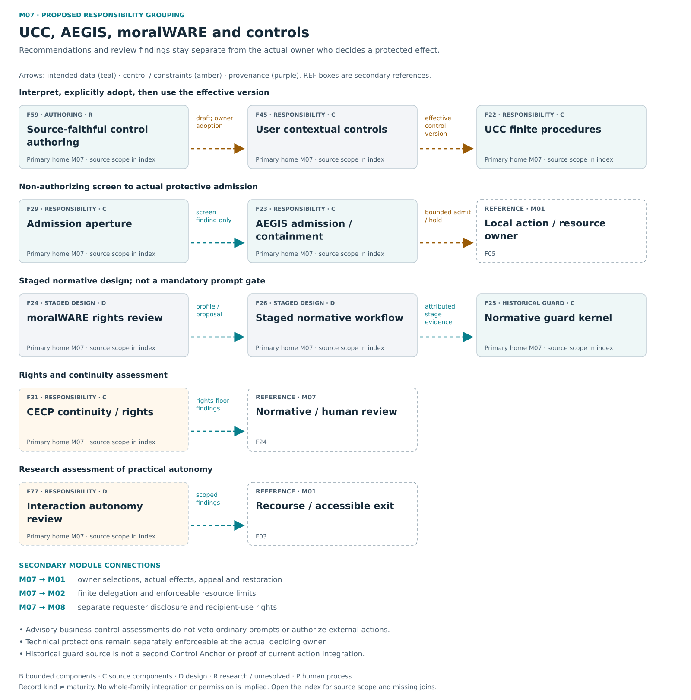

# M07 — UCC / AEGIS / moralWARE / controls

[Atlas index](../README.md) · [Placement ledger](../PLACEMENT_LEDGER.md)

Current controls, protective admission, rights review and accountable recourse.

**Placement status:** proposed editorial responsibility grouping, not an implemented package or service-owner map. Primary cards below retain different record kinds. Diagram arrows are declared intended relations unless explicitly marked source-connected.

[Scalable SVG](../svg/07-controls.svg) · [Text alternative](../TEXT_ALTERNATIVES.md#07-controls)

## F22 — UCC finite procedures

**Kind:** capability — finite control procedure execution.
**Primary home:** M07. proposed editorial responsibility grouping; not a claim of current package or service ownership.

Apply accepted control versions through supported deterministic procedures and explicitly identified human work.

**Reported scope:** source_components. Selected current or historical source mechanisms exist; full current integration and user benefit are not established for this family.
**Source presence:** selected current or historical source described
**Whole-family / record integration:** not established in this edition
**Specific join or documentary obligation:** Map each supported procedure and advisory result to its exact policy version and separate technical enforcement owner.

**Boundary:** Business-control assessments do not block ordinary prompts, withhold actual replies, require review before ordinary continuation or authorize external business action. Technical protections remain separately enforceable.
**Deciding owner:** Business-review users receive advisory findings; authentication, custody and safe-execution owners separately enforce technical restrictions.

**Description type:** preserved functional description; not an implemented API specification
- Input / context: Accepted procedure profile, exact procedure inputs and current technical constraints
- Output / record: Advisory business assessment and separately identified technical procedure outcome
- Intended reader or consumer: The user/authorized reviewer for advisory findings; technical owners for independently enforceable protections.
- Interface limit: exact current producer/validator/consumer contract remains to be traced where not established

**Classification note:** Retain UCC accepted control versions and supported finite procedures, not generic arbitrary policy execution.

**Secondary editorial associations:** [F19](M02.md#F19) in M02; [F23](M07.md#F23) in M07; [F35](M06.md#F35) in M06; [F45](M07.md#F45) in M07; [F59](M07.md#F59) in M07.

**Logical source anchor:** `FAMILY_GUIDE.en.md#F22` in the bound R5.1 English snapshot. This is intentionally not a relative hyperlink until its publication destination is settled. The preserved source description is embedded in the public JSON ledger; it is documentation, not an execution receipt.

## F23 — AEGIS admission and containment

**Kind:** capability — admission and bounded protective response.
**Primary home:** M07. proposed editorial responsibility grouping; not a claim of current package or service ownership.

Admit supported work and provide bounded defensive pause, quarantine, isolation, evidence preservation, appeal and restoration.

**Reported scope:** source_components. Selected current or historical source mechanisms exist; full current integration and user benefit are not established for this family.
**Source presence:** selected current or historical source described
**Whole-family / record integration:** not established in this edition
**Specific join or documentary obligation:** Connect protective response, evidence interpretation, appeal and restoration to the current owner; assess false positives.

**Boundary:** Defensive action needs preauthorized scope, evidence, expiry, appeal and restoration.
**Deciding owner:** The preauthorized admission/protective-action owner, with scoped appeal and restoration responsibilities.

**Description type:** preserved functional description; not an implemented API specification
- Input / context: Principal/request/context/field evidence
- Output / record: admit, hold, refuse or allowed response
- Intended reader or consumer: The actual admission or protective-action owner and the appeal/restoration process.
- Interface limit: exact current producer/validator/consumer contract remains to be traced where not established

**Classification note:** Keep narrower current admission mechanisms distinct from staged distributed protection; historical AEGIS cases are evidence, not the whole capability.

**Secondary editorial associations:** [F04](M01.md#F04) in M01; [F22](M07.md#F22) in M07; [F31](M07.md#F31) in M07; [F35](M06.md#F35) in M06; [F45](M07.md#F45) in M07.

**Logical source anchor:** `FAMILY_GUIDE.en.md#F23` in the bound R5.1 English snapshot. This is intentionally not a relative hyperlink until its publication destination is settled. The preserved source description is embedded in the public JSON ledger; it is documentation, not an execution receipt.

## F24 — moralWARE rights and normative review

**Kind:** crosscutting_responsibility — staged normative review profile.
**Primary home:** M07. proposed editorial responsibility grouping; not a claim of current package or service ownership.

Apply an explicit normative profile through separated proposal, Guardian, evidence-audit and guard responsibilities.

**Reported scope:** design. The full normative workflow is staged and inactive in the current product; historical guard source does not establish current protected-action integration.
**Source presence:** family-specific source completeness not established by this label
**Whole-family / record integration:** not established in this edition
**Specific join or documentary obligation:** Connect the staged normative chain to a protected action boundary without making it a prerequisite for the useful local loop.

**Boundary:** Normative review does not certify universal morality or override another owner's rights.
**Deciding owner:** Separately governed profile and protected-action owners; the full chain is staged/inactive in the current product.

**Description type:** preserved functional description; not an implemented API specification
- Input / context: Proposal/evidence/profile
- Output / record: review findings and allowed harmless progression
- Intended reader or consumer: Separated Guardian and evidence review, then a supported deterministic guard.
- Interface limit: exact current producer/validator/consumer contract remains to be traced where not established

**Sense distinction:** Public styling moralWARE preserves historical MORALware and MW-ESP lineage.

**Classification note:** MORALware is staged normative review across existing roles, not a duplicate independent governance organ or first-use prerequisite.

**Secondary editorial associations:** [F25](M07.md#F25) in M07; [F26](M07.md#F26) in M07; [F27](M04.md#F27) in M04; [F31](M07.md#F31) in M07; [F45](M07.md#F45) in M07.

**Logical source anchor:** `FAMILY_GUIDE.en.md#F24` in the bound R5.1 English snapshot. This is intentionally not a relative hyperlink until its publication destination is settled. The preserved source description is embedded in the public JSON ledger; it is documentation, not an execution receipt.

## F25 — Normative guard kernel

**Kind:** capability — historical deterministic guard prototype.
**Primary home:** M07. proposed editorial responsibility grouping; not a claim of current package or service ownership.

Enforce supported categorical restrictions and review boundaries without substituting scores for authority.

**Reported scope:** source_components. Historical deterministic fixture guard source exists; authenticated independent reviews and actual current protective actions are not established by it.
**Source presence:** selected historical source described; not full current adoption
**Whole-family / record integration:** not established in this edition
**Specific join or documentary obligation:** Map historical guard logic to the maintained enforcement owner instead of introducing a duplicate controller.

**Boundary:** Not the Control Anchor interface and not a model-only moral verdict.
**Deciding owner:** The maintained protected-action owner, not a new controller inferred from the guard name.

**Description type:** preserved functional description; not an implemented API specification
- Input / context: Bound review/evidence/controls
- Output / record: allowed or held transition
- Intended reader or consumer: The actual protected-action boundary; it must not become a second independent controller.
- Interface limit: exact current producer/validator/consumer contract remains to be traced where not established

**Sense distinction:** Historical ANCHOR names a guard responsibility and must not be confused with Control Anchor.

**Classification note:** Preserve actual ANCHOR guard logic as historical advisory prototype; boolean fixture votes do not establish authenticated review or protective actions.

**Secondary editorial associations:** [F22](M07.md#F22) in M07; [F23](M07.md#F23) in M07; [F24](M07.md#F24) in M07; [F26](M07.md#F26) in M07.

**Logical source anchor:** `FAMILY_GUIDE.en.md#F25` in the bound R5.1 English snapshot. This is intentionally not a relative hyperlink until its publication destination is settled. The preserved source description is embedded in the public JSON ledger; it is documentation, not an execution receipt.

## F26 — Staged normative workflow

**Kind:** crosscutting_responsibility — MORALware integration workflow.
**Primary home:** M07. proposed editorial responsibility grouping; not a claim of current package or service ownership.

Carry normative review through attributable stages, evidence checks and a distinct enforcement boundary.

**Reported scope:** design. A preserved design responsibility or proposed connection; complete intended behavior is not demonstrated.
**Source presence:** family-specific source completeness not established by this label
**Whole-family / record integration:** not established in this edition
**Specific join or documentary obligation:** Bind each review stage to attributed inputs, failures, decisions and the actual guard consumer.

**Boundary:** Workflow alone grants no execution authority.
**Deciding owner:** The relevant local task/action owner under accepted controls and affected rights; exact current service binding is not established by this public description.

**Description type:** preserved functional description; not an implemented API specification
- Input / context: Proposal/profile/findings
- Output / record: auditable stage transitions
- Intended reader or consumer: The next attributed review stage and the guard consumer.
- Interface limit: exact current producer/validator/consumer contract remains to be traced where not established

**Sense distinction:** LANTERN is a historical staged normative-workflow label, not a universal mandatory business policy.

**Classification note:** LANTERN is the integration/workflow sublayer of one consolidated MORALware program, not a parallel system.

**Secondary editorial associations:** [F24](M07.md#F24) in M07; [F25](M07.md#F25) in M07; [F27](M04.md#F27) in M04; [F33](M04.md#F33) in M04.

**Logical source anchor:** `FAMILY_GUIDE.en.md#F26` in the bound R5.1 English snapshot. This is intentionally not a relative hyperlink until its publication destination is settled. The preserved source description is embedded in the public JSON ledger; it is documentation, not an execution receipt.

## F29 — Admission aperture

**Kind:** capability — noncompensatory gate screen.
**Primary home:** M07. proposed editorial responsibility grouping; not a claim of current package or service ownership.

Apply noncompensatory consent, privacy, grounding and context gates without turning an advisory screen into authority.

**Reported scope:** source_components. Selected current or historical source mechanisms exist; full current integration and user benefit are not established for this family.
**Source presence:** selected current or historical source described
**Whole-family / record integration:** not established in this edition
**Specific join or documentary obligation:** Connect the screen to current admission authority while retaining the difference between a recommendation and its deciding service.

**Boundary:** Screen result is non-authorizing and cannot compensate away a failed hard boundary.
**Deciding owner:** The relevant local task/action owner under accepted controls and affected rights; exact current service binding is not established by this public description.

**Description type:** preserved functional description; not an implemented API specification
- Input / context: Bound conditions
- Output / record: PASS_SCREEN/HOLD/REFUSE
- Intended reader or consumer: The real admission owner, which must bind the screen to current authority.
- Interface limit: exact current producer/validator/consumer contract remains to be traced where not established

**Classification note:** Retain the Totality admission aperture as a gate; it is not the sampling/retention controller TAC.

**Secondary editorial associations:** [F22](M07.md#F22) in M07; [F23](M07.md#F23) in M07; [F30](M06.md#F30) in M06; [F45](M07.md#F45) in M07.

**Logical source anchor:** `FAMILY_GUIDE.en.md#F29` in the bound R5.1 English snapshot. This is intentionally not a relative hyperlink until its publication destination is settled. The preserved source description is embedded in the public JSON ledger; it is documentation, not an execution receipt.

## F31 — CECP continuity and rights assessment

**Kind:** optional_profile_or_extension — rights-floor assessment extension.
**Primary home:** M07. proposed editorial responsibility grouping; not a claim of current package or service ownership.

Assess necessity, proportionality, least harm, reversibility, essential-service continuity, burdens, appeal and remedy.

**Reported scope:** source_components. Historical protocol semantics support bounded non-runtime use; they do not establish current operational authority or accepted evaluator assurance.
**Source presence:** selected current or historical source described
**Whole-family / record integration:** not established in this edition
**Specific join or documentary obligation:** Trace the maintained rights-floor protocol and profile into current consumers without inheriting rejected or absent assurance.

**Boundary:** A failed rights floor is not offset by later positives. Declared consent and actor references are not authenticated real-world authority; an assessment grants no action or memory rights.
**Deciding owner:** The relevant local task/action owner under accepted controls and affected rights; exact current service binding is not established by this public description.

**Description type:** preserved functional description; not an implemented API specification
- Input / context: Declared scoped evidence, direct/foreseeable/third-party burden bearers, timed/revocable consent and observed_at_utc
- Output / record: first-failure-preserving PASS/HOLD/REJECT receipt bound to input, criteria profile, evaluator contract and observation time
- Intended reader or consumer: An accountable human or admitted review workflow with affected-party rights retained.
- Interface limit: exact current producer/validator/consumer contract remains to be traced where not established

**Classification note:** Keep concrete CECP assessment semantics and historical continuity senses separate; current reuse record defers this optional extension from core.

**Secondary editorial associations:** [F23](M07.md#F23) in M07; [F24](M07.md#F24) in M07; [F32](M04.md#F32) in M04; [F33](M04.md#F33) in M04; [F45](M07.md#F45) in M07.

**Logical source anchor:** `FAMILY_GUIDE.en.md#F31` in the bound R5.1 English snapshot. This is intentionally not a relative hyperlink until its publication destination is settled. The preserved source description is embedded in the public JSON ledger; it is documentation, not an execution receipt.

## F45 — User governed contextual controls

**Kind:** crosscutting_responsibility — user-governed policy.
**Primary home:** M07. proposed editorial responsibility grouping; not a claim of current package or service ownership.

Express purpose, privacy, resources, delegation, retention and sharing choices that bind current permitted action.

**Reported scope:** source_components. Selected current or historical source mechanisms exist; full current integration and user benefit are not established for this family.
**Source presence:** selected current or historical source described
**Whole-family / record integration:** not established in this edition
**Specific join or documentary obligation:** Map every affected stage to current policy and show how stale or revoked context is handled.

**Boundary:** Purpose/privacy/resource permissions constrain actions; advisory business assessments do not become prompt vetoes or external-action authority and cannot rewrite observations.
**Deciding owner:** The authorized policy-adoption owner; affected peers keep their own authority.

**Description type:** preserved functional description; not an implemented API specification
- Input / context: Human/institution policy and context
- Output / record: effective version at each consumer
- Intended reader or consumer: Every actual deciding consumer for the affected supported action.
- Interface limit: exact current producer/validator/consumer contract remains to be traced where not established

**Classification note:** Policy choices apply at actual consumers throughout the architecture; they cannot rewrite observations or peer authority.

**Secondary editorial associations:** [F03](M01.md#F03) in M01; [F22](M07.md#F22) in M07; [F24](M07.md#F24) in M07; [F35](M06.md#F35) in M06; [F59](M07.md#F59) in M07.

**Logical source anchor:** `FAMILY_GUIDE.en.md#F45` in the bound R5.1 English snapshot. This is intentionally not a relative hyperlink until its publication destination is settled. The preserved source description is embedded in the public JSON ledger; it is documentation, not an execution receipt.

## F59 — Source faithful control authoring

**Kind:** capability — control authoring and adoption design.
**Primary home:** M07. proposed editorial responsibility grouping; not a claim of current package or service ownership.

Preserve original control meaning, proposed interpretation, conflicts, preview and explicit versioned adoption.

**Reported scope:** research_or_unresolved. A preserved research, optional or incompletely reconciled responsibility; exact current implementation and benefit remain unresolved.
**Source presence:** family-specific source completeness not established by this label
**Whole-family / record integration:** not established in this edition
**Specific join or documentary obligation:** Map each adopted control to its advisory or technical role, supported check, unimplemented obligation and activation owner.

**Boundary:** Generated control interpretation cannot activate policy; advisory business labels and enforceable technical rules must stay distinct.
**Deciding owner:** The authenticated control activation owner; generated interpretations are proposals only.

**Description type:** preserved functional description; not an implemented API specification
- Input / context: Source control and owner context
- Output / record: draft mapping, preview, review and separately activated enforcement
- Intended reader or consumer: The authorized profile-adoption owner and supported advisory/technical procedures.
- Interface limit: exact current producer/validator/consumer contract remains to be traced where not established

**Classification note:** Source-faithful control authoring is a concrete maintained requirement; import and preview do not activate enforcement.

**Secondary editorial associations:** [F03](M01.md#F03) in M01; [F22](M07.md#F22) in M07; [F33](M04.md#F33) in M04; [F45](M07.md#F45) in M07.

**Logical source anchor:** `FAMILY_GUIDE.en.md#F59` in the bound R5.1 English snapshot. This is intentionally not a relative hyperlink until its publication destination is settled. The preserved source description is embedded in the public JSON ledger; it is documentation, not an execution receipt.

## F77 — Interaction autonomy review

**Kind:** research_proposal — proposed interaction-autonomy assessment.
**Primary home:** M07. proposed editorial responsibility grouping; not a claim of current package or service ownership.

Assess coercion, manipulation, isolation and obstacles to disengagement while preserving accessible exit and appeal.

**Reported scope:** design. A preserved design responsibility or proposed connection; complete intended behavior is not demonstrated.
**Source presence:** family-specific source completeness not established by this label
**Whole-family / record integration:** not established in this edition
**Specific join or documentary obligation:** Define observable coercive conduct and test practical disengagement, accessible exit and appeal.

**Boundary:** Engagement is not a substitute for reliability, fairness or practical exit.
**Deciding owner:** The relevant local task/action owner under accepted controls and affected rights; exact current service binding is not established by this public description.

**Description type:** preserved functional description; not an implemented API specification
- Input / context: Interaction behavior and user controls
- Output / record: scoped findings and correction proposals
- Intended reader or consumer: User-facing recourse and governance review, not engagement optimization.
- Interface limit: exact current producer/validator/consumer contract remains to be traced where not established

**Classification note:** W02 explicitly proposes a system-conduct assessment; preserve it as research rather than deleting it as a glossary-only risk name.

**Secondary editorial associations:** [F03](M01.md#F03) in M01; [F24](M07.md#F24) in M07; [F31](M07.md#F31) in M07; [F45](M07.md#F45) in M07; [F67](M01.md#F67) in M01.

**Logical source anchor:** `FAMILY_GUIDE.en.md#F77` in the bound R5.1 English snapshot. This is intentionally not a relative hyperlink until its publication destination is settled. The preserved source description is embedded in the public JSON ledger; it is documentation, not an execution receipt.
