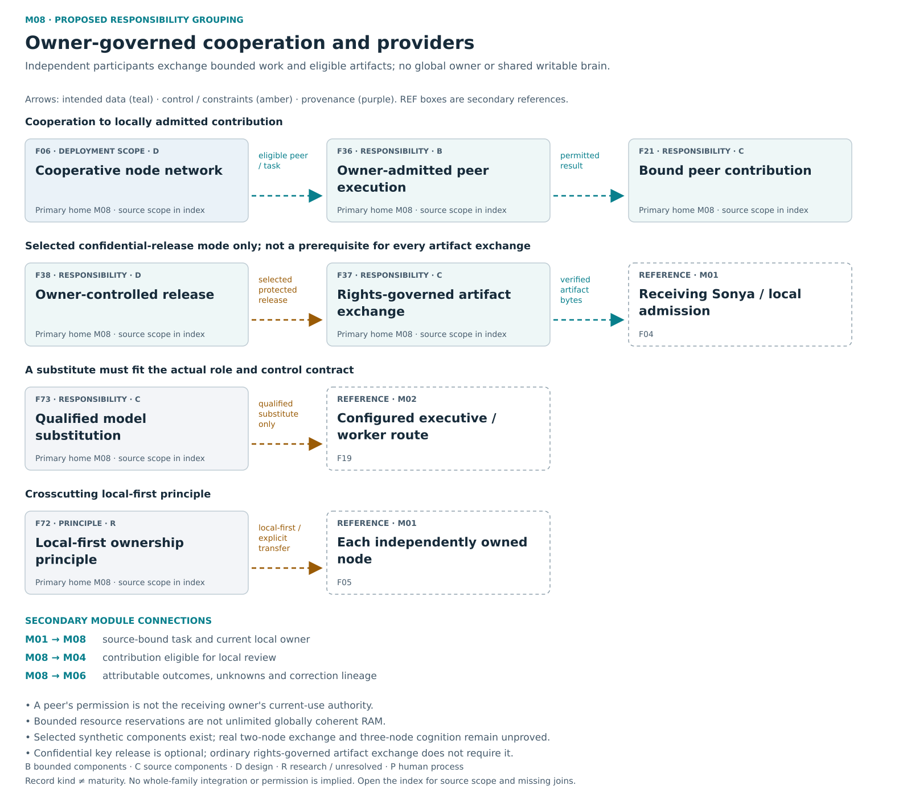

# M08 — Peer / resource / provider integration

[Atlas index](../README.md) · [Placement ledger](../PLACEMENT_LEDGER.md)

Independent resource owners, bounded contributions and qualified substitutes.

**Placement status:** proposed editorial responsibility grouping, not an implemented package or service-owner map. Primary cards below retain different record kinds. Diagram arrows are declared intended relations unless explicitly marked source-connected.

[Scalable SVG](../svg/08-cooperation.svg) · [Text alternative](../TEXT_ALTERNATIVES.md#08-cooperation)

## F06 — Cooperative node network

**Kind:** deployment_entity — cooperative network topology.
**Primary home:** M08. proposed editorial responsibility grouping; not a claim of current package or service ownership.

Connect independently governed participants for attributable review and permitted task exchange.

**Reported scope:** design. A preserved design responsibility or proposed connection; complete intended behavior is not demonstrated.
**Source presence:** family-specific source completeness not established by this label
**Whole-family / record integration:** not established in this edition
**Specific join or documentary obligation:** Demonstrate live federation, enrollment, discovery, rights and recovery across independent owners.

**Boundary:** No global Sophia instance rules all nodes.
**Deciding owner:** Each participating node retains its own authority; the coordinator cannot grant it.

**Description type:** preserved functional description; not an implemented API specification
- Input / context: Eligible peers/artifacts
- Output / record: bounded cooperation
- Intended reader or consumer: Participating node owners and bounded executive coordination.
- Interface limit: exact current producer/validator/consumer contract remains to be traced where not established

**Classification note:** The network is a federation of independently governed nodes; preserve the topology goal without inventing a global Sophia controller.

**Secondary editorial associations:** [F05](M01.md#F05) in M01; [F21](M08.md#F21) in M08; [F36](M08.md#F36) in M08; [F37](M08.md#F37) in M08.

**Logical source anchor:** `FAMILY_GUIDE.en.md#F06` in the bound R5.1 English snapshot. This is intentionally not a relative hyperlink until its publication destination is settled. The preserved source description is embedded in the public JSON ledger; it is documentation, not an execution receipt.

## F21 — Bound peer contribution

**Kind:** capability — bound remote contribution handoff.
**Primary home:** M08. proposed editorial responsibility grouping; not a claim of current package or service ownership.

Receive explicitly scoped external text or data under the local owner's current-use policy.

**Reported scope:** source_components. Scoped contribution components exist; a real physical-peer workflow still requires demonstration.
**Source presence:** selected current or historical source described
**Whole-family / record integration:** not established in this edition
**Specific join or documentary obligation:** Join external contribution preview, current-use admission, evaluation, export and reopen with a real peer.

**Boundary:** Data is not executable peer code; remote grant is not local consumption authority.
**Deciding owner:** The relevant local task/action owner under accepted controls and affected rights; exact current service binding is not established by this public description.

**Description type:** preserved functional description; not an implemented API specification
- Input / context: Peer result and native custody/proof
- Output / record: eligible or rejected synthesis input
- Intended reader or consumer: The local admitted evaluation and synthesis route.
- Interface limit: exact current producer/validator/consumer contract remains to be traced where not established

**Classification note:** Retain local-policy-bound remote text/data consumption without implying remote peers can grant their own use rights.

**Secondary editorial associations:** [F04](M01.md#F04) in M01; [F06](M08.md#F06) in M08; [F20](M02.md#F20) in M02; [F36](M08.md#F36) in M08; [F45](M07.md#F45) in M07.

**Logical source anchor:** `FAMILY_GUIDE.en.md#F21` in the bound R5.1 English snapshot. This is intentionally not a relative hyperlink until its publication destination is settled. The preserved source description is embedded in the public JSON ledger; it is documentation, not an execution receipt.

## F36 — Owner admitted cooperative execution

**Kind:** capability — owner-admitted cooperative execution.
**Primary home:** M08. proposed editorial responsibility grouping; not a claim of current package or service ownership.

Place bounded work at independent resource owners with reservations, enforcement and outcome reconciliation.

**Reported scope:** bounded_evidence. Selected synthetic peer components have bounded evidence; actual two-node exchange and three-node Wi-Fi cognition remain unproved.
**Source presence:** selected current or historical source described
**Whole-family / record integration:** not established in this edition
**Specific join or documentary obligation:** Demonstrate a real two-node exchange before the independently governed three-node cognitive pilot.

**Boundary:** Scheduled local resources do not form unlimited globally coherent RAM.
**Deciding owner:** The donating resource owner decides actual reservation and execution; the requester authorizes its disclosure.

**Description type:** preserved functional description; not an implemented API specification
- Input / context: Bound task/grant/reservation
- Output / record: execution outcome and permitted result
- Intended reader or consumer: The requester and the contributing node’s real resource owner.
- Interface limit: exact current producer/validator/consumer contract remains to be traced where not established

**Classification note:** Retain resource-owner-based task placement and reconciliation; selected synthetic cases do not establish physical federation.

**Secondary editorial associations:** [F05](M01.md#F05) in M01; [F06](M08.md#F06) in M08; [F21](M08.md#F21) in M08; [F38](M08.md#F38) in M08; [F40](M09.md#F40) in M09.

**Logical source anchor:** `FAMILY_GUIDE.en.md#F36` in the bound R5.1 English snapshot. This is intentionally not a relative hyperlink until its publication destination is settled. The preserved source description is embedded in the public JSON ledger; it is documentation, not an execution receipt.

## F37 — Rights governed artifact exchange

**Kind:** capability — rights-governed artifact exchange.
**Primary home:** M08. proposed editorial responsibility grouping; not a claim of current package or service ownership.

Share eligible content-addressed evidence and derivatives while preserving rights, visibility and correction lineage.

**Reported scope:** source_components. Selected current or historical source mechanisms exist; full current integration and user benefit are not established for this family.
**Source presence:** selected current or historical source described
**Whole-family / record integration:** not established in this edition
**Specific join or documentary obligation:** Bind rights, sharing tier, retention, correction propagation and practical exit to real artifact exchange.

**Boundary:** Content hashes establish neither secrecy nor sharing rights or truth.
**Deciding owner:** The artifact rights holder and receiving owner under current audience/purpose/retention permissions.

**Description type:** preserved functional description; not an implemented API specification
- Input / context: Approved artifact/audience
- Output / record: received verified artifact and later local use decision
- Intended reader or consumer: Recipients with current rights to the exact artifact and its permitted derivatives.
- Interface limit: exact current producer/validator/consumer contract remains to be traced where not established

**Classification note:** Retain eligible evidence exchange and correction lineage; a content hash does not grant disclosure or reuse.

**Secondary editorial associations:** [F11](M05.md#F11) in M05; [F13](M05.md#F13) in M05; [F36](M08.md#F36) in M08; [F38](M08.md#F38) in M08; [F66](M06.md#F66) in M06.

**Logical source anchor:** `FAMILY_GUIDE.en.md#F37` in the bound R5.1 English snapshot. This is intentionally not a relative hyperlink until its publication destination is settled. The preserved source description is embedded in the public JSON ledger; it is documentation, not an execution receipt.

## F38 — Owner controlled confidential release

**Kind:** capability — confidential release design.
**Primary home:** M08. proposed editorial responsibility grouping; not a claim of current package or service ownership.

Bind protected keys and permitted disclosure to exact tasks, recipients, workloads and current policy.

**Reported scope:** design. A preserved design responsibility or proposed connection; complete intended behavior is not demonstrated.
**Source presence:** family-specific source completeness not established by this label
**Whole-family / record integration:** not established in this edition
**Specific join or documentary obligation:** Qualify actual key-owner release, recipient attestation and serialized revocation at a specific hardware boundary.

**Boundary:** TLS, disk encryption and ordinary VMs do not hide plaintext from a hostile privileged host.
**Deciding owner:** The actual protected key owner at the release/commit boundary.

**Description type:** preserved functional description; not an implemented API specification
- Input / context: Authenticated release context/ciphertext
- Output / record: authorized disclosure or hold
- Intended reader or consumer: The exact authorized recipient/workload at the qualified release boundary.
- Interface limit: exact current producer/validator/consumer contract remains to be traced where not established

**Classification note:** The wallet/blockchain words are metaphors, but the separately sourced owner-bound key-release design is real; do not add currency or blockchain requirements.

**Secondary editorial associations:** [F23](M07.md#F23) in M07; [F35](M06.md#F35) in M06; [F36](M08.md#F36) in M08; [F45](M07.md#F45) in M07.

**Logical source anchor:** `FAMILY_GUIDE.en.md#F38` in the bound R5.1 English snapshot. This is intentionally not a relative hyperlink until its publication destination is settled. The preserved source description is embedded in the public JSON ledger; it is documentation, not an execution receipt.

## F72 — Local first ownership

**Kind:** crosscutting_responsibility — local-first deployment principle.
**Primary home:** M08. proposed editorial responsibility grouping; not a claim of current package or service ownership.

Prioritize owner-directed local processing and explicit data movement with practical offline behavior and exit.

**Reported scope:** research_or_unresolved. A preserved research, optional or incompletely reconciled responsibility; exact current implementation and benefit remain unresolved.
**Source presence:** family-specific source completeness not established by this label
**Whole-family / record integration:** Not applicable as a standalone module; assess the relevant process and concrete consumers in their own scopes.
**Specific join or documentary obligation:** Trace actual data movement, retention, revocation and offline behavior through selected adapters.

**Boundary:** Local execution alone is not confidentiality.
**Deciding owner:** Relevant human maintainers and the actual existing action or artifact owners; this entry establishes no separate runtime authority.

**Description type:** preserved functional description; not an implemented API specification
- Input / context: Local task/data policy
- Output / record: eligible processing location and disclosed transfers
- Intended reader or consumer: Local task owners and any explicitly selected data-movement adapter.
- Interface limit: exact current producer/validator/consumer contract remains to be traced where not established

**Classification note:** Local-first is owner-directed deployment/data-movement posture, not a missing LocalFirst module and not automatic confidentiality.

**Secondary editorial associations:** [F03](M01.md#F03) in M01; [F05](M01.md#F05) in M01; [F36](M08.md#F36) in M08; [F37](M08.md#F37) in M08; [F45](M07.md#F45) in M07.

**Logical source anchor:** `FAMILY_GUIDE.en.md#F72` in the bound R5.1 English snapshot. This is intentionally not a relative hyperlink until its publication destination is settled. The preserved source description is embedded in the public JSON ledger; it is documentation, not an execution receipt.

## F73 — Qualified model substitution

**Kind:** crosscutting_responsibility — model-substitution compatibility principle.
**Primary home:** M08. proposed editorial responsibility grouping; not a claim of current package or service ownership.

Use common interfaces while testing actual capability, rights, failure behavior and control compatibility of each substitute.

**Reported scope:** source_components. Selected current or historical source mechanisms exist; full current integration and user benefit are not established for this family.
**Source presence:** selected current or historical source described
**Whole-family / record integration:** Not applicable as a standalone module; assess the relevant process and concrete consumers in their own scopes.
**Specific join or documentary obligation:** Qualify the specific substituted model and failure paths against the shared task and control contract.

**Boundary:** A common API and installed-app detection do not establish compatibility or access rights.
**Deciding owner:** Relevant human maintainers and the actual existing action or artifact owners; this entry establishes no separate runtime authority.

**Description type:** preserved functional description; not an implemented API specification
- Input / context: Versioned adapter/model capability
- Output / record: supported role/output behavior or explicit incompatibility
- Intended reader or consumer: A specific configured role/task route using a qualified substitute.
- Interface limit: exact current producer/validator/consumer contract remains to be traced where not established

**Classification note:** Model-agnostic describes qualified substitution through actual provider/role contracts, not universal compatibility or a separate organ.

**Secondary editorial associations:** [F04](M01.md#F04) in M01; [F19](M02.md#F19) in M02; [F39](M02.md#F39) in M02; [F64](M02.md#F64) in M02.

**Logical source anchor:** `FAMILY_GUIDE.en.md#F73` in the bound R5.1 English snapshot. This is intentionally not a relative hyperlink until its publication destination is settled. The preserved source description is embedded in the public JSON ledger; it is documentation, not an execution receipt.
