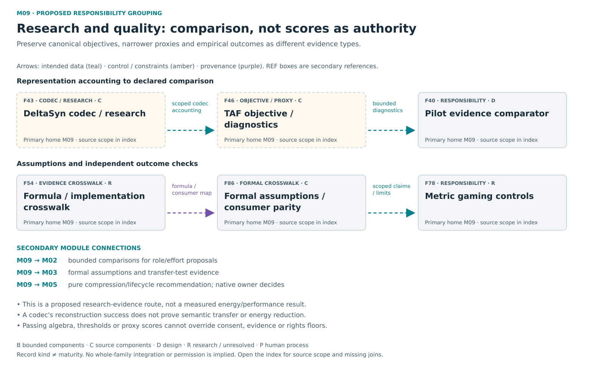
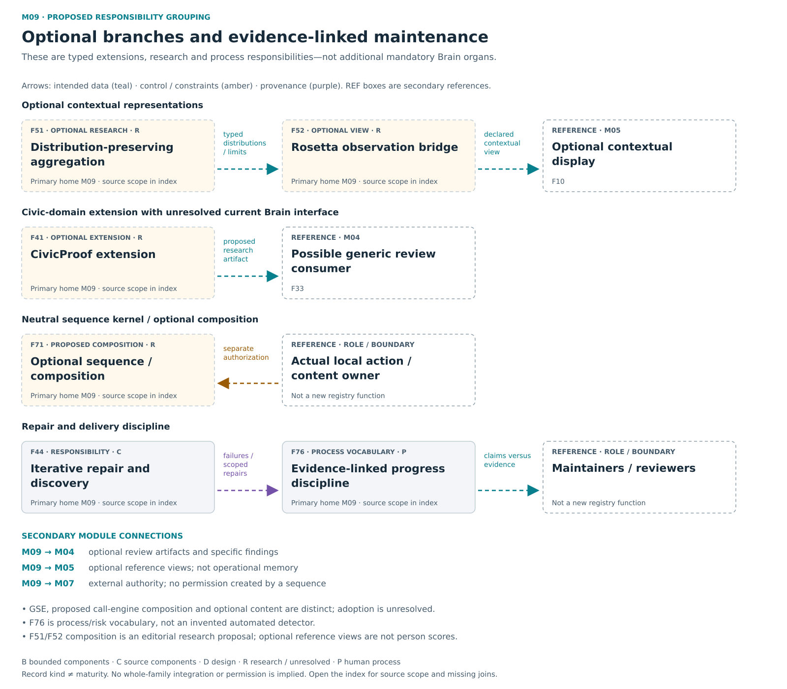

# M09 — Research / quality / optional extensions

[Atlas index](../README.md) · [Placement ledger](../PLACEMENT_LEDGER.md)

Preserved research, comparison and quality work; not a mandatory core pipeline.

**Placement status:** proposed editorial responsibility grouping, not an implemented package or service-owner map. Primary cards below retain different record kinds. Diagram arrows are declared intended relations unless explicitly marked source-connected.

[Scalable SVG](../svg/09a-quality-research.svg) · [Text alternative](../TEXT_ALTERNATIVES.md#09a-quality-research)

[Scalable SVG](../svg/09b-optional-quality.svg) · [Text alternative](../TEXT_ALTERNATIVES.md#09b-optional-quality)

## F40 — Pilot evidence comparator

**Kind:** crosscutting_responsibility — proposed assurance measurement tool.
**Primary home:** M09. proposed editorial responsibility grouping; not a claim of current package or service ownership.

Compare supplied observations for local and distributed task graphs with matched baselines and declared accounting boundaries.

**Reported scope:** design. The offline comparator is replacement work with its own evidence requirements; real measured pilot inputs remain to be established.
**Source presence:** family-specific source completeness not established by this label
**Whole-family / record integration:** not established in this edition
**Specific join or documentary obligation:** Establish the replacement comparator's own supported input contract and actual measured pilot observations.

**Boundary:** Description reduction is not measured energy reduction, and no result is inherited from unavailable evidence.
**Deciding owner:** The relevant local task/action owner under accepted controls and affected rights; exact current service binding is not established by this public description.

**Description type:** preserved functional description; not an implemented API specification
- Input / context: Authorized exports/measurements
- Output / record: truthful derived report and unknowns
- Intended reader or consumer: The human or research comparison reader; it does not launch the pilot.
- Interface limit: exact current producer/validator/consumer contract remains to be traced where not established

**Classification note:** The offline pilot comparator is a proposed measurement/evidence tool, not an operational telemetry collector and not the same kind of object as its test inputs.

**Secondary editorial associations:** [F36](M08.md#F36) in M08; [F39](M02.md#F39) in M02; [F43](M09.md#F43) in M09; [F46](M09.md#F46) in M09; [F78](M09.md#F78) in M09.

**Logical source anchor:** `FAMILY_GUIDE.en.md#F40` in the bound R5.1 English snapshot. This is intentionally not a relative hyperlink until its publication destination is settled. The preserved source description is embedded in the public JSON ledger; it is documentation, not an execution receipt.

## F41 — CivicProof extension

**Kind:** optional_profile_or_extension — separate civic-domain satellite.
**Primary home:** M09. proposed editorial responsibility grouping; not a claim of current package or service ownership.

Preserve an optional civic accountability and offline election-research lineage without granting generic Brain decision authority.

**Reported scope:** research_or_unresolved. A preserved research, optional or incompletely reconciled responsibility; exact current implementation and benefit remain unresolved.
**Source presence:** family-specific source completeness not established by this label
**Whole-family / record integration:** not established in this edition
**Specific join or documentary obligation:** Read and reconcile the exact civic-extension interface before asserting a Brain integration.

**Boundary:** No generic decision authority inferred from repository presence.
**Deciding owner:** The relevant local task/action owner under accepted controls and affected rights; exact current service binding is not established by this public description.

**Description type:** preserved functional description; not an implemented API specification
- Input / context: Synthetic civic-domain inputs
- Output / record: bounded research/verification artifacts; exact Brain interface unresolved
- Intended reader or consumer: The optional domain-specific civic accountability workflow; exact Brain interface unresolved.
- Interface limit: exact current producer/validator/consumer contract remains to be traced where not established

**Classification note:** CivicProof is a separately sourced synthetic offline civic pipeline; optional lineage is not evidence of a Brain runtime interface.

**Secondary editorial associations:** [F33](M04.md#F33) in M04; [F58](M04.md#F58) in M04; [F66](M06.md#F66) in M06.

**Logical source anchor:** `FAMILY_GUIDE.en.md#F41` in the bound R5.1 English snapshot. This is intentionally not a relative hyperlink until its publication destination is settled. The preserved source description is embedded in the public JSON ledger; it is documentation, not an execution receipt.

## F43 — DeltaSyn compression research

**Kind:** research_proposal — compression research with implemented historical codecs.
**Primary home:** M09. proposed editorial responsibility grouping; not a claim of current package or service ownership.

Perform bounded representation encoding, reconstruction and cost accounting while keeping standalone codec and DSCC specification identities distinct.

**Reported scope:** source_components. Concrete standalone encoding, reconstruction, accounting and pure-planner source exists; DSCC specification and current Brain adoption remain separate.
**Source presence:** selected current or historical source described
**Whole-family / record integration:** not established in this edition
**Specific join or documentary obligation:** Trace concrete codec and pure-planner source into current consumers, with separate native authority and durable-memory joins.

**Boundary:** Exact reconstruction does not itself establish semantic equivalence or energy savings.
**Deciding owner:** The relevant local task/action owner under accepted controls and affected rights; exact current service binding is not established by this public description.

**Description type:** preserved functional description; not an implemented API specification
- Input / context: Declared representations
- Output / record: compressed candidate and reconstruction checks
- Intended reader or consumer: A decoder/accounting reader or pure PMR planner, then a separate authorized native consumer.
- Interface limit: exact current producer/validator/consumer contract remains to be traced where not established

**Sense distinction:** Standalone DeltaSyn concrete codecs, the older TEL fixture and DSCC specification/assurance are distinct lineages; a pure planner makes recommendations, not native lifecycle effects.

**Classification note:** Preserve distinct TEL fixture, DSCC specification and standalone DeltaSyn codec lineages; test origin does not make the whole compression program a test asset.

**Secondary editorial associations:** [F13](M05.md#F13) in M05; [F39](M02.md#F39) in M02; [F40](M09.md#F40) in M09; [F46](M09.md#F46) in M09; [F69](M05.md#F69) in M05.

**Logical source anchor:** `FAMILY_GUIDE.en.md#F43` in the bound R5.1 English snapshot. This is intentionally not a relative hyperlink until its publication destination is settled. The preserved source description is embedded in the public JSON ledger; it is documentation, not an execution receipt.

## F44 — Iterative repair and discovery

**Kind:** crosscutting_responsibility — engineering repair methodology.
**Primary home:** M09. proposed editorial responsibility grouping; not a claim of current package or service ownership.

Use observed defect families and successive review to repair work and reveal missing capabilities without erasing failures.

**Reported scope:** source_components. Selected current or historical source mechanisms exist; full current integration and user benefit are not established for this family.
**Source presence:** selected current or historical source described
**Whole-family / record integration:** Not applicable as a standalone module; assess the relevant process and concrete consumers in their own scopes.
**Specific join or documentary obligation:** Preserve the complete repair and failure history and show that iterations close useful end-to-end gaps.

**Boundary:** Review assertions do not themselves authorize changes or prove correctness. Post-audit evaluation does not itself authorize persistent model-weight, profile or memory updates; those require separately governed versioned operations.
**Deciding owner:** Relevant human maintainers and the actual existing action or artifact owners; this entry establishes no separate runtime authority.

**Description type:** preserved functional description; not an implemented API specification
- Input / context: Evidence/failure/counterexample
- Output / record: scoped repair and next discriminating test
- Intended reader or consumer: Maintainers and reviewers deciding a scoped successor.
- Interface limit: exact current producer/validator/consumer contract remains to be traced where not established

**Classification note:** Spiral audit/innovation denotes evidence-led engineering iteration, not an autonomous self-improvement module.

**Secondary editorial associations:** [F33](M04.md#F33) in M04; [F54](M09.md#F54) in M09; [F76](M09.md#F76) in M09; [F78](M09.md#F78) in M09.

**Logical source anchor:** `FAMILY_GUIDE.en.md#F44` in the bound R5.1 English snapshot. This is intentionally not a relative hyperlink until its publication destination is settled. The preserved source description is embedded in the public JSON ledger; it is documentation, not an execution receipt.

## F46 — TAF objective and diagnostics

**Kind:** research_proposal — mathematical objective and bounded diagnostic.
**Primary home:** M09. proposed editorial responsibility grouping; not a claim of current package or service ownership.

Preserve the Total Action Functional research objective separately from narrower runtime and retained-byte burden proxies.

**Reported scope:** source_components. Bounded service and diagnostic paths exist; the canonical research functional is not fully measured.
**Source presence:** selected current or historical source described
**Whole-family / record integration:** not established in this edition
**Specific join or documentary obligation:** Bind the canonical mathematical version, diagnostic surrogate and actual consumer without claiming complete physical measurement.

**Boundary:** No score overrides consent, refusal, privacy or resource authority.
**Deciding owner:** The relevant local task/action owner under accepted controls and affected rights; exact current service binding is not established by this public description.

**Description type:** preserved functional description; not an implemented API specification
- Input / context: Informational/coherence/runtime burden observations
- Output / record: bounded diagnostic or proposed planning comparison; exact canonical formula must be pinned
- Intended reader or consumer: Human interpretation or bounded executive diagnostics, never permission overrides.
- Interface limit: exact current producer/validator/consumer contract remains to be traced where not established

**Sense distinction:** Canonical normalized Total Action Functional research differs from bounded runtime diagnostics and retained-byte explanations.

**Classification note:** TAF is a genuine research objective with a narrower historical diagnostic; preserve both without treating the proxy as the canonical functional.

**Secondary editorial associations:** [F39](M02.md#F39) in M02; [F40](M09.md#F40) in M09; [F43](M09.md#F43) in M09; [F53](M03.md#F53) in M03; [F54](M09.md#F54) in M09.

**Logical source anchor:** `FAMILY_GUIDE.en.md#F46` in the bound R5.1 English snapshot. This is intentionally not a relative hyperlink until its publication destination is settled. The preserved source description is embedded in the public JSON ledger; it is documentation, not an execution receipt.

## F51 — Distribution preserving aggregation

**Kind:** optional_profile_or_extension — optional contextual aggregation research.
**Primary home:** M09. proposed editorial responsibility grouping; not a claim of current package or service ownership.

Combine optional contextual views without discarding dissent, residuals or the meaning of incompatible axes.

**Reported scope:** research_or_unresolved. A preserved research, optional or incompletely reconciled responsibility; exact current implementation and benefit remain unresolved.
**Source presence:** family-specific source completeness not established by this label
**Whole-family / record integration:** not established in this edition
**Specific join or documentary obligation:** Define justified aggregation operators and compare the retained native distributions, not only the displayed summary.

**Boundary:** Incompatible axes cannot be averaged into an authoritative supreme scalar.
**Deciding owner:** The relevant local task/action owner under accepted controls and affected rights; exact current service binding is not established by this public description.

**Description type:** preserved functional description; not an implemented API specification
- Input / context: Compatible typed distributions
- Output / record: task-relative summaries with losses disclosed
- Intended reader or consumer: Optional reference displays and evaluators that need retained distributions.
- Interface limit: exact current producer/validator/consumer contract remains to be traced where not established

**Classification note:** Keep distribution-preserving aggregation as optional reference-view research, not a mandatory universal scalar hierarchy.

**Secondary editorial associations:** [F12](M05.md#F12) in M05; [F15](M03.md#F15) in M03; [F16](M03.md#F16) in M03; [F53](M03.md#F53) in M03.

**Logical source anchor:** `FAMILY_GUIDE.en.md#F51` in the bound R5.1 English snapshot. This is intentionally not a relative hyperlink until its publication destination is settled. The preserved source description is embedded in the public JSON ledger; it is documentation, not an execution receipt.

## F52 — Rosetta observation bridge

**Kind:** optional_profile_or_extension — optional Rosetta geometry and waveform research.
**Primary home:** M09. proposed editorial responsibility grouping; not a claim of current package or service ownership.

Map declared axes into typed observation and optional geometric or waveform views while preserving native meaning, units and residuals.

**Reported scope:** research_or_unresolved. Selected optional observation-bridge source exists; full validators and current consumer equivalence remain unresolved.
**Source presence:** selected historical source described; not full current adoption
**Whole-family / record integration:** not established in this edition
**Specific join or documentary obligation:** Reconcile optional source validators and adapters with current consumers; declared axes still need appropriate measurement provenance.

**Boundary:** Declared coordinates and synthetic waveforms are not physical equivalence or person scores.
**Deciding owner:** The relevant local task/action owner under accepted controls and affected rights; exact current service binding is not established by this public description.

**Description type:** preserved functional description; not an implemented API specification
- Input / context: Optional reference cell plus local coordinates/residual
- Output / record: contextual view
- Intended reader or consumer: Local observation/state consumers and optional visual or waveform views.
- Interface limit: exact current producer/validator/consumer contract remains to be traced where not established

**Sense distinction:** Waveform and geometric Rosetta views are separate from native physical quantities and operational Atlas memory.

**Classification note:** Keep native observation, local geometry and waveform as distinct optional representations; historical source exists without current Brain adoption.

**Secondary editorial associations:** [F12](M05.md#F12) in M05; [F15](M03.md#F15) in M03; [F16](M03.md#F16) in M03; [F53](M03.md#F53) in M03.

**Logical source anchor:** `FAMILY_GUIDE.en.md#F52` in the bound R5.1 English snapshot. This is intentionally not a relative hyperlink until its publication destination is settled. The preserved source description is embedded in the public JSON ledger; it is documentation, not an execution receipt.

## F54 — Formula to implementation crosswalk

**Kind:** crosscutting_responsibility — formula implementation evidence ledger.
**Primary home:** M09. proposed editorial responsibility grouping; not a claim of current package or service ownership.

Connect equations, assumptions, code consumers and evidence while preserving unmet assumptions and contradictory findings.

**Reported scope:** research_or_unresolved. A crosswalk is a maintained requirement; a complete current equation-to-consumer ledger is not established here.
**Source presence:** family-specific source completeness not established by this label
**Whole-family / record integration:** Not applicable as a standalone module; assess the relevant process and concrete consumers in their own scopes.
**Specific join or documentary obligation:** Complete the derived equation-to-consumer evidence index without silently rewriting original formulas or claims.

**Boundary:** Rendered equation or passing algebra does not establish physical truth.
**Deciding owner:** Relevant human maintainers and the actual existing action or artifact owners; this entry establishes no separate runtime authority.

**Description type:** preserved functional description; not an implemented API specification
- Input / context: Formula/version
- Output / record: traceable representations and coverage gaps
- Intended reader or consumer: Maintainers and reviewers tracing assumptions through actual consumers and outcomes.
- Interface limit: exact current producer/validator/consumer contract remains to be traced where not established

**Classification note:** This is an assurance crosswalk and maintenance obligation, not an autonomous runtime formula engine.

**Secondary editorial associations:** [F43](M09.md#F43) in M09; [F46](M09.md#F46) in M09; [F53](M03.md#F53) in M03; [F78](M09.md#F78) in M09; [F86](M09.md#F86) in M09.

**Logical source anchor:** `FAMILY_GUIDE.en.md#F54` in the bound R5.1 English snapshot. This is intentionally not a relative hyperlink until its publication destination is settled. The preserved source description is embedded in the public JSON ledger; it is documentation, not an execution receipt.

## F71 — Governed sequence kernel

**Kind:** research_proposal — source-defined kernel and optional composition bundle.
**Primary home:** M09. proposed editorial responsibility grouping; not a claim of current package or service ownership.

Preserve neutral sequence validation, compilation, planning, rendering, terminal closure and receipting separately from optional products and restricted content.

**Reported scope:** research_or_unresolved. Neutral sequence and optional composition descriptions are conserved; exact current kernel, rendering and closure adoption remain unresolved.
**Source presence:** family-specific source completeness not established by this label
**Whole-family / record integration:** not established in this edition
**Specific join or documentary obligation:** Trace the neutral compile, plan, render, close and receipt kernel separately from optional product and content compositions.

**Boundary:** Policy and authority remain external to the sequence. Neither its description nor its closure receipt grants execution/content rights; a receipt is distinct from the terminal closure procedure.
**Deciding owner:** The relevant local task/action owner under accepted controls and affected rights; exact current service binding is not established by this public description.

**Description type:** preserved functional description; not an implemented API specification
- Input / context: Permitted sequence description, constraints and optional selected composition
- Output / record: Validated/compiled plan, rendered result and terminal closure/receipt for rendered, refused, held or incomplete work
- Intended reader or consumer: The permitted sequence renderer and closure consumer; optional content remains separately authorized.
- Interface limit: exact current producer/validator/consumer contract remains to be traced where not established

**Sense distinction:** ClosureProtocol conserves terminal outcomes for rendered, refused, held and incomplete sequences. The neutral kernel, proposed call-engine composition and restricted optional Clavis content are distinct; current exact consumer adoption remains unresolved.

**Classification note:** W02 defines neutral GSE responsibilities, proposed Call Engine and optional restricted Clavis; preserve those distinctions without inferring active kernel implementation or new core organ.

**Secondary editorial associations:** [F19](M02.md#F19) in M02; [F22](M07.md#F22) in M07; [F33](M04.md#F33) in M04; [F47](M02.md#F47) in M02.

**Logical source anchor:** `FAMILY_GUIDE.en.md#F71` in the bound R5.1 English snapshot. This is intentionally not a relative hyperlink until its publication destination is settled. The preserved source description is embedded in the public JSON ledger; it is documentation, not an execution receipt.

## F76 — Evidence linked progress discipline

**Kind:** crosscutting_responsibility — risk vocabulary and human progress discipline.
**Primary home:** M09. proposed editorial responsibility grouping; not a claim of current package or service ownership.

Use evidence-linked human engineering review to identify when design narrative or architectural growth exceeds demonstrated useful capability, and preserve named gaps.

**Reported scope:** process_discipline. Risk vocabulary and evidence-linked human progress discipline are preserved; no automated drift or bloat detector is claimed.
**Source presence:** Historical risk vocabulary and maintained evidence-review obligations.
**Whole-family / record integration:** Not applicable as an independent runtime module.
**Specific join or documentary obligation:** Apply the evidence discipline to concrete claims and record their gaps; do not invent a detector or module to satisfy this entry.

**Boundary:** Documents, dashboards, phases and tests alone do not constitute a working product.
**Deciding owner:** Relevant human maintainers and the actual existing action or artifact owners; this entry establishes no separate runtime authority.

**Description type:** human_engineering_discipline_not_runtime_module
- Input / context: Claims, observed evidence and named gaps considered in review.
- Output / record: Attributable review findings and corrected scope claims.
- Intended reader or consumer: Human maintainers and reviewers using existing governance and evidence processes.
- Interface limit: No separate runtime producer, detector or integration contract is proposed.

**Classification note:** Hyperreal drift and runaway bloat name project risks; evidence-linked reality checks are the source-supported human process, not an implemented detector or mandatory new module.

**Secondary editorial associations:** [F40](M09.md#F40) in M09; [F44](M09.md#F44) in M09; [F54](M09.md#F54) in M09; [F78](M09.md#F78) in M09.

**Logical source anchor:** `FAMILY_GUIDE.en.md#F76` in the bound R5.1 English snapshot. This is intentionally not a relative hyperlink until its publication destination is settled. The preserved source description is embedded in the public JSON ledger; it is documentation, not an execution receipt.

## F78 — Metric gaming controls

**Kind:** crosscutting_responsibility — metric-gaming risk and assurance safeguards.
**Primary home:** M09. proposed editorial responsibility grouping; not a claim of current package or service ownership.

Preserve raw observations, hard gates, independent review and ablations so optimized proxies cannot replace intended outcomes.

**Reported scope:** research_or_unresolved. A preserved research, optional or incompletely reconciled responsibility; exact current implementation and benefit remain unresolved.
**Source presence:** family-specific source completeness not established by this label
**Whole-family / record integration:** not established in this edition
**Specific join or documentary obligation:** Compare score changes with independent outcomes and visible burdens so optimization cannot certify itself.

**Boundary:** No favorable score overrides required rights, safety, consent or evidence floors. Stakeholder assumptions and calibration limits remain visible; metrics cannot certify themselves.
**Deciding owner:** The relevant local task/action owner under accepted controls and affected rights; exact current service binding is not established by this public description.

**Description type:** preserved functional description; not an implemented API specification
- Input / context: Metrics/baselines/outcomes
- Output / record: discrepancy and gaming findings
- Intended reader or consumer: Independent review and selection decisions bound to real outcomes.
- Interface limit: exact current producer/validator/consumer contract remains to be traced where not established

**Classification note:** Goodhart risk names a failure mode; raw evidence, hard gates, ablations and independent review are real crosscutting safeguards, not a single Goodhart detector.

**Secondary editorial associations:** [F39](M02.md#F39) in M02; [F40](M09.md#F40) in M09; [F43](M09.md#F43) in M09; [F46](M09.md#F46) in M09; [F54](M09.md#F54) in M09.

**Logical source anchor:** `FAMILY_GUIDE.en.md#F78` in the bound R5.1 English snapshot. This is intentionally not a relative hyperlink until its publication destination is settled. The preserved source description is embedded in the public JSON ledger; it is documentation, not an execution receipt.

## F86 — Formal assumptions and consumer parity

**Kind:** crosscutting_responsibility — formal artifact and consumer-parity assurance.
**Primary home:** M09. proposed editorial responsibility grouping; not a claim of current package or service ownership.

Track exact definitions, axioms, theorem claims and executable consumers separately from empirical calibration and deployment proof.

**Reported scope:** source_components. Selected current or historical source mechanisms exist; full current integration and user benefit are not established for this family.
**Source presence:** selected current or historical source described
**Whole-family / record integration:** Not applicable as a standalone module; assess the relevant process and concrete consumers in their own scopes.
**Specific join or documentary obligation:** Map exact definitions and proof assumptions to built artifacts, executable consumers and empirical scope.

**Boundary:** Formal proof under assumptions does not calibrate thresholds or qualify installed behavior.
**Deciding owner:** Relevant human maintainers and the actual existing action or artifact owners; this entry establishes no separate runtime authority.

**Description type:** preserved functional description; not an implemented API specification
- Input / context: Versioned formula/proof/source/tests
- Output / record: scoped parity/coverage and unmet assumptions
- Intended reader or consumer: Formula-to-runtime reviewers and the specific executable consumer relying on the assumptions.
- Interface limit: exact current producer/validator/consumer contract remains to be traced where not established

**Classification note:** Preserve proof artifacts, assumptions and runtime parity work without turning formal review into deployed capability or physical validation.

**Secondary editorial associations:** [F22](M07.md#F22) in M07; [F46](M09.md#F46) in M09; [F53](M03.md#F53) in M03; [F54](M09.md#F54) in M09.

**Logical source anchor:** `FAMILY_GUIDE.en.md#F86` in the bound R5.1 English snapshot. This is intentionally not a relative hyperlink until its publication destination is settled. The preserved source description is embedded in the public JSON ledger; it is documentation, not an execution receipt.
