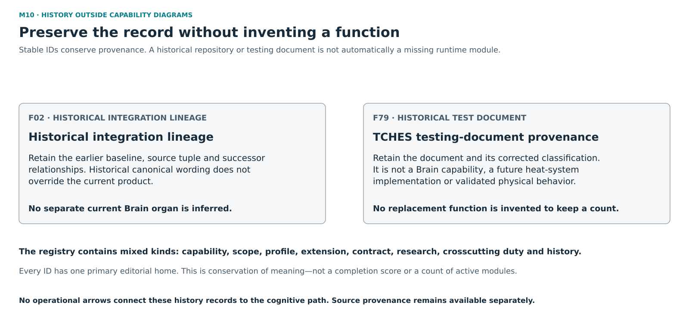

# M10 — Historical provenance register

[Atlas index](../README.md) · [Placement ledger](../PLACEMENT_LEDGER.md)

Non-capability historical records retained without inventing missing runtime work.

**Placement status:** proposed editorial responsibility grouping, not an implemented package or service-owner map. Primary cards below retain different record kinds. Diagram arrows are declared intended relations unless explicitly marked source-connected.

## F02 — Historical integration lineage

**Kind:** historical_lineage — integration repository and source tuple.
**Primary home:** M10. proposed editorial responsibility grouping; not a claim of current package or service ownership.

Preserve the earlier integrated baseline and component handoffs when names or implementations change.

**Reported scope:** not_applicable_historical_material. Historical integration lineage is retained. This entry is not a pending runtime module and has no installed-integration milestone.
**Source presence:** Historical repository and source-lineage records are described.
**Whole-family / record integration:** Not applicable to a historical lineage record.
**Specific join or documentary obligation:** Verify any specific claimed historical-to-current equivalence from its own source; no runtime implementation target follows from the lineage entry.

**Boundary:** Historical canonical declaration does not override newer product direction.
**Deciding owner:** Document maintainers classify historical records; this entry supplies no runtime action owner or grant.

**Description type:** historical_lineage_record_not_runtime_contract
- Input / context: Historical source and successor records, as documentary context.
- Output / record: An attributable lineage account, not runtime output.
- Intended reader or consumer: Readers and maintainers interpreting historical continuity.
- Interface limit: Not applicable; no runtime producer/consumer contract is proposed by this record.

**Sense distinction:** The historical TriadicGate label denotes integration lineage, not a second current product.

**Classification note:** Keep the TriadicGate lineage and successor links; remove any suggestion that its history entry is a pending runtime organ.

**Secondary editorial associations:** [F01](M00.md#F01) in M00; [F54](M09.md#F54) in M09; [F66](M06.md#F66) in M06; [F86](M09.md#F86) in M09.

**Logical source anchor:** `FAMILY_GUIDE.en.md#F02` in the bound R5.1 English snapshot. This is intentionally not a relative hyperlink until its publication destination is settled. The preserved source description is embedded in the public JSON ledger; it is documentation, not an execution receipt.

## F79 — TCHES historical testing document

**Kind:** historical_test_asset — owner-confirmed testing document.
**Primary home:** M10. proposed editorial responsibility grouping; not a claim of current package or service ownership.

Preserve the historical TCHES document reference and its use as testing material, not an intended Brain capability.

**Reported scope:** not_applicable_historical_material. Owner-confirmed historical testing document. No test procedure, result, consumer or runtime implementation is asserted here.
**Source presence:** Historical acronym/document reference and owner clarification.
**Whole-family / record integration:** Not applicable; this is not an intended Brain capability.
**Specific join or documentary obligation:** Not an implementation join. Any later historical testing claim needs its own source and evidence; none is supplied by this reference alone.

**Boundary:** Historical test material creates no capability, runtime authority, deployment requirement or implementation target.
**Deciding owner:** Not applicable; no implementing service or action owner is asserted.

**Description type:** not_applicable_historical_test_document
- Input / context: Not applicable; no capability input is asserted.
- Output / record: Not applicable; no capability output or test result is asserted.
- Intended reader or consumer: Not applicable; no operational or testing consumer is asserted.
- Interface limit: Not applicable; no Brain integration contract is proposed.

**Sense distinction:** Supersedes the R4 heat-exchange research-fixture interpretation. Stable ID retained solely for provenance.

**Classification note:** Preserve ID and test-document history; remove Brain capability, input/output contract, runtime owner, integration gap and implementation roadmap. Do not invent a replacement function.

**Secondary editorial associations:** None asserted..

**Logical source anchor:** `FAMILY_GUIDE.en.md#F79` in the bound R5.1 English snapshot. This is intentionally not a relative hyperlink until its publication destination is settled. The preserved source description is embedded in the public JSON ledger; it is documentation, not an execution receipt.
